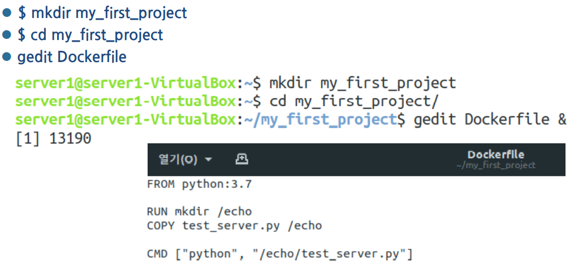

# Dockerfile

Reference: [Dockerfile reference | Docker Documentation](https://docs.docker.com/engine/reference/builder/)

### 이미지 빌드를 위한 Dockerfile 생성

- 도커는 Dockerfile에서 지침을 읽어 자동으로 이미지 빌드
- 이미지를 어셈블하기 위해 사용자가 명령 행에서 호출할 수 있는 모든 명령을 포함하는 텍스트 파일
- 이미지를 작성하기 원하는 디렉토리를 별도로 생성하고 그 안에서 작업
- 주의: 루트 디렉토리를 빌드에 사용하는 경우 전체 파일 시스템을 도커 이미지로 만들려고 시도

### Instruction

