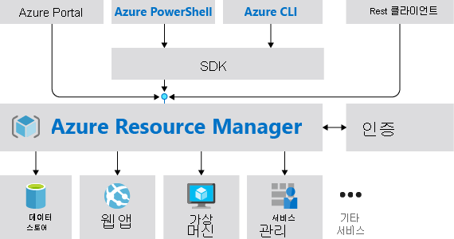
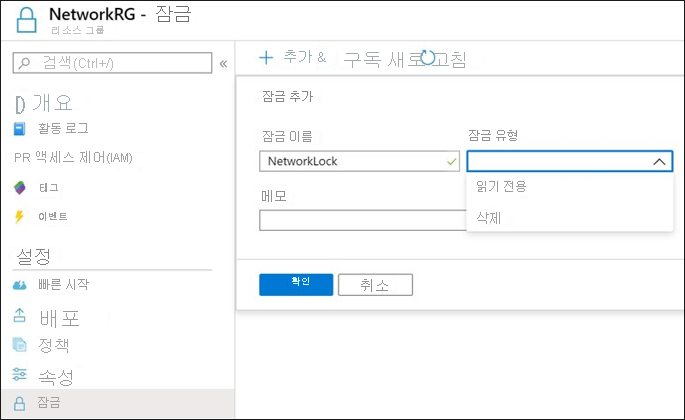
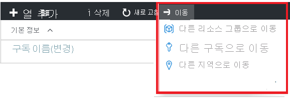
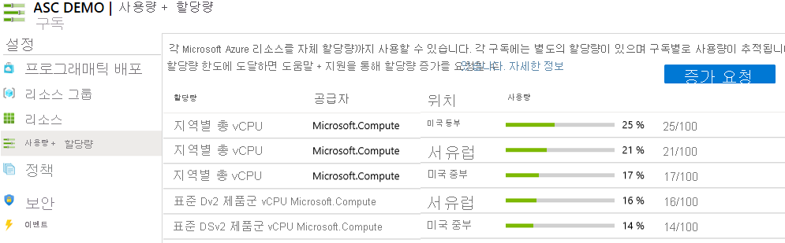

# 1. Azure관리자 필수조건

## 1) 역할

- 수십 개 또는 수백 개의 리소스를 한 번에 배포
- 스크립트를 사용하여 개별 서비스 구성.
- 사용량, 상태, 비용 등을 통해 풍부한 보고서 보기

## 2) 도구

- Azure Portal
- Azure Cloud Shell: 리소스 관리를 위한 브라우저 액세스 대화형 셀
- Azure PowerShell: Windows PowerShell 또는 PowerShell Core에 추가하여 Azure 구독에 연결하고 리소스를 관리할 수 있는 모듈
    - **Az 모듈: Azure 기능을 사용하는 cmdlet이 포함된 Azure PowerShell 모듈의 정식 이름**
- Azure CLI: Azure에 연결하고 Azure 리소스에서 관리 명령을 실행하는 명령줄 프로그램
    - CLI의 명령은 *그룹* 및 *하위 그룹*으로 구조화
    - 필요한 특정 명령을 찾는 방법은 무엇인가요? 한 가지 방법은 `az find`를 사용하는 것

## 3) Azure Resource Manager

- 솔루션에서 **리소스를 그룹으로 사용**할 수 있습니다
- 조정된 단일 작업에서 솔루션에 대한 모든 리소스를 배포, 업데이트 또는 삭제할 수 있습니다
- **배포용 템플릿**을 사용하고 이 템플릿을 테스트, 스테이징 및 프로덕션과 같은 여러 환경에서 사용할 수 있습니다
- 보안, 감사 및 태그 기능을 제공하여 배포 후에 리소스를 관리할 수 있습니다.



- 솔루션에 대한 모든 리소스를 그룹으로 배포, 관리 및 모니터링할 수 있습니다.
- 솔루션을 반복적으로 구현하고 리소스가 일관된 상태로 배치시킬 수 있습니다.
- 스크립트가 아닌 **선언적 템플릿**을 통해 인프라를 관리할 수 있습니다.
- **리소스 간의 종속성**을 정의할 수 있으므로 올바른 순서로 배포됩니다.
- 역할 기반 Access Control(RBAC)가 관리 플랫폼으로 통합

### 리소스그룹 고려사항

- 리소스는 하나의 리소스 그룹에만 존재할 수 있습니다.
- 리소스 그룹의 이름을 바꿀 수 없습니다.
- 리소스 그룹에는 다양한 유형(서비스)의 리소스가 있을 수 있습니다.
- 리소스 그룹에는 여러 지역의 리소스가 있을 수 있습니다.
- 그룹에서 모든 리소스는 동일한 수명 주기를 공유해야 합니다.

### 리소스그룹 잠금

Azure에서 실수로 리소스를 삭제하지 못하도록 하는 구조를 적용

- **읽기 전용 잠금** - 리소스를 전혀 변경할 수 없도록 합니다.
- **삭제 잠금** - 삭제를 방지합니다.



### Azure Resource 재구성

리소스를 이동할 때 원본 그룹과 대상 그룹은 모두 작업 중에 잠겨 있습니다. 쓰기 및 삭제 작업은 이동이 완료될 때까지 리소스 그룹에서 차단됩니다.



### 리소스 그룹 제거

- 리소스 그룹을 삭제하면 그 안에 포함된 모든 리소스가 삭제됩니다. 해당 리소스 그룹에는 다른 리소스 그룹의 리소스가 종속되는 리소스가 포함될 수 있습니다.
- PowerShell에서 리소스 그룹을 제거하려면 **Remove-AzResourceGroup**을 사용

### 리소스 제한

한도 대비 리소스 사용량을 볼 수 있습니다. 이 기능은 현재 사용량을 추적하고 향후 사용 계획을 수립하는 데 도움이 됩니다.



- 표시된 제한은 구독에 대한 제한입니다.
- 기본 제한을 늘려야 하는 경우 요청 증가 링크가 있습니다.
- 모든 리소스에는 Azure [제한](https://docs.microsoft.com/ko-KR/azure/azure-subscription-service-limits?toc=%2fazure%2fnetworking%2ftoc.json)에 나열된 최대 한도가 있습니다.
- 최대 제한에 도달한 경우 제한을 늘릴 수 없습니다.

## 4) Azure Resource Manager 템플릿을 통한 리소스 구성

<aside>
💡 Resource Manager 템플릿을 단일 작업으로 리소스 그룹에 배포할 수 있습니다.
배포 작업을 보다 신속하게 반복적으로 수행할 수 있습니다.

</aside>

### 템플릿 혜택

- **템플릿을 통한 일관성 향상:** 사용자와 다른 사람에게 배포를 설명하는 공통 언어를 제공합니다.
- **템플릿으로 복잡한 배포 표현:** 템플릿을 사용하면 여러 리소스를 올바른 순서로 배포할 수 있습니다. Resource Manager는 각 리소스와 그에 해당하는 종속 리소스를 매핑하고 종속 리소스를 먼저 생성합니다. 종속성 매핑은 배포를 올바른 순서로 수행하는 데 도움이 됩니다.
- **템플릿으로 오류가 발생하기 쉬운 수동 작업 줄이기:** Resource Manager는 배포가 매번 같은 방식으로 수행되도록 보장합니다.
- **템플릿은 코드이다:** 템플릿은 코드를 통해 요구 사항을 표현합니다. 코드이기 때문에 "증거를 추적할 수 있는 일련의 문서(paper trail)"를 만들 수 있습니다. 템플릿 코드는 배포를 문서화합니다. 템플릿을 변경하면 수정 기록에 템플릿(및 배포)이 시간이 지나면서 어떻게 발전했는지도 기록됩니다.
- **템플릿을 통한 재사용:** 템플릿에는 템플릿이 실행되면 채워지는 매개 변수가 포함될 수 있습니다. 매개 변수는 사용자 이름 또는 암호, 도메인 이름 등을 정의할 수 있습니다. 템플릿 매개 변수를 통해 여러 버전의 인프라(예: 준비 및 프로덕션)를 만들 수 있지만 동일한 템플릿을 계속 사용할 수 있습니다.
- **템플릿 연결 가능:** 템플릿을 함께 연결하여 템플릿 자체를 모듈화할 수 있습니다. 솔루션의 일부를 정의하는 작은 템플릿을 작성하고 결합하여 완전한 시스템을 만들 수 있습니다.
- **템플릿이 오케스트레이션을 단순화함:** 모든 리소스를 배포하기 위해 템플릿을 배포하기만 하면 됩니다. 일반적으로 이 과정을 위해 여러 작업이 수행됩니다.

### 템플릿의 구성

```json
{
    "$schema": "http://schema.management.azure.com/schemas/2019-04-01/deploymentTemplate.json#",
    "contentVersion": "",
    "parameters": {},
    "variables": {},
    "functions": [],
    "resources": [],
    "outputs": {}
}
```

parameters: 매개변수는 256개로 제한

```json
"parameters": {
    "<parameter-name>" : {
        "type" : "<type-of-parameter-value>",
        "defaultValue": "<default-value-of-parameter>",
        "allowedValues": [ "<array-of-allowed-values>" ],
        "minValue": <minimum-value-for-int>,
        "maxValue": <maximum-value-for-int>,
        "minLength": <minimum-length-for-string-or-array>,
        "maxLength": <maximum-length-for-string-or-array-parameters>,
        "metadata": {
        "description": "<description-of-the parameter>"
        }
    }
}

"parameters": {
  "adminUsername": {
    "type": "string",
    "metadata": {
      "description": "Username for the Virtual Machine."
    }
  },
  "adminPassword": {
    "type": "securestring",
    "metadata": {
      "description": "Password for the Virtual Machine."
    }
  }
}
```

## 5) PowerShell 스크립트를 사용한 Azure작업 자동화

Azure PowerShell : PowerShell에 추가하여 Azure 구독에 연결하고 리소스를 관리할 수 있는 모듈

```powershell
모듈설치
Install-Module -Name Az -Scope CurrentUser -Repository PSGallery
모듈 업데이트
Update-Module -Name Az
Azure연결
Connect-AzAccount
구독목록 가져오기
Get-AzSubscription
구독변경
Set-AzContext -Subscription '00000000-0000-0000-0000-000000000000'
모든 리소스그룹 가져오기
Get-AzResourceGroup | Format-Table
리소스그룹 만들기
New-AzReousrceGroup -Name <name> -Location <location>
리소스 확인
Get-AzResource | Format-Table
Get-AzResource -ResourceGroupName ExerciseResources
VM만들기
New-AzVm
       -ResourceGroupName <resource group name>
       -Name <machine name>
       -Credential <credentials object>
       -Location <location>
       -Image <image name>

```

## 6) CLI를 사용한 Azure 서비스 제어

```bash
연결
az login
리소스그룹 생성
az group create --name <name> --location <location>
az group list --output table

```

```bash
후속명령에서 사용할 여러번수 선언
export RESOURCE_GROUP=[sandbox resource group name]
export AZURE_REGION=centralus
export AZURE_APP_PLAN=popupappplan-$RANDOM
export AZURE_WEB_APP=popupwebapp-$RANDOM
```

## 7) JSON ARM템플릿을 사용한 Azure인프라 배포

[연습문제](02_연습문제.md)