# 2. Azure내 ID 및 거버넌스 관리

# 1) Azure Active Directory(AD)

다중 테넌트 클라우드 기반 디렉터리 및 ID 관리 서비스

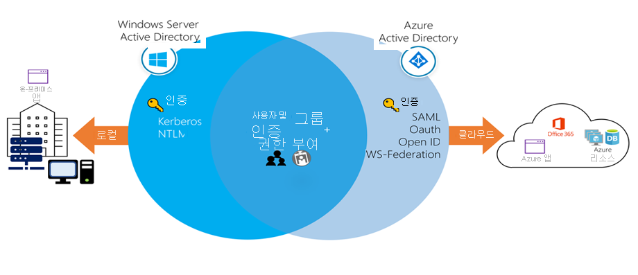

## 기능

- **클라우드 또는 온-프레미스 웹앱에 대한 Single Sign-On:** SSO에는 Microsoft 365와 Salesforce, Workday, DocuSign, ServiceNow 및 Box와 같은 수천 개의 SaaS 애플리케이션이 포함되어 있습니다.
- **iOS, macOS, Android 및 Windows 디바이스에서 작동:** 사용자는 기존 작업 자격 증명을 사용하여 맞춤형 웹 기반 액세스 패널, 모바일 앱, Microsoft 365 또는 사용자 지정 회사 포털에서 애플리케이션을 시작할 수 있습니다.
- **보안 원격 액세스를 사용하여 온-프레미스 웹 애플리케이션 보호:** 모든 위치에서 온-프레미스 웹 애플리케이션에 액세스하고 다단계 인증, 조건부 액세스 정책 및 그룹 기반 액세스 관리를 사용하여 보호합니다. 사용자는 동일한 Portal에서 SaaS 및 온-프레미스 웹앱에 액세스할 수 있습니다.
- **Active Directory를 클라우드로 쉽게 확장:** Active Directory 및 기타 온-프레미스 디렉터리를 몇 단계만으로 Azure Active Directory에 연결할 수 있습니다. 이 연결은 두 환경에서 일관된 사용자, 그룹, 암호 및 디바이스 세트를 의미합니다.
- **중요한 데이터 및 애플리케이션 보호:** 고유한 ID 보호 기능을 사용하여 애플리케이션 액세스 보안을 향상시킬 수 있습니다. 여기에는 의심스러운 로그인 활동 및 잠재적 취약성에 대한 통합 보기가 포함됩니다. 고급 보안 보고서, 알림, 수정 권장 사항 및 위험 기반 정책을 활용할 수도 있습니다.
- **셀프 서비스 기능을 사용하여 비용 절감 및 보안 강화:** 암호 재설정, 그룹 생성과 관리와 같은 중요한 작업을 직원에게 위임합니다. 확인 단계를 통해 셀프 서비스 애플리케이션 액세스 및 암호 관리를 제공하면 기술 지원팀 전화를 줄이고 보안을 강화할 수 있습니다.

| ID | 인증을 받을 수 있는 개체입니다. |
| --- | --- |
| 계정 | 연결된 데이터가 있는 ID입니다. 계정에는 반드시 ID가 있어야 합니다. |
| Azure AD계정 | Azure AD 또는 Microsoft 365 같은 다른 Microsoft 클라우드 서비스를 통해 만들어진 ID입니다 |
| Azure 구독 | Azure 클라우드 서비스 요금을 지불하는 데 사용됩니다 |
| Azure Tenant/Directory | Azure AD의 신뢰할 수 있는 전용 인스턴스인 테넌트는 조직이 Microsoft 클라우드 서비스 구독에 등록할 때 자동으로 생성됩니다. |

# 2) 사용자 및 그룹계정 구성

### 사용자 정의

- **클라우드 ID**. Azure AD에만 존재하는 사용자입니다. 예를 들어 직접 관리하는 사용자와 관리자 계정이 여기에 해당합니다. 사용자가 다른 Azure AD 인스턴스에 정의된 경우 클라우드 ID는 Azure Active Directory 또는 외부 Azure Active Directory에 있을 수 있습니다. 이 계정은 주 디렉터리에서 제거할 경우 삭제됩니다.
- **디렉터리 동기화 ID**. 온-프레미스 Active Directory에 있는 사용자입니다. Azure AD Connect를 통해 동기화 작업을 수행하면 이 사용자를 Azure로 가져옵니다. 해당 출처는 Windows Server AD입니다.
- **게스트 사용자**. Azure 외부에 존재하는 사용자입니다. 예를 들어 다른 클라우드 공급자의 계정과 Xbox LIVE 계정 등의 Microsoft 계정이 여기에 해당합니다. 해당 출처는 초대된 사용자입니다. 이 계정 유형은 외부 공급업체나 계약자가 Azure 리소스에 액세스해야 하는 경우에 유용합니다. 더 이상 도움이 필요하지 않으면 계정과 모든 액세스 권한을 제거할 수 있습니다.

### Azure portal을 통한 사용자 추가

- 사용자 프로필(사진, 직업, 연락처 정보)은 선택 사항입니다.
- 삭제된 사용자는 30일 동안 복원할 수 있습니다.
- 로그인 및 감사 로그 정보를 사용할 수 있습니다.

### **대량 사용자 계정 만들기**

CSV(쉼표로 구분된 값) 템플릿을 채우면 됩니다. Azure AD 포털에서 템플릿을 다운로드할 수 있습니다. Azure Portal에서 사용자를 만들려면 전역 관리자 또는 사용자 관리자 권한으로 로그인해야 합니다.

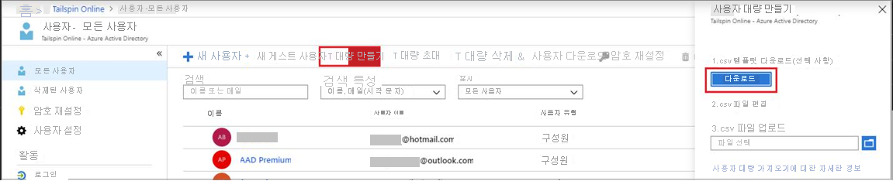

### **그룹 계정 만들기**

- **보안 그룹**. 보안 그룹은 사용자 그룹의 공유 리소스에 대한 구성원 및 컴퓨터 액세스를 관리하는 데 사용됩니다. 각 구성원에게 개별적으로 사용 권한을 추가하는 대신, 모든 구성원에게 사용 권한 집합을 동시에 제공할 수 있습니다. 이 옵션을 사용하려면 Azure AD 관리자여야 합니다.
- **Microsoft 365 그룹**. Microsoft 365 그룹은 공유 사서함, 일정, 파일, SharePoint 사이트 등에 대한 액세스 권한을 구성원에게 부여하여 협업 기회를 제공합니다. 조직 외부의 사용자에게 그룹에 대한 액세스 권한을 제공할 수도 있습니다. 사용자와 관리자는 모두 Microsoft 365 그룹을 사용할 수 있습니다.

### **그룹에 구성원 추가**

- **할당됨**. 특정 사용자를 이 그룹의 멤버로서, 고유한 권한을 가지도록 추가할 수 있습니다.
- **동적 사용자**. 동적 멤버 자격 규칙을 사용하여 멤버를 자동으로 추가하고 제거할 수 있습니다. 구성원의 특성이 변경되면 Azure에서 디렉터리에 대한 동적 그룹 규칙을 검토합니다. 구성원이 규칙 요구 사항을 충족하면 추가됩니다. 구성원이 더 이상 규칙 요구 사항을 충족하지 않으면 제거됩니다.
- **동적 디바이스(보안 그룹만 해당)**. 동적 그룹 규칙을 사용하여 디바이스를 자동으로 추가하고 제거할 수 있습니다. 디바이스의 특성이 변경되는 경우 Azure는 디렉터리에 대한 동적 그룹 규칙을 검토합니다. 디바이스가 규칙 요구 사항을 충족하는 경우 추가됩니다. 디바이스가 규칙 요구 사항을 더 이상 충족하지 않는 경우 제거됩니다.

### **관리 단위 만들기**

- Azure Portal, PowerShell cmdlet 및 스크립트 또는 Microsoft Graph를 사용하여 관리 단위를 관리할 수 있습니다.
- 전역 관리자 또는 권한 있는 역할 관리자인 경우 Portal에서 관리 단위를 관리할 수 있습니다.
- 관리 단위는 관리 권한에만 범위를 적용합니다. 멤버 또는 관리자가 자신의 기본 사용자 권한을 사용하여 관리 단위 외부의 다른 사용자, 그룹 또는 리소스를 검색하는 것을 막을 수 없습니다.

# 3) 구독 구성

Azure 구독은 Azure 계정에 연결된 Azure 서비스의 논리적 단위입니다. Azure 서비스에 대한 청구는 구독 단위로 이루어집니다. 계정이 구독과 연결된 유일한 계정인 경우 대금 청구를 담당합니다. 각 구독은 청구 및 지불 설정이 다를 수 있으므로 부서, 프로젝트, 지사 등에 따라 구독 및 계획이 다를 수 있습니다. 모든 클라우드 서비스가 구독에 속하며 구독 ID가 프로그래밍 방식 작업에 필요할 수 있습니다.

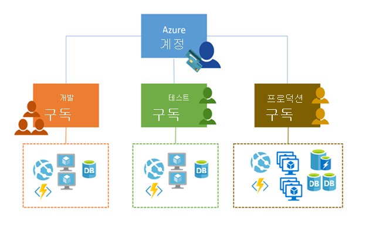

모든 Azure 구독은 Azure Active Directory와 연결할 수 있습니다. 그런 다음 사용자 및 서비스가 리소스에 액세스하기 전에 Azure Active Directory에 인증합니다.

### **Cost Management 구현**

청구 관리 작업을 수행하고 비용에 대한 청구 액세스를 관리합니다. Azure 지출을 모니터링 및 제어하고 Azure 리소스 사용을 최적화하는 기능도 있습니다.

### **비용 계획 및 제어**

- **비용 분석**. 조직의 집계된 비용을 확인하여 어느 부분에서 비용이 누적되었는지를 이해하고 지출 패턴을 식별할 수 있습니다. 또한 시간에 따라 누적된 비용을 확인하여 예산을 기준으로 월 단위, 분기 단위 또는 연 단위 비용 추세를 평가할 수 있습니다.
- **예산**. 조직에서 재무 책임을 계획하고 충족하는 데 도움이 됩니다. 또한 비용 임계값 또는 한도를 초과하지 않도록 하는 데 도움이 됩니다.
- **권장 사항**: 유휴 및 미달 사용 리소스를 식별하여 최적화를 수행하고 효율성을 개선하는 방법을 보여 줍니다. 권장 사항에 따라 작업을 수행하면서 리소스 사용 방식을 변경하여 금액을 절약할 수 있습니다.
- **비용 관리 데이터 내보내기** 외부 시스템을 사용하여 비용 관리 데이터를 액세스 및 검토하는 경우 Azure에서 데이터를 쉽게 내보낼 수 있습니다.

### **리소스 태그 적용**

Azure 리소스에 태그를 적용하여 범주별로 논리적으로 구성할 수 있습니다. 각 태그는 이름과 값으로 이루어져 있습니다. 태그를 적용한 후에는 구독에서 태그 이름과 값으로 모든 리소스를 검색할 수 있습니다. 즉, 여러 다른 리소스 그룹에서 관련 리소스를 검색할 수 있습니다.

# 4) Azure Policy

- **적용 및 규정 준수**. 기본 제공 정책을 켜거나 모든 리소스 종류에 대한 사용자 지정 정책을 빌드합니다. 실시간 정책 평가 및 적용 주기적 및 주문형 규정 준수 평가
- **대규모로 정책 적용**. 전체 조직에서 제어 권한이 있는 관리 그룹에 정책을 적용합니다. 정책 이니셔티브를 통해 여러 정책을 적용하고 정책 상태를 집계합니다.
- **수정**. 실시간 수정 및 기존 리소스에 대한 수정

### Azure 관리 그룹

조직에 구독이 여러 개 있는 경우 해당 구독에 대한 액세스, 정책 및 규정 준수를 효율적으로 관리하는 방법

- 사용자 지정 계층 및 그룹화를 통해 Azure 구독에 맞춰 조직 구성
- 구독 전체의 정책 및 지출 예산과 계층 구조를 따른 상속을 대상으로 지정
- 조직(비즈니스/팀)별 규정 준수 및 비용 보고

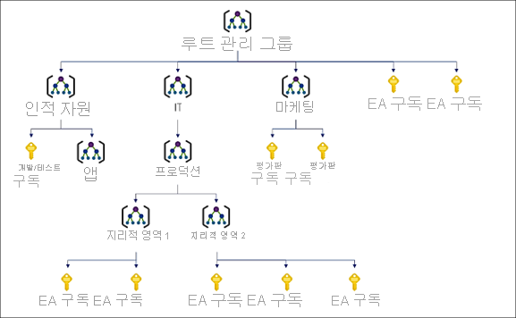

- **관리 그룹 ID**는 이 관리 그룹에 명령을 전송하는 데 사용되는 디렉터리 고유 식별자입니다. 이 식별자는 Azure 시스템 전체에서 이 그룹을 식별하는 데 사용되므로 만든 후에 편집할 수 없습니다.
- **표시 이름** 필드는 Azure Portal 내에 표시되는 이름을 포함합니다. 별도 표시 이름은 관리 그룹을 만들 때 사용되는 선택적 필드로, 언제든지 변경할 수 있습니다.

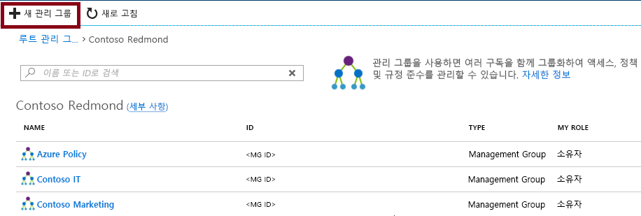

## **Azure 정책 만들기**

1. **정책 정의 찾아보기**. 정책 정의는 평가할 항목과 수행할 작업을 나타냅니다. 모든 정책 정의에는 정책이 적용되는 조건이 있습니다. 그리고 조건이 충족되면 발생하는 부수적인 효과가 있습니다. 
2. **이니셔티브 정의 만들기**. 이니셔티브 정의는 더 큰 목표를 위해 규정 준수 상태를 추적하는 데 도움이 되는 일련의 정책 정의입니다. 예를 들어 지점이 규정을 준수하는지 확인합니다.
3. **이니셔티브 정의 범위 지정**. 이니셔티브 정의의 범위를 관리 그룹, 구독 또는 리소스 그룹으로 제한할 수 있습니다.
4. **정책 평가 결과 보기**. 이니셔티브 정의가 할당되면 모든 리소스에 대한 규정 준수 상태를 평가할 수 있습니다. 범위 내의 개별 리소스, 리소스 그룹 및 구독은 정책 규칙이 영향을 미치지 않도록 제외할 수 있습니다.

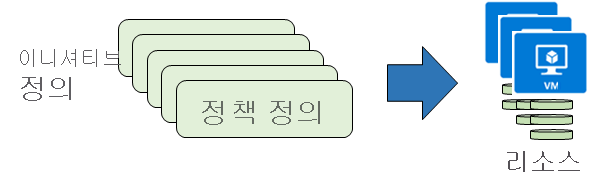

### **정책 정의 만들기**

- 허용되는 가상 머신 SKU를 사용하면 조직에서 배포할 수 있는 일련의 가상 머신 SKU를 지정할 수 있습니다.
- 허용된 위치 정책을 사용하면 조직에서 리소스를 배포할 때 지정할 수 있는 위치를 제한할 수 있습니다. 허용된 위치 정책을 사용하여 지역적 규정 준수 요구 사항을 적용할 수 있습니다.

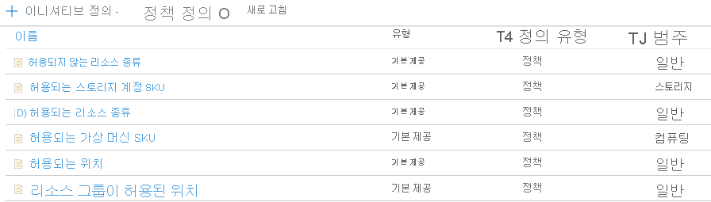

### **이니셔티브 정의 만들기**

필요한 정책 정의를 결정했으면 이니셔티브 정의를 만듭니다. 이 정의에는 하나 이상의 정책이 포함됩니다. 새 이니셔티브 정의 페이지(표시되지 않음)의 오른쪽에 선택할 수 있는 선택 목록이 있습니다.

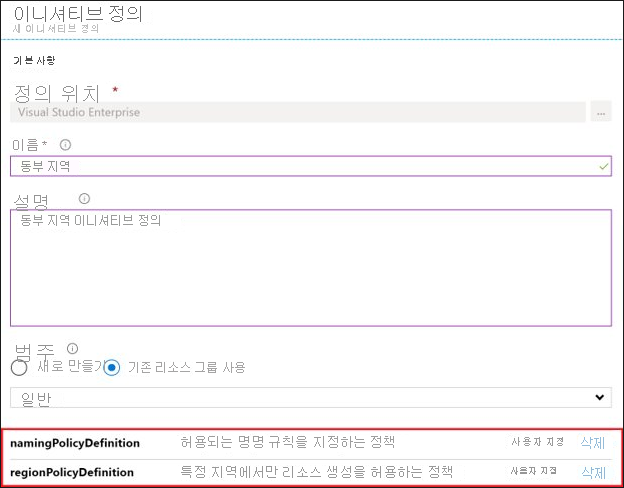

### **이니셔티브 정의 범위 지정**

이니셔티브 정의가 만들어지면 정의를 할당하여 범위를 설정할 수 있습니다. 범위는 정책 할당이 적용되는 리소스 또는 리소스 그룹을 결정합니다.

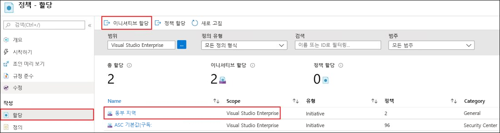

### **규정 준수 결정**

정책이 마련되면 준수 블레이드를 사용하여 비준수 이니셔티브, 비준수 정책 및 비준수 리소스를 검토할 수 있습니다.

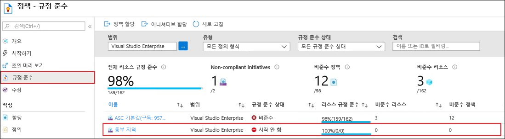

# 5) 역할기반 액세스 제어 구성

Azure RBAC를 사용하면 팀 내에서 업무를 분리하고 사용자에게 해당 작업을 수행하는 데 필요한 만큼의 권한만 부여할 수 있습니다. Azure 구독 또는 리소스에서 모든 사람에게 무제한 권한을 제공하는 대신, 특정 범위에서 특정 작업만 허용할 수 있습니다.

- **보안 주체**. 리소스에 대한 액세스를 요청하는 항목을 나타내는 개체입니다. 예: 사용자, 그룹, 서비스 주체, 관리 ID
- **역할 정의**. 수행할 수 있는 작업을 나열하는 사용 권한 컬렉션입니다. 예: Reader, Contributor, Owner, 사용자 액세스 관리자
- **범위**. 요청된 액세스 수준에 대한 경계입니다. 예: 관리 그룹, 구독, 리소스 그룹, 리소스
- **할당**. 특정 범위에서 보안 주체에 역할 정의를 연결합니다. 사용자는 할당을 만들어 역할 정의에 설명된 액세스 권한을 부여할 수 있습니다. 거부 할당은 현재 읽기 전용이며 Azure에서만 설정할 수 있습니다.

## **역할 정의 만들기**

각 역할은 JSON 파일에 정의된 속성 집합입니다. 역할 정의에는 이름, ID 및 설명이 포함됩니다. 해당 정의에는 허용된 권한(Actions), 거부된 권한(NotActions) 및 역할의 범위(읽기 권한 등)도 포함됩니다.

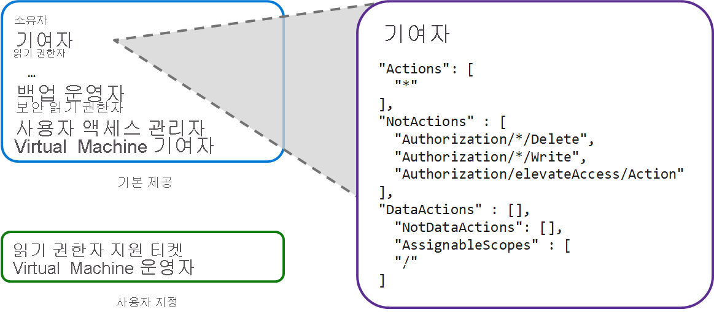

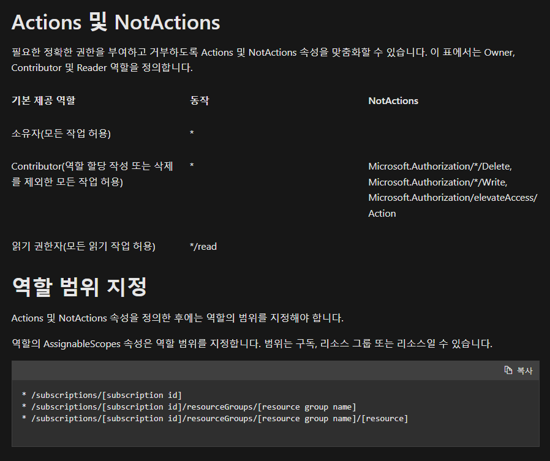

## **역할 할당 만들기**

역할 정의의 범위를 사용자, 그룹, 서비스 주체 또는 관리 ID로 지정하는 프로세스입니다. 역할 할당의 목적은 액세스 권한을 부여하는 것입니다.

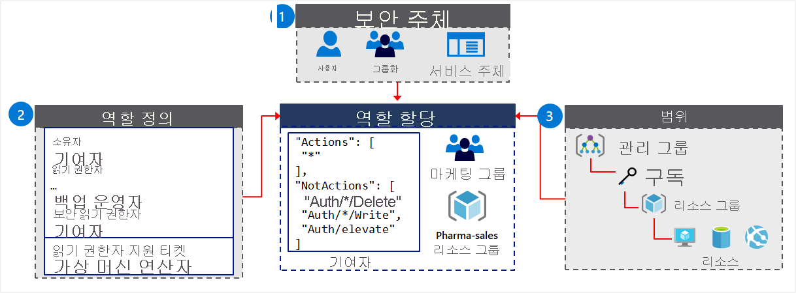

## **역할 기반 액세스 제어 적용**

RBAC는 여러 범위에서 할당할 수 있는 기본 제공 역할을 많이 포함하고 있으며, 고유의 사용자 지정 역할을 만들 수 있습니다. Azure AD에서 사용자, 그룹, 도메인 등의 리소스를 관리할 수 있도록 여러 Azure AD 관리자 역할이 있습니다.

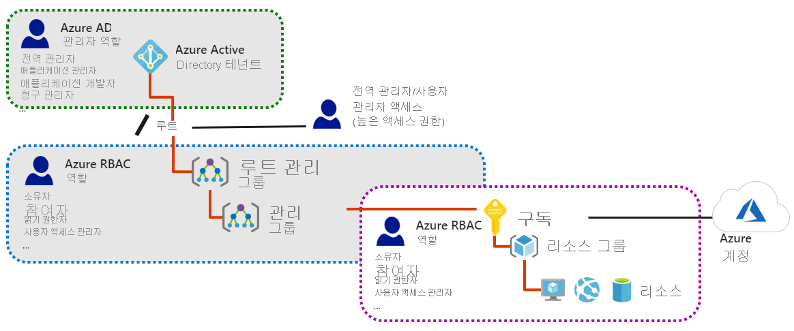

## **역할 기반 액세스 제어 역할 결정**

- **소유자** - 액세스 권한을 다른 사용자에게 위임할 수 있는 권한을 포함하여 모든 리소스에 대한 전체 액세스 권한을 보유합니다. 서비스 관리자 및 공동 관리자에게 구독 범위에서 Owner 역할이 할당됩니다.
- **Contributor**. 모든 유형의 Azure 리소스를 만들고 관리할 수 있지만 다른 사용자에게 액세스 권한을 부여할 수 없습니다.
- **Reader**. 기존 Azure 리소스를 볼 수 있습니다.
- **사용자 액세스 관리자**. 리소스를 관리하는 대신 Azure 리소스에 대한 사용자 액세스를 관리할 수 있습니다.

# 6) Azure AD에서 Azure사용자 및 그룹 만들기

## 사용자 계정

- **관리자**: 사용자의 관리자 액세스 권한으로 작업을 수행할 수 있는 사람을 제어할 수 있습니다. Azure AD 조직에서 ID 작업을 관리할 제한된 사용자 그룹에게 이 역할을 할당합니다.
- **멤버 사용자:** 프로필 정보 관리와 같은 기본 권한 세트가 포함된 Azure AD 조직의 기본 멤버입니다. 새 사용자가 조직에 참가하는 경우 일반적으로 이 유형의 계정을 만듭니다. 그러나 이 사용자는 사용자를 만들고 삭제하는 등의 방법으로 다른 사용자를 관리할 수 없습니다.
- **게스트 사용자**: 조직과 협업할 사람을 초대할 경우 게스트 사용자로 Azure AD 조직에 추가합니다. 그런 다음, 사용 링크가 포함된 초대 메일을 보내거나 공유할 앱의 직접 링크를 보낼 수 있습니다. 기본적으로 Azure AD 멤버 사용자는 게스트 사용자를 초대할 수 있습니다. 사용자 관리자 역할을 가진 사용자가 이 기본값을 사용하지 않도록 설정할 수 있습니다.

# 7) Azure RBAC로 Azure 리소스 보안

각 Azure 구독이 단일 Azure AD 디렉터리와 연결되어 있다는 점에 주의해야 합니다. 해당 디렉터리의 사용자, 그룹 및 애플리케이션은 Azure 구독에서 리소스를 관리할 수 있습니다. 구독은 SSO(Single Sign-On) 및 액세스 관리에 대해 Azure AD를 사용합니다. **Azure AD Connect**
를 사용하여 온-프레미스 Active Directory를 클라우드로 확장할 수 있습니다. 이 기능을 통해 직원은 기존 회사 ID를 사용하여 Azure 구독을 관리할 수 있습니다.

Azure RBAC(Azure 역할 기반 액세스 컨트롤)는 Azure에서 리소스의 세밀한 액세스를 관리하는 Azure Resource Manager 기반의 권한 부여 시스템입니다.

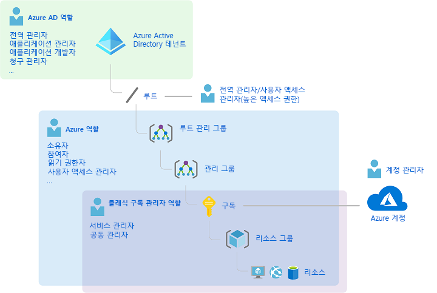

## **Azure Portal의 Azure RBAC**

Azure Portal의 여러 영역에서는 ID 및 액세스 관리라고도 하는 **액세스 제어(IAM)**
이라는 창을 볼 수 있습니다. 이 창에서 해당 영역에 액세스할 수 있는 사용자와 그 역할을 볼 수 있습니다. 이 창을 사용하여 액세스 권한을 부여하거나 제거할 수 있습니다.

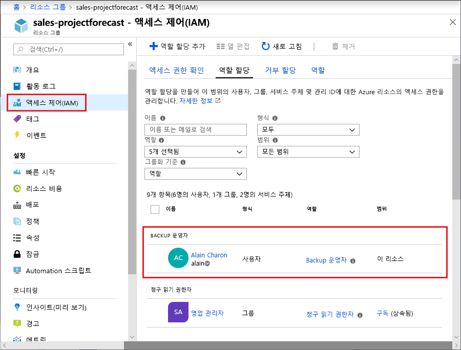

### **1. 보안 주체(누구)**

액세스 권한을 부여할 사용자, 그룹 또는 애플리케이션을 가리키는 고급스러운 이름입니다.

### **2. 역할 정의(수행할 수 있는 작업)**

읽기, 쓰기 및 삭제와 같이 수행할 수 있는 작업이 나열됩니다

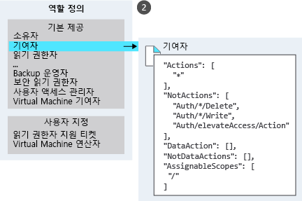

기본제공 역할

- **소유자** - 액세스 권한을 다른 사용자에게 위임할 수 있는 권한을 포함하여 모든 리소스에 대한 전체 액세스 권한을 보유합니다.
- **기여자** - 모든 유형의 Azure 리소스를 만들고 관리할 수 있지만 다른 사용자에게 액세스 권한을 부여할 수 없습니다.
- **읽기 권한자** - 기존 Azure 리소스를 볼 수 있습니다.
- **사용자 액세스 관리자** - Azure 리소스에 대한 사용자 액세스를 관리할 수 있습니다.

### **3. 범위(어디)**

액세스 권한이 적용되는 대상입니다.

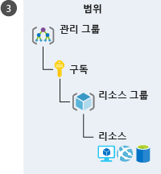

### **역할 할당**

액세스 권한을 부여하기 위해 특정 범위에서 보안 주체에게 역할을 바인딩하는 프로세스

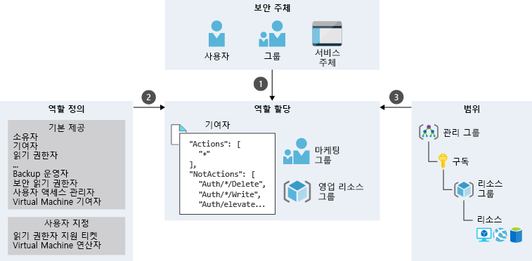

# 8) **Azure AD 셀프 서비스 암호 재설정 (SSPR)**

SSPR을 통해 사용자는 웹 브라우저 또는 Windows 로그인 화면에서 암호를 다시 설정하여 Azure, Microsoft 365 및 그 밖에 인증에 Azure AD를 사용하는 애플리케이션에 대한 액세스 권한을 다시 얻을 수 있습니다.

## **SSPR 작동 방식**

1. **지역화**: 포털에서는 브라우저의 로캘 설정을 확인하고 SSPR 페이지를 적절한 언어로 렌더링합니다.
2. **검증**: 사용자는 사용자 이름을 입력하고 captcha를 전달하여 봇이 아닌 사용자임을 확인합니다.
3. **인증**: 사용자는 신원을 인증하는 데 필요한 데이터를 입력합니다. 예를 들어 코드를 입력하거나 본인 확인 질문에 답할 수 있습니다.
4. **암호 재설정**: 사용자가 인증 테스트를 통과하면 새 암호를 입력하고 확인할 수 있습니다.
5. **알림**: 일반적으로 재설정을 확인하는 메시지가 사용자에게 전송됩니다.

## **암호 재설정 인증**

- **모바일 앱 알림**: Microsoft Authenticator 앱 설치 및 다단계 인증 설정 페이지에서 앱을 등록
- **모바일 앱 코드**: Authenticator앱을 사용하며 동일한 방식으로 앱을 설치하고 등록
- **메일**: 외부에 있는 메일 주소를 제공
- **휴대폰**
- **사무실 전화**
- **보인확인 질문**

## **권장 구성**

- 두 개 이상의 인증 재설정 요청 방법을 사용하도록 설정합니다.
- 모바일 앱 알림 또는 코드를 기본 방법으로 사용하지만, 모바일 디바이스가 없는 사용자를 지원하기 위해 메일 또는 사무실 전화 방법을 사용하도록 설정할 수도 있습니다.
- 휴대폰 방법은 사기성 SMS 메시지를 보낼 수 있기 때문에 권장하지 않습니다.
- 본인 확인 질문에 대한 대답이 다른 사람에게 알려질 수 있기 때문에 본인 확인 질문 옵션은 가장 권장하지 않는 방법입니다. 본인 확인 질문 방법은 하나 이상의 다른 방법과 함께 사용해야 합니다.

## **알림 구성**

- **사용자에게 암호 재설정에 대해 알림**: 암호를 다시 설정하는 사용자에게 기본 및 보조 메일 주소를 알립니다. 악의적인 사용자가 재설정을 수행하는 경우 이 알림으로 위험 완화 단계를 수행할 수 있는 사용자에게 경고합니다.
- **다른 관리자가 암호를 재설정하면 모든 관리자에게 알림**: 다른 관리자가 암호를 다시 설정하면 모든 관리자에게 알림이 제공됩니다.

## **최소 인증 방법 수 필요**

사용자가 설정해야 하는 최소 방법 수(1~2개)를 지정할 수 있습니다. 예를 들어 모바일 앱 코드, 메일, 사무실 전화, 본인 확인 질문 방법을 사용하도록 설정하고 최소 두 가지 방법을 지정할 수 있습니다. 사용자는 지정된 최소 방법 수에 필요한 정보를 등록한 후 SSPR에 등록된 것으로 간주됩니다.

## **SSPR 출시 범위**

- **사용 안 함**: Azure AD 조직의 사용자는 SSPR을 사용할 수 없습니다. 이 값은 기본값입니다.
- **사용**: Azure AD 조직의 모든 사용자는 SSPR을 사용할 수 있습니다.
- **선택됨**: 지정된 보안 그룹의 멤버만 SSPR을 사용할 수 있습니다. 이 옵션을 사용하여 구성을 테스트하고 예상대로 작동하는지 확인할 수 있는 대상 사용자 그룹에 대해 SSPR을 사용하도록 설정할 수 있습니다.

[연습문제](02_연습문제.md)