# 3. Azure내 스토리지 구현 및 관리

# 1) 스토리지 계정 구성

[스토리지 계정 구성 - Learn](https://docs.microsoft.com/ko-kr/learn/modules/configure-storage-accounts/)

## azure 스토리지 구현

- **내구성 및 고가용성**. 로컬 재해 또는 자연재해로부터 추가적으로 보호하기 위해 데이터 센터 또는 지리적 영역에서 데이터를 복제할 수 있습니다.
- **보안**. Azure Storage에 기록된 모든 데이터는 서비스에서 암호화됩니다. Azure Storage는 데이터에 액세스할 수 있는 사용자를 자세히 제어할 수 있습니다.
- **스케일링 가능**. Azure Storage는 오늘날의 애플리케이션에 대한 데이터 저장소 및 성능 요구 사항을 충족하기 위해 대규모로 확장할 수 있도록 설계되었습니다.
- **관리됨**. Microsoft Azure에서 하드웨어 유지 관리, 업데이트 및 중요한 문제를 처리합니다.
- **액세스 가능**. Azure Storage의 데이터는 HTTP 또는 HTTPS를 통해 전 세계 어디에서든 액세스할 수 있습니다.

### Azure Storage 범주

- **가상 머신용 스토리지**. 가상 머신 스토리지에는 디스크 및 파일이 포함됩니다. 디스크는 Azure IaaS 가상 머신에 대한 영구 블록 스토리지입니다. 파일은 클라우드에서 완벽하게 관리되는 파일 공유를 제공합니다.
- **비정형 데이터**. 비정형 데이터에는 Blob 및 Data Lake Store가 포함됩니다. Blob은 스케일링 성능이 뛰어난 REST 기반 클라우드 개체 저장소입니다. Data Lake Store는 서비스로서의 HDFS(Hadoop 분산 파일 시스템) 입니다.
- **정형 데이터**. 정형 데이터에는 테이블, Cosmos DB 및 Azure SQL DB가 포함됩니다. 테이블은 키/값이며 NoSQL 저장소를 자동으로 스케일링합니다. Cosmos DB는 글로벌 분산형 데이터베이스 서비스입니다. Azure SQL DB는 SQL 기반으로 구축된 완전 관리형 Database-as-a-Service입니다.

### Azure Storage 데이터 서비스

**컨테이너(Blob) 스토리지**

클라우드를 위한 Microsoft의 개체 스토리지 솔루션입니다. Blob Storage는 텍스트 또는 이진 데이터와 같이 구조화되지 않은 대량의 데이터를 저장하는 데 최적화되어 있습니다.

- 브라우저에 이미지 또는 문서 직접 제공
- 분산 액세스용 파일 저장.
- 비디오 및 오디오 스트리밍.
- 백업/복원, 재해 복구 및 보관용 데이터 저장
- 온-프레미스 또는 Azure 호스팅 서비스에서 분석하기 위한 데이터 저장.

**Azure Files**

표준 SMB(서버 메시지 블록) 프로토콜을 사용하여 액세스할 수 있는 고가용성 네트워크 파일 공유를 설정할 수 있습니다. 즉, 여러 VM이 읽기 및 쓰기 권한을 모두 사용하여 동일한 파일을 공유할 수 있습니다.

**Queue 스토리지**

메시지를 저장하고 검색하는 데 사용됩니다. 큐 메시지의 크기는 최대 64KB일 수 있고 큐에는 수 많은 메시지가 포함될 수 있습니다. 큐는 비동기적으로 처리할 메시지 목록을 저장하는 데 사용됩니다.

**Table Storage**

Azure Cosmos DB의 일부입니다. 기존 Azure Table Storage 서비스 외에도 처리량 최적화 테이블, 전역 분산 및 자동 보조 인덱스를 제공하는 새로운 Azure Cosmos DB 테이블 API가 있습니다. 테이블 스토리지는 정형 비관계형 데이터를 저장하는 데 적합합니다.

### **복제 전략 결정**

계획된 이벤트 및 계획되지 않은 이벤트로부터 보호되도록 데이터를 복사합니다. 이러한 이벤트로는 일시적인 하드웨어 오류, 네트워크 또는 정전, 대규모 자연 재해 등이 포함될 수 있습니다.

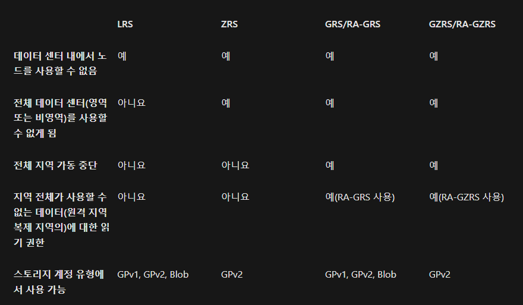

**로컬 중복 스토리지**

LRS는 **가장 저렴한 복제 옵션**이며 다른 옵션보다 내구성이 가장 낮습니다. 데이터 센터 수준의 재해(예: 화재 또는 홍수)가 발생하면 **모든 복제본이 손실되거나 복구되지 않을 수 있습니다**

**영역 중복 스토리지**

ZRS(영역 중복 스토리지)는 단일 지역에 있는 3개의 스토리지 클러스터에서 데이터를 동기적으로 복제합니다. 각 스토리지 클러스터는 다른 스토리지 클러스터와 물리적으로 분리되어 있으며 자체 가용성 영역에 상주합니다.

**지역 중복 스토리지**

GRS(지역 중복 스토리지)는 데이터 원본의 기본 위치에서 수백 마일 떨어진 **보조 지역에 데이터를 복제**합니다. GRS는 **지역 정전이 발생한 경우에도** 더 높은 수준의 내구성을 제공합니다.

**지역 영역 중복 스토리지**

GZRS(지역 영역 중복 스토리지)는 **지역 중복 스토리지에서 제공하는 지역 가동 중단에 대한 보호 기능과 영역 중복 스토리지의 고가용성을 결합**합니다. GZRS 스토리지 계정의 데이터는 주 지역에 있는 3개의 Azure 가용성 영역에 복사되며 지역 재해로부터 보호하기 위해 보조 지리적 지역에도 복제됩니다. 각 Azure 지역은 동일한 지리적 위치 내의 다른 지역과 쌍을 이루어 함께 지역 쌍을 만듭니다.

### **스토리지 액세스**

Azure Storage에 저장되는 모든 개체에는 고유한 URL 주소가 있습니다

- Container Service: `//mystorageaccount.blob.core.windows.net`
- Table service: `//mystorageaccount.table.core.windows.net`
- 큐 서비스: `//mystorageaccount.queue.core.windows.net`
- 파일 서비스: `//mystorageaccount.file.core.windows.net`

**사용자 지정 도메인 구성**

Blob 데이터에 액세스할 수 있도록 사용자 지정 도메인을 구성할 수 있습니다. 앞서 설명한 대로 Azure Blob 스토리지의 기본 엔드포인트는 <storage-account-name>.blob.core.windows.net입니다.

# 2) Blob스토리지 구성

### **Blob service 리소스**

- 스토리지 계정
- 스토리지 계정의 컨테이너
- 컨테이너의 Blob

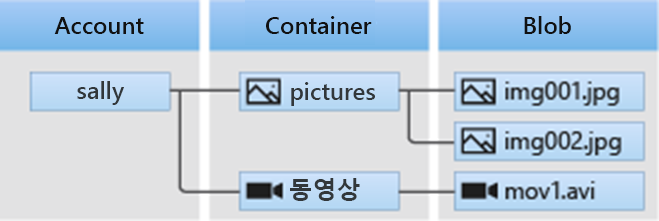

### **Blob 컨테이너 만들기**

Blob 집합의 그룹화를 제공합니다. 모든 Blob은 컨테이너에 있어야 합니다. 계정에 포함될 수 있는 컨테이너의 개수 제한은 없습니다.

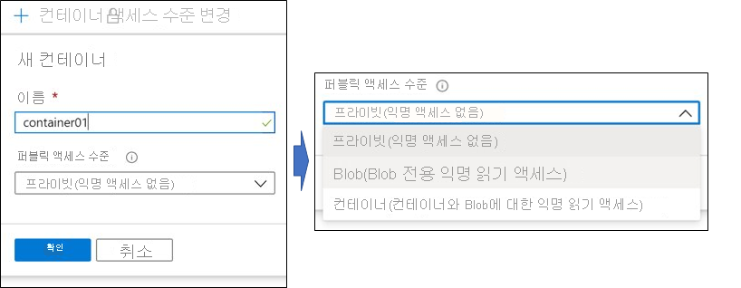

**퍼블릭 액세스 수준**: 컨테이너의 데이터를 공개적으로 액세스할 수 있는지를 지정합니다. 기본적으로 컨테이너 데이터는 계정 소유자에게만 공개됩니다.

- 컨테이너 및 Blob에 대한 익명 액세스를 없애려면 **프라이빗** 을 사용합니다.
- Blob에 대한 익명 공용 읽기 권한만 허용하려면 **Blob**을 사용합니다.
- Blob을 포함하여 전체 컨테이너에 대한 익명 공용 읽기 및 목록 권한을 허용하려면 **컨테이너**를 사용합니다.

### **Blob 액세스 계층 만들기**

사용 패턴에 따라 블록 Blob 데이터에 액세스하기 위한 다양한 옵션을 제공합니다

- **핫**. 스토리지 계층의 개체에 자주 액세스하는 데 최적화되어 있습니다. 새 스토리지 계정은 기본적으로 핫 계층에 만들어집니다.
- **쿨**. 자주 액세스하지 않고 최소 30일 동안 저장된 많은 양의 데이터를 저장하는 데 최적화되어 있습니다. 쿨 계층에 데이터를 저장하는 것은 상당히 비용 효율적이지만, 데이터 액세스 비용이 핫 계층의 데이터에 액세스하는 것보다 더 높을 수 있습니다.
- **보관**. 몇 시간의 검색 대기 시간을 허용할 수 있고, 최소 180일 동안 보관 계층에 남아 있는 데이터에 맞게 최적화되어 있습니다. 보관 계층에 데이터를 저장하는 것이 가장 비용 효율적이지만, 데이터 액세스 비용이 핫 또는 쿨 계층의 데이터에 액세스하는 것보다 높을 수 있습니다.

### **Blob 수명 주기 관리 규칙 추가**

정책을 사용하여 데이터를 적절한 액세스 계층으로 전환하거나 데이터의 수명 주기 후에 만료합니다.

- Blob을 쿨 스토리지 계층으로 전환하여(핫 스토리지 계층에서 쿨 스토리지 계층으로, 핫 스토리지 계층에서 보관 스토리지 계층으로 또는 쿨 스토리지 계층에서 보관 스토리지 계층으로) 성능 및 비용을 최적화합니다.
- 수명 주기가 끝나면 Blob을 삭제합니다.
- 스토리지 계정 수준에서 하루에 한 번 실행할 규칙을 정의합니다.
- 컨테이너 또는 Blob 하위 집합에 규칙을 적용합니다.

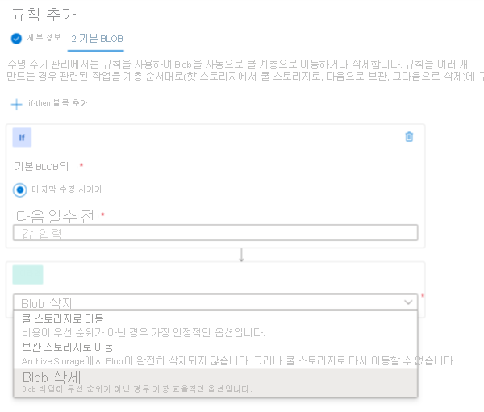

### **Blob 개체 복제 확인**

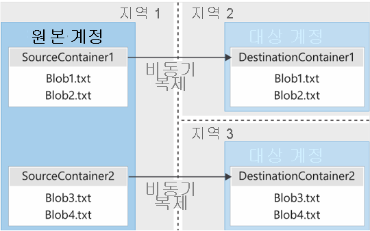

개체 복제는 구성하는 규칙에 따라 컨테이너의 블록 Blob을 비동기적으로 복사합니다. Blob의 콘텐츠, Blob과 연결된 모든 버전, Blob의 메타데이터 및 속성은 모두 원본 컨테이너에서 대상 컨테이너로 복사됩니다.

- 개체 복제를 사용하려면 원본 계정과 대상 계정 모두에서 Blob 버전 관리을 사용하도록 설정해야 합니다.
- 개체 복제는 Blob 스냅샷을 지원하지 않습니다. 원본 계정의 Blob에 대한 스냅샷은 대상 계정에 복제되지 않습니다.
- 원본 및 대상 계정이 핫 또는 쿨 계층에 있는 경우 개체 복제가 지원됩니다. 원본 및 대상 계정이 다른 계층에 있을 수 있습니다.
- 개체 복제를 구성하는 경우 원본 스토리지 계정 및 대상 계정을 지정하는 복제 정책을 만듭니다. 복제 정책에는 원본 컨테이너와 대상 컨테이너를 지정하고 원본 컨테이너에서 복제할 블록 Blob을 나타내는 하나 이상의 규칙이 포함되어 있습니다.

### **Blob 업로드**

- **블록 Blob(기본값)**은 Blob을 만들기위해 데이터 블록으로 구성됩니다. Blob Storage를 사용하는 대부분의 시나리오에서는 블록 Blob을 사용합니다. 블록 Blob은 텍스트와, 파일, 이미지 및 비디오 같은 바이너리 데이터를 클라우드에 저장하는 데 적합합니다.
- **추가 Blob**은 블록으로 구성되었다는 점에서 블록 Blob과 유사하지만 추가 작업에 최적화되어 있으므로 로깅 시나리오에 유용합니다.
- **페이지 Blob**은 최대 8TB 크기까지 가능하며 빈번한 읽기/쓰기 작업에 대해 더 효율적입니다. Azure 가상 머신은 OS 및 데이터 디스크로 페이지 Blob을 사용합니다.

### **Blob 업로드 도구**

- **AzCopy**는 Blob Storage, 컨테이너 또는 스토리지 계정 간에 데이터를 복사하는 사용하기 쉬운 Windows 및 Linux용 명령줄 도구입니다.
- **Azure Storage 데이터 이동 라이브러리**는 Azure Storage 서비스 간에 데이터를 이동하기 위한 .NET 라이브러리입니다. AzCopy 유틸리티는 데이터 이동 라이브러리를 사용하여 빌드됩니다.
- **Azure Data Factory**는 Azure 리소스 인증에 계정 키, 공유 액세스 서명, 서비스 주체 또는 관리형 ID를 사용하여 Blob 스토리지 간에 데이터 복사를 지원합니다.
- **Blobfuse**는 Azure Blob Storage의 가상 파일 시스템 드라이버입니다. Blobfuse를 사용하여 Linux 파일 시스템을 통해 스토리지 계정의 기존 블록 Blob 데이터에 액세스할 수 있습니다.
- **Azure Data Box Disk**는 큰 데이터 세트 또는 네트워크 제약 조건으로 인해 유선으로 데이터를 업로드할 수 없는 경우 온-프레미스 데이터를 Blob 스토리지로 전송하는 서비스입니다. Azure Data Box Disk를 사용하여 Microsoft의 SSD(Solid-State Disk)를 요청할 수 있습니다. 그런 다음, 해당 디스크에 데이터를 복사하고, Microsoft에 다시 제공하여 Blob 스토리지에 업로드할 수 있습니다.
- **Azure Import/Export** 서비스는 스토리지 계정의 대용량 데이터를 사용자가 제공하고 이후에 Microsoft가 다시 사용자에게 사용자 데이터로 제공하는 하드 드라이브로 내보내는 방법을 제공합니다.

### **스토리지 가격 책정 확인**

- **성능 계층**: 스토리지 계층이 저장된 데이터의 양과 데이터 저장 비용을 결정합니다. 성능 계층이 쿨 계층화되면 기가바이트당 비용이 감소합니다.
- **데이터 액세스 비용**: 계층이 차가워질수록 데이터 액세스 요금이 증가합니다. 쿨 및 보관 스토리지 계층에 있는 데이터의 경우 읽기에 대해 기가바이트당 데이터 액세스 요금이 부과됩니다.
- **트랜잭션 비용**: 모든 계층에 대해 트랜잭션당 요금이 청구됩니다. 계층이 쿨 계층화되면 요금이 증가합니다.
- **지역에서 복제 데이터 전송 비용**: 이 요금은 GRS 및 RA-GRS를 포함하여 지역에서 복제가 구성된 계정에만 해당합니다. 지역 복제 데이터 전송에는 기가바이트당 요금이 발생합니다.
- **아웃바운드 데이터 전송 비용**: 아웃바운드 데이터 전송(Azure 지역 외부로 전송되는 데이터)을 사용하면 대역폭 사용량에 대해 기가바이트 단위로 요금이 발생합니다. 이 청구는 범용 스토리지 계정과 일치합니다.
- **스토리지 계층 변경**: 계정 스토리지 계층을 쿨에서 핫으로 변경하면 스토리지 계정에서 모든 기존 데이터를 읽는 것과 같은 요금이 발생합니다. 하지만 계정 스토리지 계층을 핫에서 쿨로 변경하면 모든 데이터를 쿨 계층에 쓰는 것과 동일한 요금이 부과됩니다(GPv2 계정에만 해당).

# 3) 스토리지 보안 구성

## **스토리지 보안 전략 검토**

- **암호화**. Azure Storage에 쓴 모든 데이터는 SSE(Storage 서비스 암호화)를 사용하여 자동으로 암호화됩니다.
- **인증**. Azure AD(Azure Active Directory) 및 RBAC(역할 기반 액세스 제어)는 다음과 같이 리소스 관리 작업 및 데이터 작업 모두에 대한 Azure Storage에 지원됩니다.
    - 스토리지 계정으로 범위가 지정된 RBAC 역할을 보안 주체에 할당하고 Azure AD를 사용하여 키 관리와 같은 리소스 관리 작업의 권한을 부여할 수 있습니다.
    - Blob 및 큐 서비스에 대한 데이터 작업을 위해 Azure AD 통합이 지원됩니다.
- **전송 중 데이터**. 클라이언트 쪽 암호화, HTTP 또는 SMB 3.0을 사용하여 애플리케이션과 Azure 간에 전송 중인 데이터의 보안을 유지할 수 있습니다.
- **디스크 암호화**. 가상 머신에서 사용되는 OS 및 데이터 디스크는 Azure Disk Encryption을 사용하여 암호화될 수 있습니다.
- **공유 액세스 서명**. 공유 액세스 서명을 사용하여 Azure Storage의 데이터 개체에 대한 위임된 액세스 권한을 부여할 수 있습니다.

### **권한 부여 옵션**

- **Azure AD(Azure Active Directory)**. Azure AD는 Microsoft의 클라우드 기반 ID 및 액세스 관리 서비스입니다. Azure AD에서는 RBAC(역할 기반 액세스 제어)를 통해 사용자, 그룹 또는 애플리케이션에 대한 세분화된 액세스 권한을 할당할 수 있습니다.
- **공유 키**. 공유 키 권한 부여는 계정 액세스 키와 기타 매개 변수를 사용하여 권한 부여 헤더의 요청에 전달되는 암호화된 서명 문자열을 생성합니다.
- **공유 액세스 서명**. SAS(공유 액세스 서명)는 지정된 사용 권한을 사용하고 지정된 시간 간격으로 계정의 특정 리소스에 대한 액세스 권한을 위임합니다.
- **컨테이너 및 Blob에 대한 익명 액세스**. 필요에 따라 컨테이너 또는 Blob 수준에서 Blob 리소스를 공용으로 설정할 수 있습니다. 익명 읽기 권한을 위해 모든 사용자가 퍼블릭 컨테이너 또는 Blob에 액세스할 수 있습니다. 퍼블릭 컨테이너 및 Blob에 대한 읽기 요청에는 권한 부여가 필요하지 않습니다.

## **공유 액세스 서명 만들기**

SAS(공유 액세스 서명)는 Azure Storage 리소스에 대한 제한된 액세스 권한을 부여하는 URI입니다. 스토리지 계정 키에 대한 액세스 권한이 없는 클라이언트에 SAS를 제공할 수 있습니다. 이러한 클라이언트에 SAS URI를 배포하여 지정된 기간 동안 리소스에 액세스하도록 할 수 있습니다.

- 계정 수준 SAS는 여러 스토리지 서비스에 대한 액세스 권한을 위임할 수 있습니다. 예를 들어 Blob, 파일, 큐 및 테이블이 있습니다.
- SAS가 유효한 경우 시작 시간 및 만료 시간을 포함하는 간격입니다.
- SAS에서 부여된 권한입니다. 예를 들어 blob의 SAS는 해당 blob에 읽기 및 쓰기 권한을 부여할 수 있지만 삭제 권한은 부여하지 않습니다.

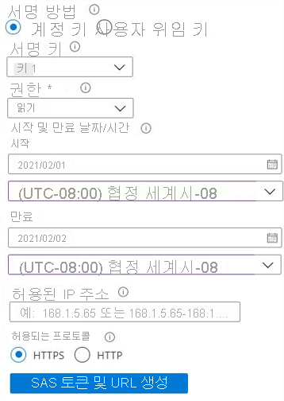

SAS를 만들면 매개 변수와 토큰을 사용하여 URI가 만들어집니다. URI는 스토리지 리소스 URI와 SAS 토큰으로 구성됩니다.

> [https://myaccount.blob.core.windows.net/?restype=service&comp=properties&sv=2015-04-05&ss=bf&srt=s&st=2015-04-29T22%3A18%3A26Z&se=2015-04-30T02%3A23%3A26Z&sr=b&sp=rw&sip=168.1.5.60-168.1.5.70&spr=https](https://myaccount.blob.core.windows.net/?restype=service&comp=properties&sv=2015-04-05&ss=bf&srt=s&st=2015-04-29T22%3A18%3A26Z&se=2015-04-30T02%3A23%3A26Z&sr=b&sp=rw&sip=168.1.5.60-168.1.5.70&spr=https) &sig=F%6GRVAZ5Cdj2Pw4txxxxx
> 

[URI 및 SAS 매개 변수 식별 - Learn](https://docs.microsoft.com/ko-kr/learn/modules/configure-storage-security/4-identify-uri-sas-parameters)

## **고객 관리형 키 만들기**

Azure Key Vault는 암호화 키를 관리할 수 있습니다. 사용자 고유의 암호화 키를 만들고 Azure Key Vault에 저장할 수도 있고 Azure Key Vault의 API를 사용하여 암호화 키를 생성할 수도 있습니다.

고객 관리형 키는 더 많은 유연성과 제어를 제공합니다. 액세스 제어를 만들고, 비활성화하고, 감사하고, 회전하고, 정의할 수 있습니다.

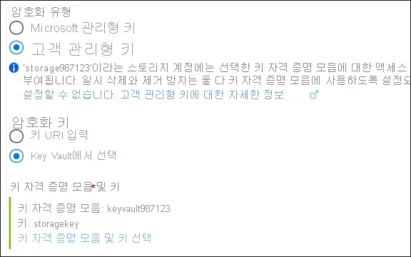

# 4) Azure Files 및 Azure파일 동기화 구성

[소개 - Learn](https://docs.microsoft.com/ko-kr/learn/modules/configure-azure-files-file-sync/1-introduction)

- **바꾸기 및 보완**. Azure Files는 기존의 온-프레미스 파일 서버 또는 NAS 디바이스를 완전히 바꾸거나 보완하는 데 사용할 수 있습니다.
- **어디서나 액세스**. Windows, macOS 및 Linux와 같이 자주 사용되는 운영 체제는 전세계 어디서나 Azure File 공유를 직접 탑재할 수 있습니다.
- **리프트 앤 시프트**. Azure Files를 사용하면 파일 애플리케이션 또는 사용자 데이터를 저장하기 위해 파일 공유를 사용하는 클라우드로 애플리케이션을 쉽게 "전환"할 수 있습니다.
- **Azure 파일 공유**. Azure 파일 공유는 사용되는 데이터의 성능 및 분산 캐싱을 위해 Azure 파일 동기화를 사용하여 온-프레미스 또는 클라우드의 Windows Server에 복제될 수도 있습니다.
- **공유 애플리케이션**. 예를 들어 구성 파일에 공유 애플리케이션 설정 저장.
- **진단 데이터**. 로그, 메트릭 및 크래시 덤프와 같은 진단 데이터를 공유 위치에 저장.
- **도구 및 유틸리티**. Azure 가상 머신 또는 클라우드 서비스를 개발하거나 관리하는 데 필요한 도구 및 유틸리티 저장.

Blob과 구분되는 특징

- Azure 파일은 진정한 디렉터리 개체입니다. Azure Blob은 플랫 네임스페이스입니다.
- Azure 파일은 파일 공유를 통해 액세스합니다. Azure Blob은 컨테이너를 통해 액세스합니다.
- Azure 파일은 여러 가상 머신 간에 공유 액세스를 제공합니다. Azure 디스크는 단일 가상 머신 전용입니다.

## **파일 공유 스냅샷 만들기**

공유 스냅샷 기능은 파일 공유 수준에서 제공됩니다. 개별 파일 복원을 위해 개발 파일 수준에서 검색이 제공됩니다. 먼저 모든 공유 스냅샷을 삭제하지 않으면 공유 스냅샷이 있는 공유를 삭제할 수 없습니다.

공유 스냅샷은 기본적으로 증분합니다. 가장 최근의 공유 스냅샷 이후에 변경된 데이터만 저장됩니다. 증분 스냅샷은 공유 스냅샷을 만드는 데 필요한 시간을 최소화하고 스토리지 비용을 절감할 수 있습니다. 공유 스냅샷이 증분식으로 저장되더라도 공유를 복원하려면 가장 최근의 공유 스냅샷만 유지해야 합니다.

## **파일 동기화 구현**

온-프레미스 파일 서버의 유연성, 성능 및 호환성을 유지하면서 Azure Files에서 조직의 파일 공유를 중앙 집중화할 수 있습니다. Azure 파일 동기화는 Windows Server를 Azure 파일 공유의 빠른 캐시로 변환합니다.

SMB, NFS 및 FTPS를 포함하여 로컬로 데이터에 액세스하기 위해 Windows Server에서 사용할 수 있는 모든 프로토콜을 사용할 수 있습니다. 전 세계에서 필요한 만큼 많은 캐시를 가질 수 있습니다.

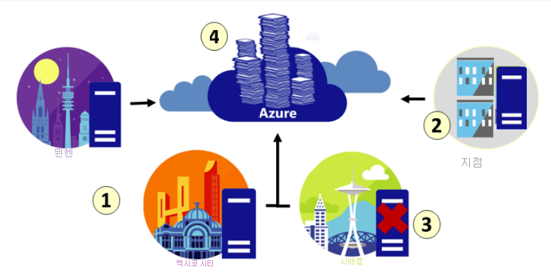

- **리프트 앤 시프트**. Azure와 온-프레미스 시스템 간에 액세스해야 하는 애플리케이션을 이동하는 기능입니다. Windows Server와 Azure Files 간에 동일한 데이터에 대해 쓰기 액세스를 제공합니다. 이로 인해 여러 지점이 있는 회사에서 모든 지점과 파일을 공유해야 합니다.
- **지점**. 지점에서 파일을 백업하거나 사용자가 Azure 스토리지에 연결할 새 서버를 설정해야 합니다.
- **백업 및 재해 복구**. 파일 동기화가 구현되면 Azure Backup은 온-프레미스 데이터를 백업합니다. 또한 신속한 재해 복구를 위해 파일 메타데이터를 즉시 복원하고 필요에 따라 데이터를 회수할 수 있습니다.
- **파일 보관**. 최근에 액세스한 데이터만 로컬 서버에 있습니다. 사용되지 않은 데이터는 Azure의 클라우드 계층화 기능으로 이동됩니다.

## **파일 동기화 구성 요소 식별**

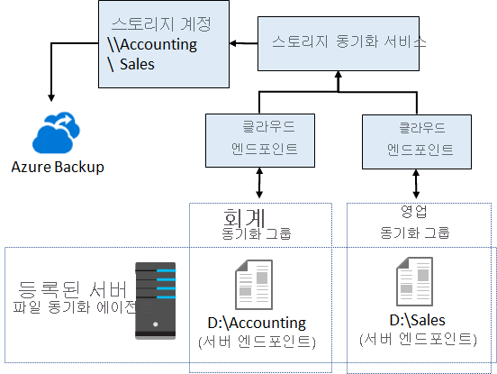

**스토리지 동기화 서비스**. Azure 파일 동기화에 대한 상위 수준의 Azure 리소스입니다. 스토리지 동기화 서비스 리소스는 스토리지 계정 리소스의 피어이며, Azure 리소스 그룹에 유사하게 배포할 수 있습니다. Storage 동기화 서비스는 여러 동기화 그룹을 통해 여러 스토리지 계정과 동기화 관계를 만들 수 있기 때문에 스토리지 계정 리소스와는 별개의 최상위 수준 리소스가 필요합니다.

**동기화 그룹**. 파일 집합에 대한 동기화 토폴로지를 정의합니다. 동기화 그룹 내 엔드포인트는 서로 동기화된 상태를 유지합니다. 예를 들어 Azure 파일 동기화를 사용하여 관리하려는 두 개의 고유한 파일 세트가 있는 경우 두 개의 동기화 그룹을 만들고 서로 다른 엔드포인트를 각 동기화 그룹에 추가합니다.

**등록된 서버**. 서버(또는 클러스터)와 Storage 동기화 서비스 간의 신뢰 관계를 나타냅니다.

**Azure 파일 동기화 에이전트**. Windows Server가 Azure 파일 공유와 동기화되도록 하는 다운로드 가능 패키지입니다.

- FileSyncSvc.exe: 서버 엔드포인트의 변경 내용을 모니터링하고 Azure와의 동기화 세션을 시작하는 백그라운드 Windows 서비스입니다.
- StorageSync.sys: Azure Files로의 파일 계층화를 담당하는 Azure 파일 동기화 파일 시스템 필터입니다(클라우드 계층화가 사용될 경우).
- PowerShell 관리 cmdlet: Microsoft.StorageSync Azure 리소스 공급자와 상호 작용하는 데 사용하는 PowerShell cmdlet입니다. 다음(기본) 위치에서 이러한 항목을 찾을 수 있습니다.
    - C:\Program Files\Azure\StorageSyncAgent\StorageSync.Management.PowerShell.Cmdlets.dll
    - C:\Program Files\Azure\StorageSyncAgent\StorageSync.Management.ServerCmdlets.dll

**서버 엔드포인트**. 서버 볼륨의 폴더와 같이 등록된 서버의 특정 위치를 나타냅니다. 해당 네임스페이스가 겹치지만 않으면 여러 서버 엔드포인트가 같은 볼륨에 있을 수 있습니다(예: F:\sync1 및 F:\sync2).

**클라우드 엔드포인트**. 동기화 그룹의 일부인 Azure 파일 공유입니다. 전체 Azure 파일 공유가 동기화되며, Azure 파일 공유는 하나의 클라우드 엔드포인트의 구성원만 될 수 있습니다. 따라서 Azure 파일 공유는 하나의 동기화 그룹의 구성원만 될 수 있습니다.

## **Azure 파일 동기화 배포**

1. **스토리지 동기화 서비스 배포**. Azure Portal에서 스토리지 동기화 서비스를 배포할 수 있습니다. 이름, 구독, 리소스 그룹 및 위치를 제공해야 합니다.
2. **Azure 파일 동기화에서 사용할 Windows Server 준비**. 장애 조치(Failover) 클러스터의 서버 노드를 포함하여 Azure 파일 동기화와 함께 사용하려는 각 서버에 대해 서버를 구성해야 합니다. 준비 단계에는 Internet Explorer 보안 강화를 일시적으로 사용하지 않도록 설정하고 최신 PowerShell 버전을 확인하는 작업이 포함됩니다.
3. **Azure 파일 동기화 에이전트 설치**. Azure 파일 동기화 에이전트는 Windows Server가 Azure 파일 공유와 동기화되도록 하는 다운로드 가능 패키지입니다. Azure 파일 동기화 에이전트 설치 패키지는 비교적 빠르게 설치되어야 합니다. 기본 설치 경로를 유지하고 Microsoft 업데이트를 통해 Azure 파일 동기화를 최신 상태로 유지하는 것이 좋습니다.
4. **스토리지 동기화 서비스에 Windows Server 등록**. Azure 파일 동기화 에이전트 설치를 마치면 서버 등록 UI가 자동으로 열립니다. 스토리지 동기화 서비스에 Windows Server를 등록하면 서버(또는 클러스터)와 스토리지 동기화 서비스 간에 트러스트 관계가 설정됩니다. 등록하려면 1단계에서 만든 구독 ID, 리소스 그룹 및 스토리지 동기화 서비스가 필요합니다. 한 번에 하나의 서버(또는 클러스터)만 하나의 스토리지 동기화 서비스에 등록될 수 있습니다.

# 5) 도구를 사용하여 스토리지 구성

## **Azure Storage Explorer 사용**

Windows, macOS 및 Linux에서 Azure Storage 데이터를 쉽게 사용할 수 있게 하는 독립 실행형 앱입니다. Storage Explorer를 사용하여 여러 계정 및 구독에 액세스하고 모든 스토리지 콘텐츠를 관리할 수 있습니다.

리소스에 완전히 액세스하려면 Storage Explorer에 관리 권한(Azure Resource Manager)과 데이터 레이어 권한이 모두 필요합니다. 즉, 스토리지 계정, 계정의 컨테이너, 컨테이너의 데이터에 대한 액세스를 제공하는 Azure AD(Azure Active Directory) 권한이 필요합니다.

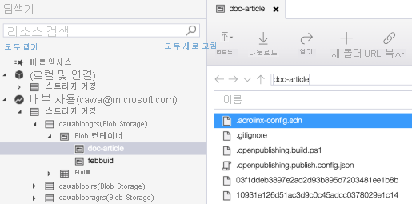

### **스토리지에 연결**

- **Azure 구독에 연결**. Azure 구독에 속한 스토리지 리소스를 관리합니다.
- **로컬 개발 스토리지로 작업**. Azure Storage 에뮬레이터를 사용하여 로컬 스토리지를 관리합니다.
- **외부 스토리지에 연결**. 스토리지 계정의 계정 이름, 키 및 엔드포인트를 사용하여 다른 Azure 구독에 속하거나 국가별 Azure 클라우드 아래에 있는 스토리지 리소스를 관리합니다(아래 참조).
- **SAS를 사용하여 스토리지 계정 연결**. SAS(공유 액세스 서명)를 사용하여 다른 Azure 구독에 속한 스토리지 리소스를 관리합니다.
- **SAS를 사용하여 서비스 연결**. SAS를 사용하여 다른 Azure 구독에 속하는 특정 스토리지 서비스(Blob 컨테이너, 큐 또는 테이블)를 관리합니다.
- **연결 문자열을 사용하여 Azure Cosmos DB 계정에 연결**. 연결 문자열을 사용하여 Cosmos DB 계정을 관리합니다.

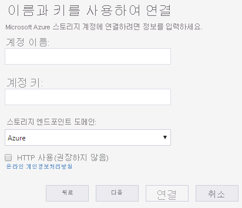

## **가져오기 및 내보내기 서비스 사용**

디스크 드라이브를 Azure 데이터 센터에 발송하여 많은 양의 데이터를 안전하게 Azure Blob Storage 및 Azure Files로 가져올 수 있습니다. 이 서비스를 사용하여 데이터를 Azure Blob Storage에서 디스크 드라이브로 전송하고 온-프레미스 사이트로 발송할 수도 있습니다.

### **가져오기 작업**

디스크 드라이브를 Azure 데이터 센터에 배송하여 Azure Blob 스토리지(블록 및 페이지 Blob) 및 Azure Files로 대량 데이터를 안전하게 전송합니다. 이 경우 데이터를 포함한 하드 드라이브를 배송합니다.

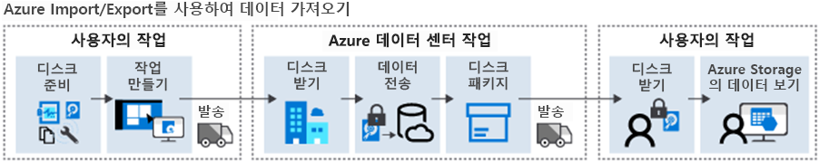

### **작업 내보내기**

데이터를 Azure 스토리지에서 하드 디스크 드라이브로 전송하고 온-프레미스 사이트로 배송합니다.

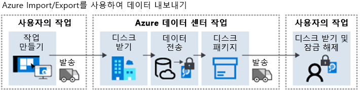

## **AzCopy 사용**

Microsoft Azure Blob 및 파일 스토리지와 데이터를 복사하는 데 사용되는 차세대 명령줄 유틸리티로, 안정적인 고성능 데이터 전송을 위해 다시 디자인된 명령줄 인터페이스와 새 아키텍처를 제공합니다.

- Azure Data Lake Storage Gen2 API를 지원합니다.
- 계정 전체를 다른 계정으로 복사하는 기능을 지원합니다(Blob 서비스만 해당).
- 현재 계정 간 복사에는 새로운 Put from URL API가 사용됩니다. 클라이언트에 데이터를 전송할 필요가 없기 때문에 더 빠르게 전송할 수 있습니다.
- 지정된 경로의 파일 및 BLOB을 나열/제거합니다.
- 경로, --include 플래그 및 --exclude 플래그에서 와일드카드 패턴을 지원합니다.
- 향상된 복원력: 모든 AzCopy 인스턴스는 작업 순서 및 관련 로그 파일을 만듭니다. 이전 작업을 살펴보고 다시 시작하고, 실패한 작업을 재개할 수 있습니다. AzCopy는 전송 실패 후 자동으로 전송을 다시 시도합니다.
- 일반적인 성능이 향상되었습니다.

### **인증 옵션**

- **Azure Active Directory**(Blob 및 ADLS Gen2 서비스 지원). .\azcopy 로그인을 사용하여 Azure Active Directory를 통해 로그인합니다. 사용자가 Azure Active Directory 인증을 사용하여 Blob 스토리지에 데이터를 쓰려면 ‘Storage Blob 데이터 기여자’ 역할이 할당되어야 합니다.
- **SAS 토큰**(Blob 및 파일 서비스). 명령줄에서 Blob 경로에 SAS 토큰을 추가하여 사용합니다.

# 6) Azure Storage 계정 만들기

## **필요한 스토리지 계정 수 결정**

### **Azure Storage란?**

Azure Blob, Azure Files, Azure Queues 및 Azure Tables입니다.

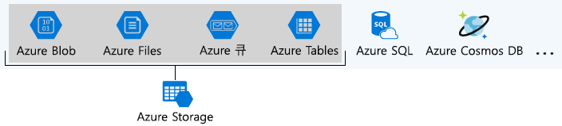

## **스토리지 계정이란?**

Azure Storage 서비스의 집합을 함께 그룹화하는 컨테이너입니다. 스토리지 계정은 Azure 리소스이며 리소스 그룹에 포함됩니다.

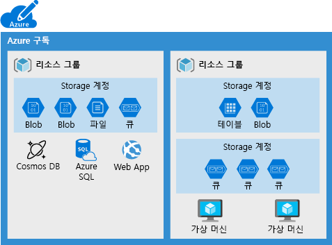

## **스토리지 계정 설정**

- **구독**: 계정의 서비스에 대한 요금이 청구되는 Azure 구독입니다.
- **위치**: 서비스를 계정에 저장하는 데이터 센터입니다.
- **성능**: 스토리지 계정에 사용할 수 있는 데이터 서비스와 데이터 저장에 사용되는 하드웨어 디스크 종류를 결정합니다.
    - **표준**을 사용하면 사용자가 모든 데이터 서비스(Blob, File, Queue, Table)에서 자기 디스크 드라이브를 사용할 수 있습니다.
    - **프리미엄**은 더 많은 데이터 저장 서비스를 제공합니다. 이러한 스토리지 계정은 스토리지에 SSD(반도체 드라이브)를 사용합니다.
- **복제**: 하드웨어 오류 또는 자연재해로부터 보호하기 위해 데이터의 복사본을 만드는 데 사용되는 전략을 결정합니다. 최소한 Azure에서는 스토리지 계정과 연결된 데이터 센터 내의 3개 데이터 복사본을 자동으로 유지합니다.
- **접근 단계**: 스토리지 계정에서 Blob에 액세스할 수 있는 속도를 제어합니다. 핫은 쿨보다 빠른 액세스를 제공하지만 비용이 증가합니다. 핫 액세스 단계는 Blob에만 적용되며 새 Blob에 대한 기본값으로 제공됩니다.
- **보안 전송 필요**: 액세스에 대해 지원되는 프로토콜을 결정하는 보안 기능입니다. 활성화하면 HTTPS가 필요하고, 비활성화하면 HTTP가 허용됩니다.
- **가상 네트워크**: 지정한 가상 네트워크에서 인바운드 액세스 요청만을 허용하는 보안 기능입니다.

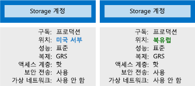

## **계정 설정 선택**

**이름**

각 스토리지 계정에는 이름이 있습니다. 이름은 Azure 내에서 전역적으로 고유해야 하고, 소문자와 숫자만 사용해야 하고, 3~24자 사이여야 합니다.

**배포 모델**

Azure에서 리소스를 구성하는 데 사용하는 시스템입니다.

- **Resource Manager**: Azure Resource Manager API를 사용하는 현재 모델입니다. 대부분의 Azure Resource에서 작동
- **클래식**: Azure Service Management API를 사용하는 레거시 제품입니다.

**계정 종류**

해당 서비스의 계정과 가격에 포함할 수 있는 데이터 서비스를 결정하는 정책 집합

- **StorageV2(범용 v2)**: 모든 스토리지 형식 및 모든 최신 기능을 지원하는 현재 제품입니다.
- **Storage (범용 v1)**: 모든 스토리지 형식을 지원하는 레거시 종류이지만 모든 기능을 지원하지 않을 수 있습니다
- **Blob 스토리지**: 블록 Blob 및 추가 Blob만을 허용하는 레거시 종류

# 7) **공유 액세스 서명 사용 Azure Storage 액세스 제어**

# **Azure Storage 액세스**

### **퍼블릭 액세스**

익명 퍼블릭 액세스를 사용하려면 스토리지 계정과 컨테이너 설정이 모두 필요합니다. 이 접근 방식의 장점은 파일에 액세스해야 하는 클라이언트와 키를 공유하지 않아도 된다는 것입니다. 또한 SAS를 관리할 필요가 없습니다.

- **스토리지 계정.** AllowBlobPublicAccess 속성을 설정하여 퍼블릭 액세스를 허용하도록 스토리지 계정을 구성합니다. True로 설정하면 컨테이너의 퍼블릭 액세스 설정도 설정된 경우에만 BLOB 데이터를 퍼블릭 액세스에 사용할 수 있습니다.
- **컨테이너** 스토리지 계정에 대해 익명 액세스가 허용된 경우에만 익명 액세스를 사용할 수 있습니다. 컨테이너에는 BLOB에 대한 퍼블릭 읽기 액세스 또는 컨테이너 및 해당 BLOB에 대한 퍼블릭 읽기 액세스의 두 가지 가능한 설정 퍼블릭 액세스가 있습니다. 익명 액세스는 개별 BLOB이 아닌 컨테이너 수준에서 제어됩니다.

### **Azure Active Directory**

Azure AD 옵션을 사용하여 자격 증명을 코드에 저장하지 않고 Azure Storage에 안전하게 액세스합니다. AD 권한 부여에는 2단계 접근 방식을 사용합니다. 먼저 성공한 경우 OAuth 2.0 토큰을 반환하는 보안 주체를 인증합니다. 그런 다음, 이 토큰을 Azure Storage에 전달하여 요청된 리소스에 대한 권한 부여를 사용하도록 설정합니다.

### **공유 키**

생성된 모든 스토리지 계정용으로 두 개의 512비트 액세스 키를 만듭니다. 해당 키를 공유하여 스토리지 계정에 대한 액세스 권한을 클라이언트에 부여합니다. 해당 키는 스토리지의 루트 액세스 권한에 해당하는 액세스 권한을 모든 사용자에게 부여합니다.

### **공유 액세스 서명**

SAS를 사용하면 읽기 전용 또는 읽기/쓰기 액세스, 만료 시간 등 Azure Storage 파일에 대한 세부적인 액세스 권한을 부여할 수 있으며, 그 후에는 SAS를 통해 클라이언트가 선택한 리소스에 더 이상 액세스할 수 없습니다. 공유 액세스 서명은 스토리지 리소스에 권한을 부여하는 키이며 계정 키와 동일한 방식으로 보호되어야 합니다.

- **사용자 위임 SAS**: BLOB 스토리지에만 사용할 수 있으며 Azure AD 자격 증명으로 보호됩니다.
- **서비스 SAS**: 서비스 SAS는 스토리지 계정 키를 사용하여 보호됩니다. 서비스 SAS는 Azure Storage 서비스(BLOB, 큐, 테이블, 파일) 중 하나의 리소스에 대한 액세스 권한을 위임합니다.
- **계정 SAS**: 계정 SAS는 스토리지 계정 키를 사용하여 보호됩니다. 계정 SAS는 서비스 SAS와 동일한 컨트롤을 포함하지만, 서비스 통계 가져오기와 같이 서비스 수준 작업에 대한 액세스도 제어할 수 있습니다.

## **공유 액세스 서명을 사용하여 Azure Storage에 대한 액세스 위임**

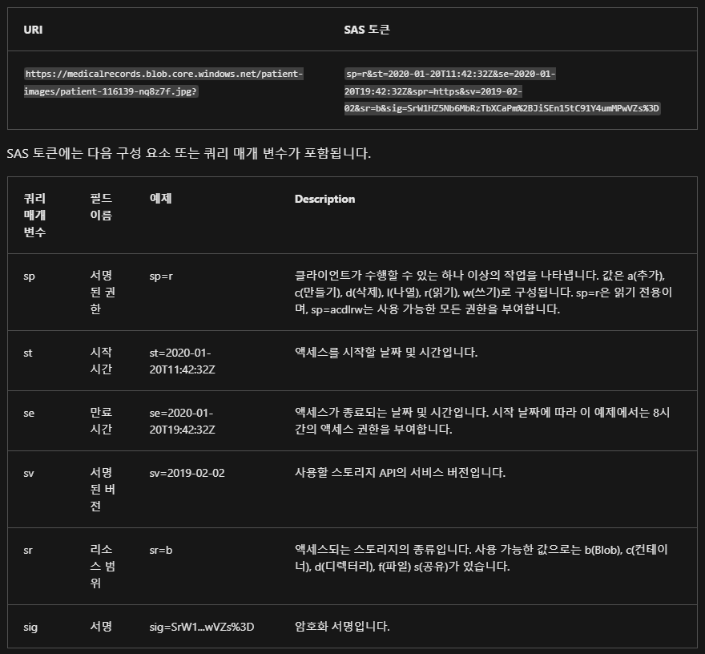

## **저장된 액세스 정책(Stored Access Policy)**

- **식별자**: 저장된 액세스 정책을 참조하는 데 사용할 이름입니다.
- **시작 시간**: 정책 사용을 시작하는 날짜 및 시간의 DateTimeOffset 값입니다. 이 값은 null일 수 있습니다.
- **만료 시간**: 정책이 만료되는 날짜 및 시간의 DateTimeOffset 값입니다. 이 시간 이후에는 스토리지에 대한 요청이 403 오류-코드 메시지와 함께 실패합니다.
- **권한**: **acdlrw** 중 하나 또는 모두일 수 있는 문자열로 표시되는 권한 목록입니다.

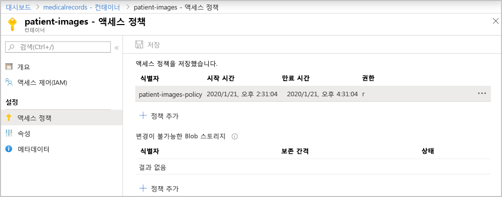

# 8) **Azure Storage Explorer를 사용하여 데이터 업로드, 다운로드 및 관리**

[연습문제](02_연습문제.md)