# 4. Azure컴퓨팅 리소스 배포 및 관리

# 1) 가상머신 가용성 구성

## **클라우드 서비스 책임 검토**

가상 머신은 IaaS(Infrastructure as a Service) 제품의 일부입니다. IaaS는 인터넷을 통해 프로비저닝되고 관리되는 인스턴트 컴퓨팅 인프라입니다.

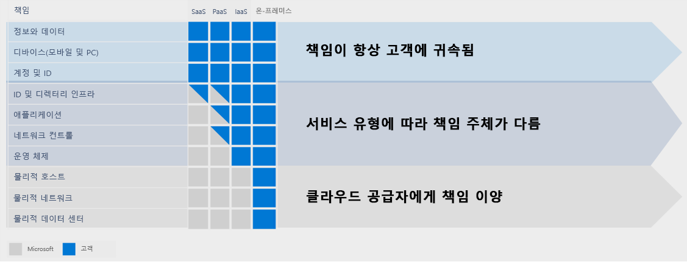

- **테스트 및 개발**. 팀에서 테스트 및 개발 환경을 빠르게 설정하고 분해하여 새 애플리케이션을 더 빠르게 출시할 수 있습니다. IaaS를 사용하면 개발-테스트 환경을 신속하고 경제적으로 스케일 업 및 스케일 다운할 수 있습니다.
- **웹 사이트 호스팅**. IaaS를 사용하여 웹사이트를 운영하는 경우 기존의 웹 호스팅보다 비용이 적게 들 수 있습니다.
- **스토리지, 백업 및 복구.** 조직에서는 스토리지 비용과 스토리지 관리의 복잡성을 방지합니다. 이를 위해 일반적으로 숙련된 직원이 데이터를 관리하고 법적 및 규정 준수 요구를 충족해야 합니다. IaaS는 예측할 수 없는 수요를 관리하고 지속적으로 증가하는 스토리지 요구 사항을 처리하는 데 유용합니다.
- **고성능 컴퓨팅**. 슈퍼 컴퓨터, 컴퓨터 그리드 또는 컴퓨터 클러스터의 HPC(고성능 컴퓨팅)는 수백만 개의 변수 또는 계산과 관련된 복잡한 문제를 해결하는 데 도움이 됩니다.
- **빅 데이터 분석**. 빅 데이터는 잠재적으로 중요한 패턴, 추세 및 연결을 포함하는 대규모 데이터 세트에 사용되는 인기 있는 용어입니다. 데이터 세트를 마이닝하여 이러한 숨겨진 패턴을 찾거나 파악하려면 엄청난 양의 처리 능력이 필요하며 이러한 능력은 IaaS에서 경제적으로 제공합니다.
- **확장된 데이터 센터**. Azure에서 가상 머신을 추가하여 데이터 센터에 용량을 추가합니다. 물리적 위치에 하드웨어 또는 공간을 물리적으로 추가하는 비용을 방지합니다. 실제 네트워크를 Azure 클라우드 네트워크에 원활하게 연결합니다.

## **가상 머신 계획**

### **네트워크 시작**

VNet(가상 네트워크)은 Azure에서 Azure Virtual Machines와 다른 Azure 서비스 간의 프라이빗 연결을 제공하기 위해 사용됩니다. 동일한 가상 네트워크에 속한 VM과 서비스는 서로 액세스할 수 있습니다. 기본적으로 가상 네트워크 외부의 서비스는 가상 네트워크 내의 서비스에 연결할 수 없습니다. 그러나 온-프레미스 서버를 포함하여 외부 서비스에 대한 액세스를 허용하도록 네트워크를 구성할 수 있습니다.

### **VM 이름 지정**

VM 이름은 운영 체제의 일부로 구성된 컴퓨터 이름으로 사용됩니다. 이름은 Windows VM의 경우 최대 15자, Linux VM의 경우 최대 64자까지 지정할 수 있습니다.

### **VM 위치 결정**

가상 머신을 만들고 배포하는 경우 리소스(CPU, 스토리지 등)를 할당하려는 지역을 선택해야 합니다. 지역을 사용하면 성능을 향상하고 법률, 규정 준수 또는 세금 요구 사항을 충족할 수 있도록 사용자에게 최대한 가깝게 VM을 배치할 수 있습니다.

### **위치에 대한 고려 사항**

- **위치에 따라 사용 가능한 옵션이 제한될 수 있습니다**. 영역마다 사용 가능한 하드웨어가 다르며 지역에 따라 사용할 수 없는 구성도 있습니다.
- **위치 간에 가격 차이가 있습니다**. 워크로드가 특정 위치에 바인딩되지 않는 경우 여러 지역에서 필요한 구성을 확인하여 가장 낮은 가격을 찾으면 매우 경제적으로 이용할 수 있습니다.

## **가격 책정 옵션 파악**

**컴퓨팅 비용** - 시간당 가격으로 책정되지만 분당 요금으로 청구됩니다. 시간당 가격은 선택한 VM 크기와 OS에 따라 다릅니다. VM 비용에는 Windows 운영 체제에 대한 요금이 포함됩니다. Linux 기반 인스턴스는 운영 체제 라이선스 비용이 들지 않으므로 더 저렴합니다.

- **소비 기반** - 소비 기반 옵션을 사용하여 컴퓨팅 용량 비용을 초 단위로 지불합니다. 언제든지 시작하거나 중지할 수 있을 뿐만 아니라 필요할 때마다 컴퓨팅 용량을 늘리거나 줄일 수도 있습니다.예를 들어 빠른 테스트를 수행하거나 VM에서 앱을 개발하는 경우에 적절한 옵션입니다.
- **Reserved Virtual Machine Instances** - RI(Reserved Virtual Machine Instances) 옵션은 지정한 지역에서 1년 또는 3년 동안 가상 머신을 사전 구매하는 옵션입니다. 약정은 선불 조건으로 체결되며, 대신 종량제 가격 책정에 비해 최대 72%의 가격 절감 효과를 얻을 수 있습니다. RI는 유연하며 조기 해지 수수료로 쉽게 교환하거나 반환할 수 있습니다. VM을 지속적으로 실행해야 하거나 예산 예측이 필요한 경우 이 옵션을 사용합니다. VM을 1년 이상 사용하도록 약정할 수 있습니다.

**스토리지 비용** - VM에서 사용하는 스토리지에 대한 요금은 별도로 부과됩니다. VM의 상태는 스토리지 요금과 관련이 없습니다. VM이 중지/할당 취소된 경우에도 디스크에서 사용하는 스토리지에 대해 요금이 청구됩니다.

## **가상 머신 스토리지 확인**

모든 Azure 가상 머신은 Windows 운영 체제 디스크(Windows VM인 경우)와 임시 디스크의 적어도 2개의 디스크를 포함합니다. 가상 머신에는 하나 이상의 데이터 디스크도 있습니다. 모든 디스크는 VHD로 저장됩니다.

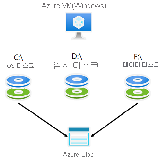

### **운영 체제 디스크**

모든 가상 머신은 하나의 연결된 운영 체제 디스크를 갖습니다. OS 디스크에는 VM이 만들어질 때 선택된 OS가 사전 설치되어 있습니다. 이 디스크는 SATA 드라이브로 등록되며 기본적으로 C 드라이브로 레이블이 지정됩니다.

### **임시 디스크**

임시 디스크의 데이터는 유지 관리 이벤트 또는 VM을 다시 배포할 때 손실될 수 있습니다. VM의 표준 다시 부팅 동안 임시 드라이브의 데이터가 유지되어야 합니다.

- 이 디스크는 Windows 가상 머신에서 기본적으로 D: 드라이브로 레이블이 지정되며 pagefile.sys를 저장하는 데 사용됩니다.
- Linux 가상 머신에서 디스크는 일반적으로 /dev/sdb이며, Azure Linux 에이전트에 의해 /mnt로 포맷되고 마운트됩니다.

### **데이터 디스크**

데이터 디스크는 애플리케이션 데이터 또는 사용자가 보존해야 하는 기타 데이터를 저장하기 위해 가상 머신에 연결된 관리 디스크입니다. 데이터 디스크는 SCSI 드라이브로 등록되며 사용자가 선택한 문자로 레이블이 지정됩니다.

### **관리 디스크**

Azure 관리 디스크는 VHD(가상 하드 디스크)입니다. 온-프레미스 서버의 물리적 디스크처럼 생각할 수 있지만 가상화된 디스크입니다. Azure 관리 디스크는 Azure의 무작위 IO 스토리지 개체인 페이지 Blob으로 저장됩니다. 관리 디스크를 ‘관리’로 부르는 것은 페이지 Blob, Blob 컨테이너 및 Azure Storage 계정에 대한 추상이기 때문입니다. 관리 디스크를 사용할 경우 디스크를 프로비저닝하기만 하면 Azure에서 나머지 작업을 처리합니다.

## **Windows 가상 머신에 연결**

**RDP(원격 데스크톱 프로토콜)**를 사용하면 지원되는 모든 버전의 Windows를 실행하는 Azure VM에 대해 GUI(그래픽 사용자 인터페이스) 세션을 설정할 수 있습니다. Azure Portal은 VM이 실행 중이고 공용 또는 개인 IP 주소를 통해 액세스할 수 있는 경우 및 TCP 포트 3389에서 인바운드 트래픽을 허용하는 경우 Azure Windows VM 블레이드에서 **연결 단추**를 자동으로 사용하도록 설정합니다Azure PowerShell **Get-AzRemoteDesktopFile** cmdlet은 동일한 기능을 제공합니다.

**WinRM(Windows 원격 관리)**을 사용하여 지원되는 모든 버전의 Windows를 실행하는 Azure VM에 대한 명령줄 세션을 설정할 수 있습니다. 또한 WinRM을 사용하여 비대화형 Windows PowerShell 스크립트를 실행할 수 있습니다. WinRM은 인증서를 사용하여 추가 세션 보안을 용이하게 합니다. 세션을 설정하기 전에 사용하려는 인증서를 Azure Key Vault에 업로드할 수 있습니다. WinRM 연결을 설정하는 프로세스에는 다음과 같은 개략적인 단계가 포함됩니다.

1. 키 자격 증명 모음 만들기.
2. 자체 서명된 인증서 만들기.
3. Key Vault에 인증서 업로드.
4. Key Vault에 업로드된 인증서의 URL 식별.
5. Azure VM 구성에서 URL 참조.

## **Linux 가상 머신에 연결**

SSH는 Azure에서 호스팅되는 Linux VM에 대한 기본 연결 프로토콜입니다. SSH 자체에서 암호화된 연결을 제공하지만 SSH 연결과 함께 암호를 하더라도 VM은 여전히 무차별 암호 대입 공격이나 암호 추측에 취약합니다. SSH를 사용하여 VM에 연결하는 데 있어 더 안전하고 선호하는 방법은 이러한퍼블릭-프라이빗 키 쌍, 즉 SSH 키를 사용하는 것입니다.

- **퍼블릭 키**는 퍼블릭 키 암호화를 사용하려는 Linux VM 또는 다른 서비스에 배치됩니다.
- **프라이빗 키**는 로컬 시스템에 남아 있습니다. 이 프라이빗 키는 보호해야 하는 한편, 공유하면 안됩니다.

# 2) 가상머신 가용성 구성

[가상 머신 가용성 구성 - Learn](https://docs.microsoft.com/ko-kr/learn/modules/configure-virtual-machine-availability/)

## 가상 머신에 영향을 줄 수 있는 세 가지 시나리오

**계획되지 않은 하드웨어 유지 관리** Azure 플랫폼이 하드웨어 또는 물리적 머신에 연결된 플랫폼 구성 요소가 실패할 것으로 예측하는 경우에 발생합니다.

**예기치 않은 가동 중지 시간** 가상 머신의 하드웨어 또는 실제 인프라에 예기치 않게 문제가 발생하는 경우입니다. 예기치 않은 가동 중지 시간에는 로컬 네트워크 오류, 로컬 디스크 오류 또는 기타 랙 수준의 오류가 포함될 수도 있습니다.

**계획된 유지 관리** 가상 머신이 실행 중인 플랫폼 인프라의 전체적인 안정성, 성능 및 보안을 향상시키기 위해 Microsoft가 기본 Azure 플랫폼에 적용하는 주기적인 업데이트입니다. 이러한 업데이트 대부분은 가상 머신이나 클라우드 서비스에 영향을 미치지 않고 수행됩니다.

## **가용성 집합 설정**

관련된 VM 그룹을 배포하여 데이터 센터에서 호스트 운영 체제를 업그레이드하는 동안 이러한 VM이 모두 단일 실패 지점의 영향을 받지 않고 동시에 업그레이드되지 않도록 하는 데 사용되는 논리적 기능입니다.

가용성 집합에 배치된 VM은 일단의 동일한 기능을 수행하고 동일한 소프트웨어를 설치해야 합니다.

- 중복성을 위해 가용성 집합에 여러 가상 머신을 구성합니다.
- 각 애플리케이션 계층을 별도의 가용성 집합으로 구성합니다.
- 가용성 집합과 부하 분산 장치를 결합합니다.
- 가상 머신에서 관리 디스크를 사용합니다.

### **SLA(서비스 수준 계약)**

- 동일한 Azure 지역에 있는 둘 이상의 가용성 영역에 둘 이상의 인스턴스가 배포된 모든 가상 머신에 대해 적어도 99.99%의 시간 동안 하나 이상의 인스턴스에 대한 가상 머신 연결이 보장됩니다.
- 동일한 가용성 집합에 둘 이상의 인스턴스가 배포된 모든 가상 머신에 대해 적어도 99.95%의 시간 동안 하나 이상의 인스턴스에 대한 가상 머신 연결이 보장됩니다.
- 모든 운영 체제 디스크 및 데이터 디스크에 프리미엄 스토리지를 사용하는 단일 인스턴스 Virtual Machine의 경우 99.9% 이상의 Virtual Machine 연결을 보장합니다.

## **업데이트 및 장애 도메인 검토**

### **업데이트 도메인**

서비스 업그레이드(롤아웃) 중에 함께 업그레이드되는 노드 그룹입니다. 업데이트 도메인을 사용하면 Azure가 배포 전체에서 증분 또는 롤링 업그레이드를 수행할 수 있습니다.

### **장애 도메인**

실패의 물리적 단위를 나타내는 노드 그룹입니다. 장애 도메인은 단일 실패 지점을 공유하는 공통된 하드웨어, 스위치 집합을 공유하는 가상 머신 그룹을 정의합니다. 전원 또는 네트워킹 스위치 세트로 서비스되는 서버 랙을 예로 들 수 있습니다.

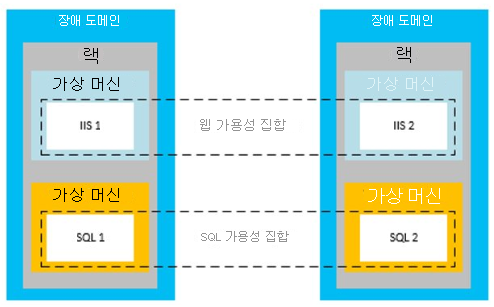

## **가용성 영역 검토**

Azure 지역의 가용성 영역은 장애 도메인과 업데이트 도메인의 조합입니다. 예를 들어 Azure 지역의 3개 영역에 VM을 3개 이상 만들면 장애 도메인 3개와 업데이트 도메인 3개에 VM이 효과적으로 분산됩니다.

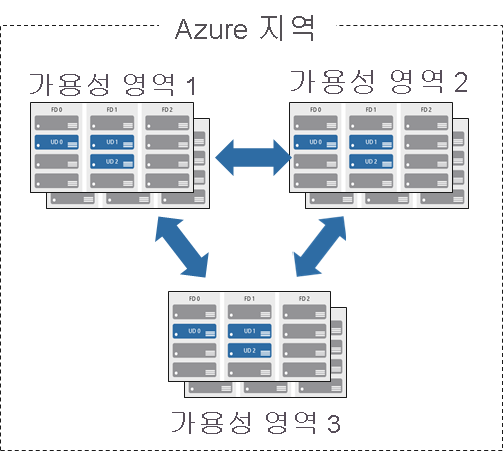

- 가용성 영역은 Azure 지역 내의 고유한 물리적 위치입니다.
- 각 영역은 독립된 전원, 냉각 및 네트워킹을 갖춘 하나 이상의 데이터 센터로 구성됩니다.
- 복원력을 보장하려면 활성화된 모든 지역에서 최소한 세 개의 별도 영역이 필요합니다.
- 지역 내에서 가용성 영역의 물리적 구분은 애플리케이션 및 데이터를 데이터 센터 오류로부터 보호할 수 있습니다.
- 영역 중복 서비스는 단일 지점 오류에서 보호하기 위해 가용성 영역에서 애플리케이션 및 데이터를 복제합니다.
- Azure는 가용성 영역을 통해 업계 최고의 99.99% VM 작동 시간 SLA를 제공합니다.

## **확장 집합 구현**

**동일한** VM 세트를 배포하고 관리하는데 사용할 수 있는 Azure Compute 리소스입니다. 모든 VM은 동일하게 구성되었으며 가상 머신 확장 집합은 실제 자동 크기 조정을 지원하도록 디자인되었습니다.

- 모든 VM 인스턴스는 동일한 기본 OS 이미지 및 구성에서 만들어집니다. 이 방법을 사용하면 추가 구성 작업 또는 네트워크 관리 없이 수백 개의 VM을 쉽게 관리할 수 있습니다.
- 확장 집합은 기본 4계층 트래픽 분산에는 Azure 부하 분산 장치를 사용하고, 고급 7계층 트래픽 분산 및 SSL 종료에는 Azure Application Gateway를 사용하도록 지원합니다.
- 확장 집합은 애플리케이션의 여러 인스턴스를 실행하는 데 사용됩니다. 이러한 VM 인스턴스 중 하나에 문제가 있는 경우, 고객은 중단을 최소화하면서 다른 VM 인스턴스 중 하나를 통해 애플리케이션에 계속 액세스합니다.
- 애플리케이션에 대한 고객의 요구는 하루 또는 일주일 내내 변할 수 있습니다. 고객 요구를 맞추기 위해 확장 집합은 애플리케이션 수요가 증가함에 따라 VM 인스턴스 수를 자동으로 늘린 다음, 수요가 감소함에 따라 VM 인스턴스 수를 줄일 수 있습니다. 이것을 자동 스케일링이라고 합니다.
- 확장 집합은 최대 1,000개의 VM 인스턴스를 지원합니다. 사용자 고유의 사용자 지정 VM 이미지를 만들고 업로드하는 경우 600개의 VM 인스턴스로 제한됩니다.

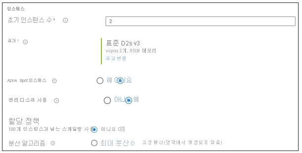

- **초기 인스턴스 수.** 확장 집합의 가상 머신 수입니다(0~1,000).
- **인스턴스 크기.** 확장 집합에 있는 각 가상 머신의 크기입니다.
- **Azure 스폿 인스턴스**. 우선 순위가 낮은 VM은 Microsoft Azure 초과 컴퓨팅 용량에서 할당됩니다. 스폿 인스턴스를 사용하면 여러 유형의 워크로드를 저렴한 비용으로 실행할 수 있습니다.
- **Managed Disks를 사용합니다.** 관리 디스크는 기본 스토리지 계정을 숨기고, 대신 디스크의 추상화를 표시합니다. 비관리 디스크는 기본 스토리지 계정 및 VHD Blob을 노출합니다.
- **100개 인스턴스가 넘는 스케일링 사용.** 아니요인 경우 확장 집합은 최대 용량이 100인 하나의 배치 그룹으로 제한됩니다. 예인 경우 확장 집합은 여러 배치 그룹으로 확장할 수 있습니다. 이렇게 하면 용량을 최대 1,000까지 사용할 수 있지만 확장 집합의 가용성 특성이 변경됩니다.
- **분산 알고리즘**. 워크로드 대부분이 최대로 분산되도록 배포하는 것이 좋습니다. 이 방법은 최상의 분산을 제공합니다.

## **자동 스케일링 구현**

Azure 가상 머신 확장 집합은 애플리케이션을 실행하는 VM 인스턴스의 수를 자동으로 늘리거나 줄입니다. 즉, 변화하는 수요에 맞게 동적으로 스케일링할 수 있습니다.

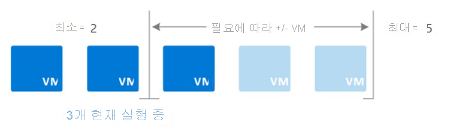

- **용량을 자동으로 조정**. 정의된 임계값이 충족되면 자동 스케일링 규칙에 따라 확장 집합의 용량을 조정하는 작업을 수행합니다.
- **스케일 아웃**. 증가된 로드가 단순한 요구가 아닌 일관된 요구인 경우 확장 집합의 VM 인스턴스 수를 늘리도록 자동 크기 조정 규칙을 구성할 수 있습니다.
- **스케일 인**.  감소된 로드가 일정 기간 동안 일관성 있게 유지될 경우 확장 집합의 VM 인스턴스 수를 줄이도록 자동 크기 조정 규칙을 구성할 수 있습니다.
- **이벤트 예약**. 고정 시간에 확장 집합의 용량을 자동으로 늘리거나 줄이도록 이벤트를 예약합니다.
- **오버헤드 감소**. 관리 오버헤드를 줄여 애플리케이션의 성능을 모니터링하고 최적화합니다.

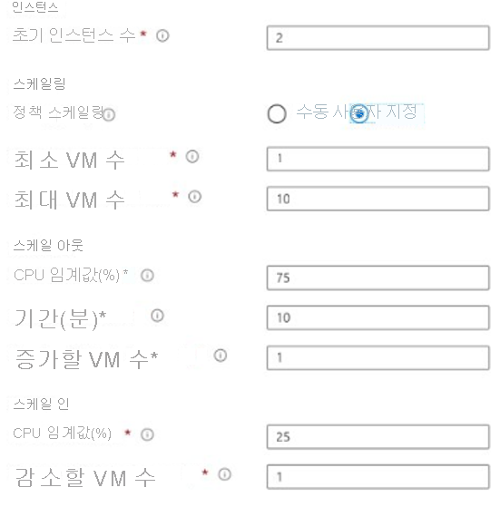

- **최소 VM 수.** 이 확장 집합에서 자동 스케일링의 최솟값입니다.
- **최대 VM 수.** 이 확장 집합에서 자동 스케일링의 최댓값입니다.
- **스케일 아웃 CPU 임계값.** 스케일 아웃 자동 스케일링 규칙을 트리거하기 위한 CPU 사용량 백분율 임계값입니다.
- **증가할 VM 수.** 스케일 아웃 자동 스케일링 규칙이 트리거될 때 확장 집합에 추가할 가상 머신의 수입니다.
- **스케일 인 CPU 임계값.** 스케일 인 자동 스케일링 규칙을 트리거하기 위한 CPU 사용량 백분율 임계값입니다.
- **감소할 VM 수.** 스케일 인 자동 스케일링 규칙이 트리거될 때 확장 집합에서 제거할 가상 머신의 수입니다.

# 3) **가상 머신 확장 구성**

Azure VM에서 배포 후 구성 및 자동화 태스크를 제공하는 작은 애플리케이션입니다. 예를 들어 가상 머신에 소프트웨어 설치, 바이러스 백신 보호가 필요한 경우, 또는 내부에서 스크립트를 구성하려면 VM 확장을 사용하면 됩니다.

## **사용자 지정 스크립트 확장 구현**

CSE(사용자 지정 스크립트 확장)를 사용하여 구성 후 가상 머신 사용자 지정 작업을 자동으로 시작하고 실행할 수 있습니다. 스크립트 확장은 가상 머신 중지 또는 소프트웨어 구성 요소 설치와 같은 간단한 작업을 수행할 수 있습니다. 그러나 스크립트는 더 복잡할 수 있으며 일련의 작업을 수행할 수 있습니다.

- **시간 제한**. 사용자 지정 스크립트 확장을 실행하는 시간은 90분입니다. 배포가 이 시간을 초과하는 경우 시간 제한으로 표시됩니다.
- **종속성**. 확장에 네트워킹 또는 스토리지 액세스가 필요한 경우 콘텐츠를 사용할 수 있는지 확인합니다.
- **오류 이벤트**. 스크립트를 실행할 때 발생할 수 있는 모든 오류를 고려해야 합니다. 예를 들어 디스크 공간이 부족하거나 보안 및 액세스 제한이 있습니다
- **중요한 데이터**. 확장에 자격 증명, 스토리지 계정 이름 및 스토리지 계정 액세스 키와 같은 중요한 정보가 필요할 수도 있습니다

## **Desired State Configuration 구현**

DSC(Desired State Configuration)는 Windows PowerShell의 관리 플랫폼입니다. DSC를 사용하여 소프트웨어 서비스에 대한 구성 데이터를 배포 및 관리하고 이러한 서비스가 실행되는 환경을 관리할 수 있습니다. DSC에서는 소프트웨어 환경을 어떻게 구성할지를 선언적으로 지정하는 데 사용할 수 있는 Windows PowerShell 언어 확장, Windows PowerShell cmdlet 및 리소스를 제공합니다. DSC는 또한 기존 구성을 유지하고 관리하는 수단을 제공합니다.

- **Configuration** 블록. 가장 바깥쪽 스크립트 블록입니다. **Configuration** 키워드를 사용하고 이름을 제공하여 정의합니다.
- 하나 이상의 **Node** 블록. 노드 블록은 구성 중인 컴퓨터나 VM을 정의합니다.
- 하나 이상의 리소스 블록. 리소스 블록은 리소스 속성을 구성합니다.

# 4) **App Service 요금제 구성**

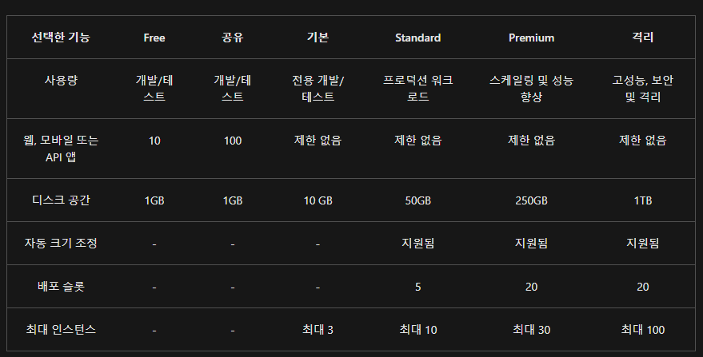

## **App Service 스케일 업 및 스케일 아웃**

**스케일 업**. 더 많은 CPU, 메모리, 디스크 공간 및 추가 기능(전용 VM(가상 머신), 사용자 지정 도메인 및 인증서, 스테이징 슬롯, 자동 크기 조정 등)을 사용할 수 있습니다. 앱이 속한 App Service 계획의 가격 책정 계층을 변경하여 강화합니다.

**규모 확장**: 앱을 실행하는 VM 인스턴스 수가 증가합니다. 가격 책정 계층에 따라 최대 30개의 인스턴스로 확장할 수 있습니다. 고립 계층에서 App Service 환경은 규모 확장 수를 100개 인스턴스까지 증대합니다. 인스턴스 수 스케일링은 수동 또는 자동으로(자동 스케일링) 구성할 수 있습니다. 자동 스케일링은 미리 정의된 규칙 및 일정을 기반으로 합니다.

### **자동 크기 조정 설정**

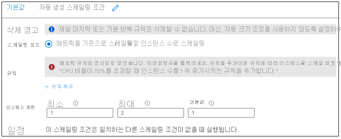

- **메트릭 기반**. 메트릭 기반의 규칙은 애플리케이션 부하를 측정하고 해당 부하를 기반으로 VM을 추가 또는 제거합니다. 예를 들어 CPU 사용률이 50%를 초과하는 경우 이 작업을 수행합니다. 메트릭의 예로는 CPU 시간, 평균 응답 시간, 요청이 있습니다.
- **시간 기준**. 시간 기준(일정 기반) 규칙을 사용하면 부하 시간에서 패턴이 있는 경우 부하가 늘어나거나 줄어들기 전에 스케일링할 수 있습니다. 예를 들어 지정된 표준 시간대에 토요일 오전 8시마다 웹후크를 트리거합니다.

# 5) Azure App Service 구성

## **Azure App Services 구현**

- **여러 언어 및 프레임워크** App Service는 ASP.NET, Java, Ruby, Node.js, PHP 또는 Python을 최고 수준으로 지원합니다. 또한 PowerShell 및 기타 스크립트 또는 실행 파일을 백그라운드 서비스로 실행할 수 있습니다.
- **DevOps 최적화**. Azure DevOps, GitHub, BitBucket, Docker Hub 또는 Azure Container Registry를 사용하여 연속 통합 및 지속적인 배포를 설정합니다. 테스트 및 스테이징 환경을 통해 업데이트를 승격합니다. Azure PowerShell 또는 플랫폼 간 CLI(명령줄 인터페이스)를 사용하여 App Service에서 앱을 관리합니다.
- **고가용성을 갖춘 글로벌 규모**. 수동 또는 자동으로 스케일 업 또는 스케일 아웃합니다. Microsoft의 글로벌 데이터 센터 인프라의 모든 위치에서 앱을 호스팅하고 App Service SLA 를 사용하면 고가용성이 보장됩니다.
- **SaaS 플랫폼 및 온-프레미스 데이터에 연결** 엔터프라이즈 시스템(예: SAP), SaaS 서비스(예: Salesforce) 및 인터넷 서비스(예: Facebook)를 위해 50개 이상의 커넥터에서 선택합니다. 하이브리드 연결 및 Azure Virtual Networks를 사용하여 온-프레미스 데이터에 액세스합니다.
- **보안 및 규정 준수**. App Service는 ISO, SOC 및 PCI와 호환됩니다. Azure Active Directory 또는 소셜 로그인(Google, Facebook, Twitter 및 Microsoft)을 사용하여 사용자를 인증합니다. IP 주소 제한을 만들고 서비스 ID를 관리합니다.
- **애플리케이션 템플릿**. Azure Marketplace의 방대한 애플리케이션 템플릿 목록에서 WordPress, Joomla, Drupal 등을 선택할 수 있습니다.
- **Visual Studio 통합**. Visual Studio의 전용 도구는 생성, 배포, 디버깅 작업을 간소화합니다.
- **API 및 모바일 기능**. App Service는 RESTful API 시나리오에 대한 턴키 방식 CORS 지원을 제공하며, 인증, 오프라인 데이터 동기화, 푸시 알림 등을 활성화하여 모바일 앱 시나리오를 간소화합니다.
- **서버리스 코드**. 인프라를 명시적으로 프로비저닝하거나 관리하지 않고도 요청 시에 코드 조각이나 스크립트를 실행하고, 코드에서 실제로 사용하는 컴퓨팅 시간에 대해서만 비용을 지불합니다.

### **애플리케이션 설정**

- **Always On**. 트래픽이 없는 경우에도 앱을 로드 상태로 유지합니다. 연속 WebJobs 또는 CRON 언어 식을 사용하여 트리거되는 WebJobs에 필요합니다.
- **ARR 선호도**. 다중 인스턴스 배포에서 클라이언트가 세션 수명 동안 동일한 인스턴스로 라우팅되는지 확인합니다.
- **연결 문자열**. 연결 문자열은 미사용 상태에서 암호화되며 암호화된 채널을 통해 전송됩니다.

## **연속 통합 및 지속적인 배포 살펴보기 (CI/CD)**

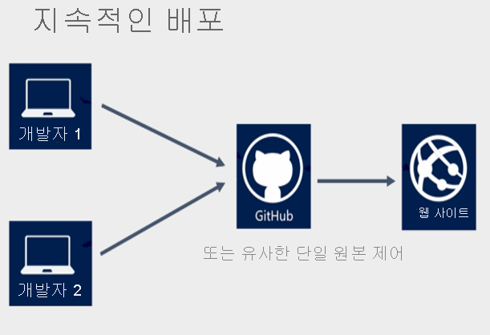

### **자동화된 배포**

자동화된 배포 또는 연속 통합은 최종 사용자에게 최소한의 영향을 주면서 빠르고 반복적인 패턴으로 새 기능 및 버그 수정을 푸시하는데 사용되는 프로세스입니다. Azure는 여러 원본에서 직접 자동화된 배포를 지원합니다. 다음 옵션을 사용할 수 있습니다.

- **Azure DevOps**: Azure DevOps(이전에는 Visual Studio Team Services로 알려짐)에 코드를 푸시하고, 클라우드에서 코드를 빌드하고, 테스트를 실행하고, 코드에서 릴리스를 생성하고, 마지막으로 코드를 Azure 웹앱에 푸시할 수 있습니다.
- **GitHub**: Azure는 GitHub에서 직접 자동화된 배포를 지원합니다. 자동화된 배포를 위해 GitHub 리포지토리를 Azure에 연결하면 GitHub의 프로덕션 분기에 푸시하는 모든 변경 내용이 자동으로 배포됩니다.
- **Bitbucket**: GitHub와 유사하므로 Bitbucket을 사용하여 자동화된 배포를 구성할 수 있습니다.

### **수동 배포**

코드를 Azure에 수동으로 푸시하는 데 사용할 수 있는 몇 가지 옵션이 있습니다.

- **Git**: App Service 웹앱은 원격 리포지토리로 추가할 수 있는 Git URL 기능을 제공합니다. 원격 리포지토리에 푸시하면 앱이 배포됩니다.
- **CLI**: `webapp up`은 앱을 패키지하고 배포하는 명령줄 인터페이스의 기능입니다. 배포에는 새 App Service 웹앱을 만드는 작업이 포함될 수 있습니다.
- **Visual Studio**: Visual Studio는 배포 프로세스를 안내할 수 있는 App Service 배포 마법사 기능을 제공합니다.
- **FTP/S**: FTP 또는 FTPS는 App Service를 포함한 많은 호스팅 환경에 코드를 푸시하는 기존 방법입니다.

## **배포 슬롯 만들기**

배포 슬롯은 고유한 호스트 이름을 사용하는 라이브 앱입니다. 앱 콘텐츠 및 구성 요소는 프로덕션 슬롯을 포함하여 두 배포 슬롯 간에 교환될 수 있습니다.

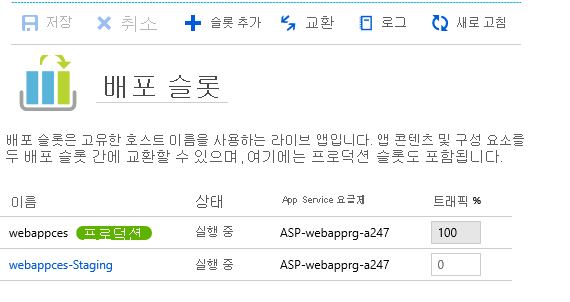

- 프로덕션 슬롯과 교환하기 전에 준비 배포 슬롯에서 앱 변경 사항의 유효성을 검사할 수 있습니다.
- 먼저 슬롯으로 앱을 배포하고 프로덕션으로 교환하기 때문에 프로덕션으로 교환되기 전에 슬롯에 있는 모든 인스턴스가 준비되어 있는 상태입니다. 따라서 앱을 배포할 때 가동 중지가 발생하지 않습니다. 트래픽 리디렉션은 중단 없이 원활하게 수행되며 교환 작업으로 인해 삭제되는 요청은 없습니다. 사전 교환 유효성 검사가 필요하지 않은 경우 자동 교환 을 구성하여 이 전체 워크플로를 자동화할 수 있습니다.
- 교환 후에는 이전의 준비된 앱이 들어 있던 슬롯 안에 이전의 프로덕션 앱이 들어갑니다. 프로덕션 슬롯과 교환한 변경 내용이 예상과 다른 경우 같은 교환 작업을 즉시 수행하여 "마지막 양호 상태"로 돌아갈 수 있습니다.

### **배포 슬롯 추가**

새 배포 슬롯은 비어 있거나 복제할 수 있습니다. 다른 배포 슬롯으로부터 구성을 복제할 때 복제된 구성을 편집할 수 있습니다. 교환 후(특정 슬롯) 다른 구성 요소는 동일한 슬롯에 남아 있지만 일부 구성 요소는 교환(특정 슬롯 아님)에 따라 콘텐츠를 따릅니다.

## **App Service 보안 유지**

Azure App Service는 내장된 인증 및 권한 부여 지원을 제공하므로 웹앱, API 및 모바일 백엔드에 코드를 최소한으로 작성하거나 코드를 작성하지 않고 사용자를 로그인시켜 데이터에 액세스할 수 있으며 Azure Functions도 사용할 수 있습니다.

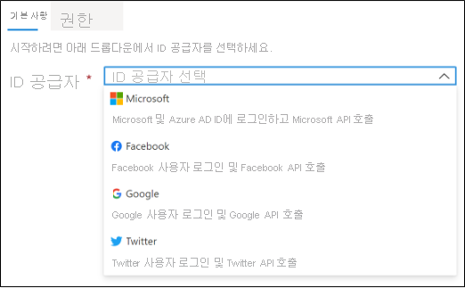

- 지정된 공급자를 사용하여 사용자를 인증합니다.
- 토큰이 유효한지 검사하고, 저장하고, 새로 고칩니다.
- 인증된 세션을 관리합니다.
- 요청 헤더에 ID 정보를 삽입합니다.

## **사용자 지정 도메인 이름 만들기**

1. **도메인 이름을 예약합니다**. 외부 도메인 이름(즉, *.azurewebsites.net 아님)에 아직 등록하지 않은 경우 사용자 지정 도메인을 설정하는 가장 쉬운 방법은 Azure Portal에서 직접 구입하는 것입니다. 이 프로세스를 통해 타사 사이트로 가서 관리하는 대신 포털에서 웹앱의 도메인 이름을 직접 관리할 수 있습니다.
2. **도메인을 Azure 웹앱에 매핑하는 DNS 레코드를 만듭니다.** DNS(Domain Name System)는 데이터 레코드를 사용하여 도메인 이름을 IP 주소에 매핑합니다. DNS 레코드에는 몇 가지 유형이 있습니다. 웹앱의 경우 A 레코드 또는 CNAME 레코드를 만듭니다. IP 주소가 변경되면 CNAME 항목은 여전히 유효하지만 A 레코드를 업데이트해야 합니다. 그러나 일부 도메인 등록 기관에서는 루트 도메인 또는 와일드카드 도메인에 대한 CNAME 레코드를 허용하지 않습니다. 이 경우 A 레코드를 사용해야 합니다.
    - A(주소) 레코드는 도메인 이름을 IP 주소에 매핑합니다.
    - CNAME(정식 이름) 레코드는 도메인 이름을 다른 도메인 이름에 매핑합니다. DNS는 두 번째 이름을 사용하여 주소를 조회합니다. 사용자는 여전히 브라우저에서 첫 번째 도메인 이름을 볼 수 있습니다. 예를 들어 contoso.com을 yourwebapp.azurewebsites.net에 매핑할 수 있습니다.
3. **사용자 지정 도메인 사용**. 도메인을 가져오고 DNS 레코드를 만든 후 Portal을 사용하여 사용자 지정 도메인의 유효성을 검사하고 웹앱에 추가할 수 있습니다. 테스트해야 합니다.

## **App Service 백업**

Azure App Service의 백업 및 복원 기능을 사용하여 수동으로 또는 일정에 따라 앱 백업을 쉽게 만들 수 있습니다. 백업이 무기한 보존되도록 구성할 수 있습니다. 기존 앱을 덮어쓰거나 다른 앱으로 복원하여 앱을 이전 상태의 스냅샷으로 복원할 수 있습니다.

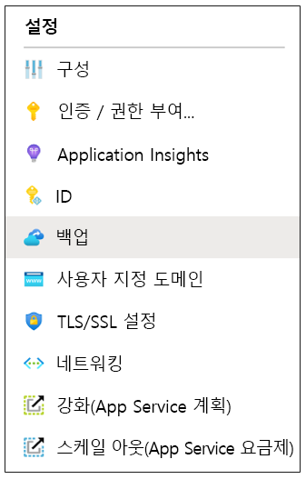

### **백업 대상**

- 앱 구성
- 파일 내용
- 앱에 연결된 데이터베이스(SQL Database, Azure Database for MySQL, Azure Database for PostgreSQL, 앱 내 MySQL)

## **Application Insights 사용**

Application Insights는 라이브 애플리케이션을 모니터링합니다. 성능 이상을 자동으로 감지하고, 문제를 진단하고 사용자가 실제로 앱을 사용하여 수행하는 작업을 파악할 수 있는 강력한 분석 도구를 포함하고 있습니다.

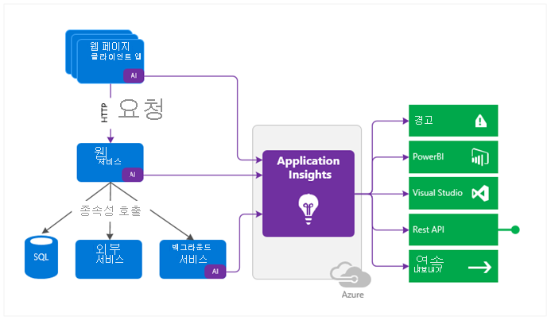

- **요청 속도, 응답 시간 및 실패율** - 하루 중 어느 시간에 어떤 페이지를 가장 많이 방문하는지, 사용자가 어디에 있는지 확인합니다. 어떤 페이지가 가장 성능이 우수한지 확인합니다. 요청이 더 있는데 응답 시간과 실패율이 높아지면 아마도 리소스 문제가 있는 것입니다.
- **종속성 비율, 응답 시간 및 실패율** - 외부 서비스 때문에 속도가 느려지는지 확인합니다.
- **예외** - 집계된 통계를 분석하거나 특정 인스턴스를 선택하여 스택 추적 및 관련 요청을 자세히 분석합니다. 서버 및 브라우저 예외가 전부 보고됩니다.
- **페이지 보기 및 로드 성능** - 사용자의 브라우저에서 보고합니다.
- **사용자 및 세션 수**.
- Windows 또는 Linux 서버 컴퓨터의 **성능 카운터** - CPU, 메모리, 네트워크 사용량 등.
- Docker 또는 Azure의 **호스트 진단**.
- 앱의 **진단 추적 로그** - 추적 이벤트를 요청과 상호 연결하는 데 사용됩니다.
- 판매된 품목, 승리한 게임 등의 비즈니스 이벤트를 추적하기 위해 개발자가 직접 클라이언트 또는 서버 코드로 작성하는 **사용자 지정 이벤트 및 메트릭**.

# 6) Azure Container Instances 구성

## **Azure Container Instances 검토**

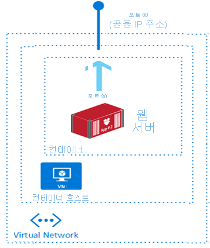

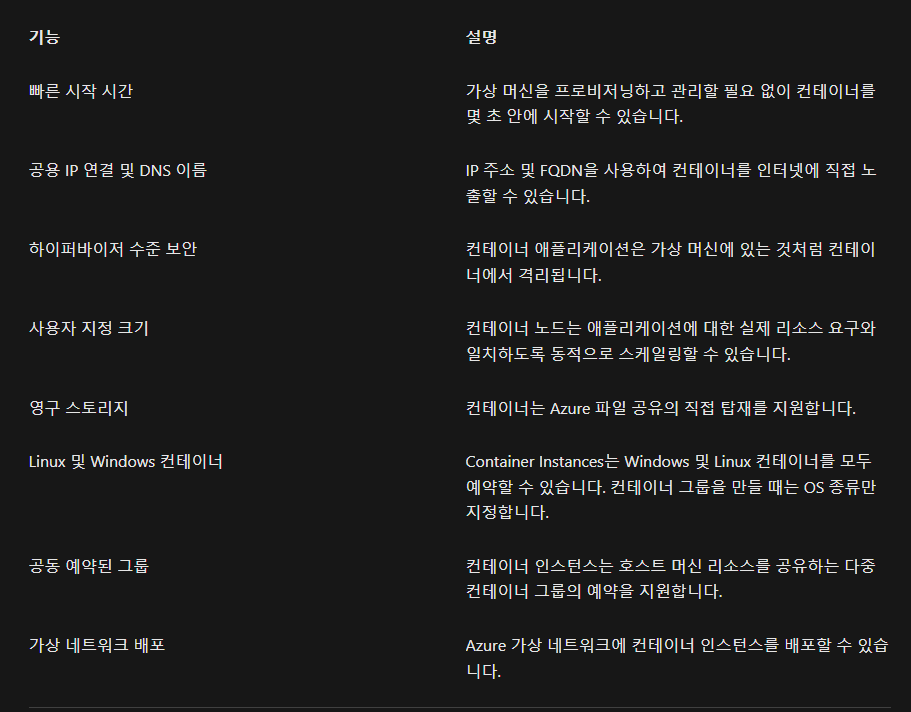

## **컨테이너 그룹 구현**

컨테이너 그룹은 같은 호스트 컴퓨터에서 예약되어 있는 컨테이너 컬렉션입니다. 컨테이너 그룹의 컨테이너는 수명 주기, 리소스, 로컬 네트워크, 스토리지 볼륨을 공유합니다. Kubernetes의 Pod와 개념이 비슷합니다.

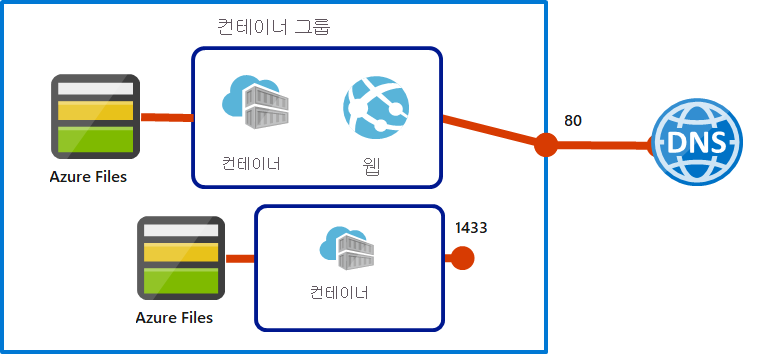

### **배포 옵션**

다중 컨테이너 그룹을 배포하는 두 가지 일반적인 방법은 Resource Manager 템플릿 또는 YAML 파일을 사용하는 것입니다. 컨테이너 인스턴스를 배포할 때 추가 Azure 서비스 리소스(예: Azure Files 공유)를 배포해야 하는 경우 Resource Manager 템플릿을 사용하는 것이 좋습니다.

# 7) **Azure Kubernetes Service 구성**

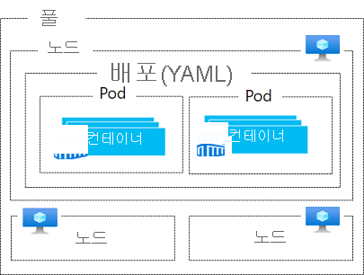

**풀**은 구성이 동일한 노드 그룹입니다.

**노드**는 컨테이너화된 애플리케이션을 실행하는 개별 가상 머신입니다.

**Pod**은 애플리케이션의 단일 인스턴스입니다. Pod은 여러 컨테이너를 포함할 수 있습니다.

**컨테이너**는 소프트웨어 및 모든 해당 종속성을 포함하는 경량의 이식 가능한 실행 파일 이미지입니다.

**배포**에는 Kubernetes에서 관리되는 하나 이상의 동일한 Pod이 있습니다.

**매니페스트**는 배포를 설명하는 YAML 파일입니다.

## **AKS 클러스터 및 노드 아키텍처**

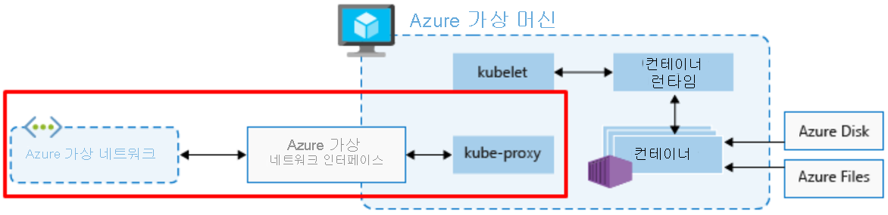

애플리케이션과 지원 서비스를 실행하려면 Kubernetes 노드가 필요합니다. *AKS 클러스터*에는 Kubernetes 노드 구성 요소 및 컨테이너 런타임을 실행하는 하나 이상의 노드(Azure Virtual Machines)가 포함되어 있습니다.

- *kubelet*은 Azure 관리형 노드에서 오케스트레이션 요청을 처리하고 요청된 컨테이너 실행 예약을 처리하는 Kubernetes 에이전트입니다.
- 가상 네트워킹은 각 노드의 *kube-proxy*에서 처리됩니다. 프록시는 네트워크 트래픽을 라우팅하고 서비스와 Pod에 대한 IP 주소 지정을 관리합니다.
- *컨테이너 런타임*은 컨테이너화된 애플리케이션을 실행하고 가상 네트워크 및 스토리지와 같은 추가 리소스와 상호 작용할 수 있게 하는 구성 요소입니다. Kubernetes 버전 1.19 이상의 노드 풀을 사용하는 AKS 클러스터는 포함된 항목을 컨테이너 런타임으로 사용합니다. 노드 풀에 v1.19 이전의 Kubernetes를 사용하는 AKS 클러스터는 Moby(업스트림 docker)를 컨테이너 런타임으로 사용합니다.

## **AKS 네트워킹 구성**

애플리케이션에 액세스하거나 애플리케이션 구성 요소가 서로 통신할 수 있도록 Kubernetes에서 추상화 계층을 가상 네트워킹에 제공합니다. Kubernetes 노드는 가상 네트워크에 연결되고, Pod에 대한 인바운드 및 아웃바운드 연결을 제공할 수 있습니다.

### **Services**

애플리케이션 워크로드에 대한 네트워크 구성을 간소화하기 위해 Kubernetes는 Service를 사용하여 일단의 Pod를 논리적으로 그룹화하고 네트워크 연결을 제공합니다. 사용할 수 있는 Service 유형은 다음과 같습니다.

- **클러스터 IP** - AKS 클러스터 내에서 사용할 내부 IP 주소를 만듭니다. 클러스터 내의 다른 워크로드를 지원하는 내부 전용 애플리케이션에 적합합니다.
- **NodePort** - 노드 IP 주소와 포트를 사용하여 애플리케이션에 직접 액세스할 수 있도록 포트 매핑을 기본 노드에 만듭니다.
- **LoadBalancer** - Azure 부하 분산 장치 리소스를 만들고, 외부 IP 주소를 구성하고, 요청된 Pod를 부하 분산 장치 백 엔드 풀에 연결합니다. 고객 트래픽이 애플리케이션에 도달할 수 있도록 하기 위해 부하 분산 규칙이 원하는 포트에 만들어집니다.
- **ExternalName** - 애플리케이션에 쉽게 액세스하기 위한 특정 DNS 항목을 만듭니다.

### **Pod**

Kubernetes는 Pod를 사용하여 애플리케이션의 인스턴스를 실행합니다. Pod는 애플리케이션의 단일 인스턴스를 나타냅니다. Pod에 여러 컨테이너가 포함될 수 있는 고급 시나리오가 있지만 일반적으로 Pod은 컨테이너와 1:1로 매핑됩니다.

## **AKS 스토리지 구성**

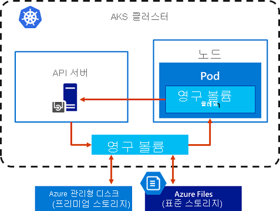

### **볼륨**

Pod 간에 애플리케이션 수명 주기를 통해 데이터를 저장, 검색 및 유지하는 방법을 나타냅니다. 데이터를 저장하고 검색하는 기존 볼륨은 Azure Storage에서 지원하는 Kubernetes 리소스로 만들어집니다. 이러한 데이터 볼륨은 수동으로 만들어 Pod에 직접 할당하거나 Kubernetes에서 자동으로 만들 수 있습니다. 이러한 데이터 볼륨은 Azure Disks 또는 Azure Files를 사용할 수 있습니다.

- *Azure Disks*를 사용하여 *DataDisk* Kubernetes 리소스를 만들 수 있습니다.  Azure Disks는 *ReadWriteOnce*로 탑재되므로 단일 노드에서만 사용할 수 있습니다. 여러 노드에서 동시에 액세스할 수 있는 스토리지 볼륨의 경우 Azure Files를 사용합니다.
- *Azure Files*를 사용하여 Azure Storage 계정을 통해 지원되는 SMB 3.0 공유를 Pod에 탑재할 수 있습니다. Files를 사용하면 여러 노드 및 Pod 간에 데이터를 공유할 수 있습니다

### **영구적 볼륨**

Kubernetes API에서 만들어지고 관리되는 스토리지 리소스로 개별 Pod의 수명을 초과하여 존재할 수 있습니다.

Azure Disks 또는 Azure Files는 PersistentVolume을 제공하는 데 사용됩니다. 앞서의 '볼륨' 섹션에서 설명한 대로 Disks 또는 Files의 선택은 종종 데이터 또는 성능 계층에 대한 동시 액세스의 필요성에 의해 결정됩니다.

### **스토리지 클래스**

AKS에서 처음 4개 StorageClass가 트리 내 스토리지 플러그 인을 사용하여 클러스터용으로 생성됩니다.

- default - Azure StandardSSD 스토리지를 사용하여 Managed Disk를 만듭니다. 회수 정책은 사용된 영구 볼륨이 삭제되면 기본 Azure Disk도 삭제되도록 합니다.
- managed-premium - Azure Premium 스토리지를 사용하여 Managed Disk를 만듭니다. 또 다시 회수 정책은 사용된 영구 볼륨이 삭제되면 기본 Azure Disk도 삭제되도록 합니다.
- azurefile - Azure Standard 스토리지를 사용하여 Azure 파일 공유를 만듭니다. 회수 정책은 사용된 영구 볼륨이 삭제되면 기본 Azure 파일 공유도 삭제되도록 합니다.
- azurefile-premium - Azure Premium 스토리지를 사용하여 Azure 파일 공유를 만듭니다. 회수 정책은 사용된 영구 볼륨이 삭제되면 기본 Azure 파일 공유도 삭제되도록 합니다.

### **영구적 볼륨 클레임**

특정 StorageClass의 Disk 또는 File 스토리지, 액세스 모드 및 크기를 요청합니다. 정의된 StorageClass에 따라 클레임을 처리할 기존 리소스가 없는 경우 Kubernetes API 서버는 Azure에서 기본 스토리지 리소스를 동적으로 프로비전할 수 있습니다. 볼륨이 Pod에 연결되면 Pod 정의에 볼륨 탑재가 포함됩니다.

## **AKS 스케일링 구성**

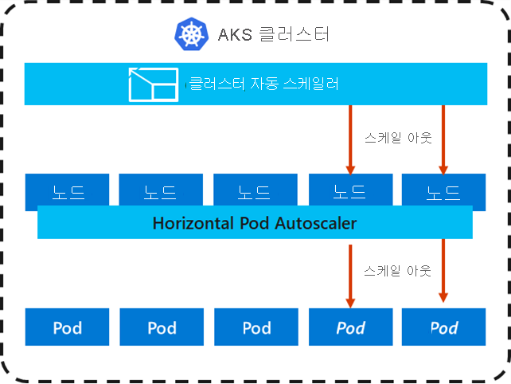

### **Horizontal Pod Autoscaler**

HPA(Horizontal Pod Autoscaler)를 사용하여 리소스 수요를 모니터링하고 복제본 수를 자동으로 조정합니다. 기본적으로 Horizontal Pod Autoscaler는 Metrics API에서 30초 간격으로 필요한 복제본 개수 변경을 확인합니다. 변경이 필요한 경우 그에 따라 복제본 수가 늘어나거나 줄어듭니다. 

**Cooldown of scaling events**

경합 이벤트를 최소화하기 위해 휴지 또는 지연 값을 설정할 수 있습니다. 이러한 값은 다른 크기 조정 이벤트가 트리거되기 위해, Horizontal Pod Autoscaler가 크기 조정 이벤트 이후에 대기해야 하는 기간을 정의합니다. 이 동작을 사용하면 새 복제본 개수가 적용되고 Metrics API에는 분산된 워크로드가 반영됩니다. 기본적으로 규모 확장 이벤트에 따른 지연은 3분이며 규모 축소 이벤트에 따른 지연은 5분입니다.

### **Cluster autoscaler**

Pod 요구 변경에 대응하기 위해 Kubernetes에는 노드 풀의 요청된 컴퓨팅 리소스에 따라 노드 수를 조정하는 클러스터 자동 크기 조정기가 있습니다.

기본적으로 클러스터 자동 크기 조정기는 API 서버에서 10초 간격으로 필요한 노드 개수 변경을 확인합니다.

## **Azure Container Instances에 대한 AKS 스케일링 구성**

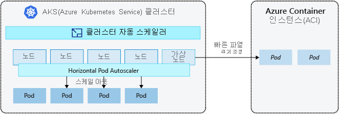

AKS 클러스터 크기를 빠르게 조정하기 위해 ACI(Azure Container Instances)와 통합할 수 있습니다. Kubernetes에는 복제본 및 노드 개수 크기를 조정하기 위한 기본 제공 구성 요소가 있습니다. 그러나 애플리케이션 크기를 빠르게 조정해야 할 경우 Horizontal Pod Autoscaler는 노드 풀의 기존 컴퓨팅 리소스가 제공할 수 있는 것보다 더 많은 Pod를 예약할 수 있습니다. 구성된 경우 이 시나리오는 클러스터 자동 스케일러를 트리거하여 노드 풀에 추가 노드를 배포합니다. 해당 노드가 성공적으로 프로비저닝되는 데 몇 분 정도 걸릴 수 있습니다.

# **Azure Automation 상태 구성**

Azure Automation 상태 구성을 사용하여 클러스터의 VM(가상 머신)이 설치된 동일한 소프트웨어와 일관된 상태에 있고 구성이 동일한지 확인합니다.

이를 통해 모든 리소스의 원하는 상태를 일관되게 배포하고, 안정적으로 모니터링하고, 자동으로 업데이트할 수 있습니다.

[연습문제](02_연습문제.md)