# 5. Azure관리자를 위한 가상 네트워크 구성 및 관리

# 1) 가상 네트워크 구성

[소개 - Learn](https://docs.microsoft.com/ko-kr/learn/modules/configure-virtual-networks/1-introduction)

## 가상 네트워크 계획

Azure VNet(Virtual Network)은 클라우드의 사용자 네트워크를 나타내는 표현입니다. 구독 전용 Azure 클라우드를 논리적으로 격리한 것이 가상 네트워크입니다. VNet을 사용하여 Azure에서 VPN(가상 사설망)을 프로비전 및 관리할 수 있으며 필요에 따라 VNet을 Azure에서 다른 VNet 또는 온-프레미스 IT 인프라와 연결하여 하이브리드 또는 크로스-프레미스 솔루션을 만들 수 있습니다. 또한 VNet에 대한 DNS 서버 설정 및 VNet의 서브넷으로 구분에 대한 제어권을 가집니다.

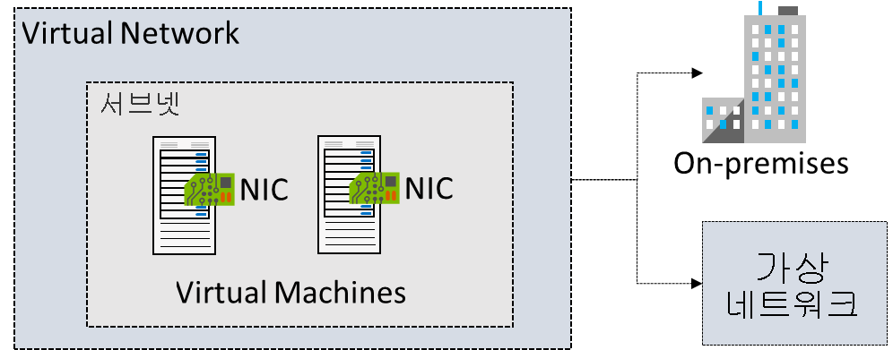

- **프라이빗 클라우드만 사용하는 전용 VNet을 만듭니다**. VNet을 만들 때 VNet 내의 서비스 및 VM은 클라우드 내에서 안전하게 직접 서로 통신할 수 있습니다. 솔루션의 일부로 인터넷 통신이 필요한 VM 및 서비스에 대한 엔드포인트 연결을 계속 구성할 수 있습니다.
- **VNet을 사용하여 데이터 센터를 안전하게 확장합니다**. 기존의 사이트 간(S2S) VPN을 빌드하여 데이터 센터 용량을 안전하게 확장할 수 있습니다. S2S VPN은 IPSEC를 사용하여 회사 VPN Gateway와 Azure 간의 보안 연결을 제공합니다.
- **하이브리드 클라우드 시나리오를 활성화합니다**. VNet은 유연성을 제공하여 다양한 하이브리드 클라우드 시나리오를 지원합니다. 메인프레임 및 Unix 시스템과 같은 모든 형식의 온-프레미스 시스템에 클라우드 기반 애플리케이션을 안전하게 연결할 수 있습니다.

## **서브넷 만들기**

각 서브넷은 가상 네트워크 주소 공간에 속하는 IP 주소 범위를 포함합니다. 범위는 가상 네트워크의 주소 공간 내에서 고유해야 합니다. 범위는 가상 네트워크 내에서 다른 서브넷 주소 범위와 겹쳐서는 안 됩니다. CIDR(Classless Inter-Domain Routing) 표기법을 사용하여 주소 공간을 지정해야 합니다.

- **서비스 요구 사항**. 가상 네트워크에 직접 배포된 각 서비스에는 서브넷 내부 및 외부로 허용되어야 하는 트래픽 유형 및 라우팅에 대한 특정 요구 사항이 있습니다.
- **가상 어플라이언스**. 기본적으로 Azure에서는 가상 네트워크 내의 모든 서브넷 간에 네트워크 트래픽을 라우팅합니다. 서브넷 간의 Azure 라우팅을 방지하거나 네트워크 가상 어플라이언스를 통해 서브넷 간에 트래픽을 라우팅하도록 Azure의 기본 라우팅을 재정의할 수 있습니다.
- **서비스 엔드포인트**. Azure Storage 계정 또는 Azure SQL 데이터베이스와 같은 Azure 리소스에 대한 액세스를 가상 네트워크 서비스 엔드포인트가 있는 특정 서브넷으로 제한할 수 있습니다.
- **네트워크 보안 그룹**. 가상 네트워크의 각 서브넷에 하나의 네트워크 보안 그룹을 연결하거나 연결하지 않을 수 있습니다.
- **프라이빗 링크**. Azure Private Link는 가상 네트워크에서 Azure PaaS(Platform as a Service), 고객 소유 또는 Microsoft 파트너 서비스에 대한 프라이빗 연결을 제공합니다.

## **가상 네트워크 만들기**

지역별로 구독당 최대 50개의 가상 네트워크를 만들 수 있습니다. Azure 지원에 문의하여 이 한도를 500으로 늘릴 수 있습니다.

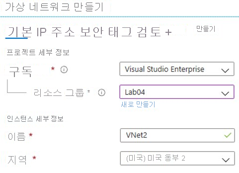

## **IP 주소 지정 계획**

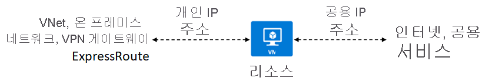

- **개인 IP 주소**: VPN 게이트웨이 또는 ExpressRoute 회로를 사용하여 Azure로 네트워크를 확장할 때 Azure 가상 네트워크(VNet) 및 온-프레미스 네트워크 내에서 통신하는 데 사용됩니다.
- **공용 IP 주소**: Azure 공용 웹 서비스를 포함한 인터넷과의 통신에 사용됩니다.

### **정적 주소 지정과 동적 주소 지정**

IP 주소는 정적으로 할당하거나 동적으로 할당할 수도 있습니다. 고정 IP 주소는 변경되지 않으며 다음과 같은 특정 상황에 가장 적합합니다.

- DNS 이름 확인(IP 주소를 변경하려면 호스트 레코드를 업데이트해야 하는 경우).
- 앱 또는 서비스에 고정 IP 주소를 사용해야 하는 IP 주소 기반 보안 모델.
- TLS/SSL 인증서가 IP 주소에 연결되어 있습니다.
- IP 주소 범위를 사용하여 트래픽을 허용하거나 거부하는 방화벽 규칙.
- 도메인 컨트롤러 및 DNS 서버와 같은 역할 기반 VM.

## **공용 IP 주소 지정 만들기**

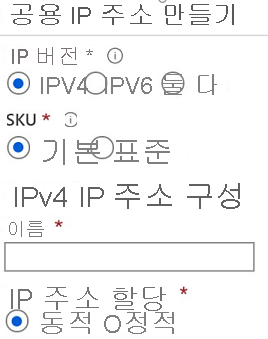

**IP 버전**. IPv4와 IPv6 중 하나를 고르거나 둘 모두를 선택합니다. 둘 모두를 선택하면 IPv4 주소 하나와 IPv6 주소 하나로 이루어진 두 개의 공용 IP 주소가 생성됩니다.

**SKU**. 독립 실행형 가상 머신, 가용성 집합 내의 가상 머신 또는 가상 머신 확장 집합은 기본 또는 표준 SKU를 사용할 수 있습니다.

**이름**. 이름은 선택한 **리소스 그룹 내에서 고유**해야 합니다.

**IP 주소 할당.** IP 주소 할당에는 두 가지 유형이 있습니다.

- **동적** - 동적 주소는 공용 IP 주소가 Azure 리소스에 연결되고 리소스를 처음 시작한 후에만 할당됩니다. 동적 주소는 가상 머신과 같은 리소스에 할당되고 가상 머신이 중지(할당 취소)되었다 다시 시작된 경우 변경될 수 있습니다.
- **정적** - 공용 IP 주소가 생성되면 고정 주소가 할당됩니다. 고정 주소는 공용 IP 주소 리소스를 삭제할 때까지 해제되지 않습니다. IP 버전에 IPv6를 선택한 경우, 기본 SKU에 대한 할당 메서드는 반드시 동적이어야 합니다. IPv4와 IPv6 모두에게 있어 표준 SKU 주소는 고정적입니다.

# 2) **네트워크 보안 그룹 구성**

## **네트워크 보안 그룹 구현 (NSG)**

NSG(네트워크 보안 그룹)를 사용하여 가상 네트워크에서 리소스에 대한 네트워크 트래픽을 제한할 수 있습니다. 네트워크 보안 그룹에는 인바운드 또는 아웃바운드 네트워크 트래픽을 허용하거나 거부하는 보안 규칙 목록이 포함됩니다. NSG를 서브넷이나 네트워크 인터페이스에 연결할 수 있습니다.

## **네트워크 보안 그룹 규칙 결정**

다음을 지정하여 규칙을 추가할 수 있습니다.

- 이름
- 우선 순위
- 포트
- 프로토콜(모두, TCP, UDP)
- 원본(모두, IP 주소, 서비스 태그)
- 대상(모두, IP 주소, 가상 네트워크)
- 작업(허용 또는 거부)

### **인바운드 규칙**

기본 인바운드 보안 규칙은 세 가지입니다. 해당 규칙은 가상 네트워크 및 Azure Load Balancer의 트래픽을 제외한 모든 인바운드 트래픽을 거부합니다.

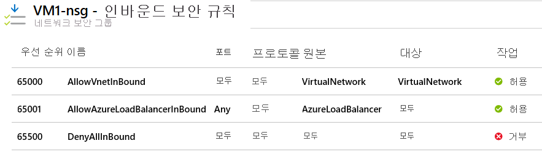

### **아웃바운드 규칙**

기본 아웃바운드 보안 규칙은 세 가지입니다. 해당 규칙은 인터넷 및 가상 네트워크로의 아웃바운드 트래픽만 허용합니다.

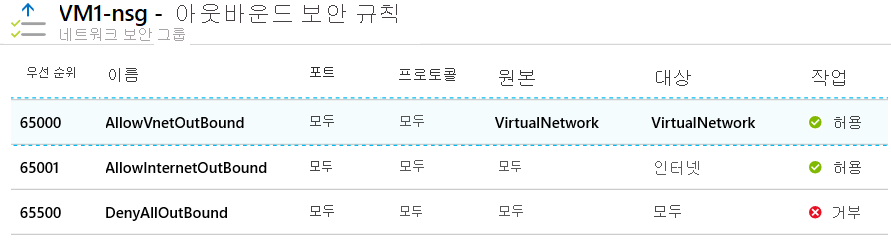

## **네트워크 보안 그룹 유효 규칙 결정**

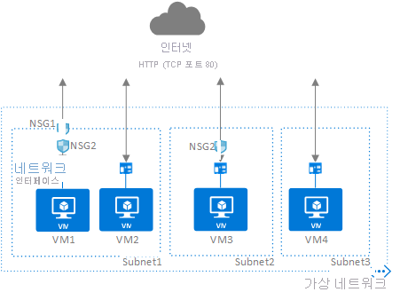

위의 예제에서는 포트 80에서 들어오는 트래픽이 있는 경우 서브넷 수준 허용 포트 80에 NSG가 있어야 합니다. 또한 NIC 수준의 포트 80에 허용 규칙이 있는 또 다른 NSG가 필요합니다.

들어오는 트래픽의 경우 서브넷 수준에서 설정된 NSG를 먼저 평가한 다음 NIC 수준에서 설정된 NSG를 평가합니다. 나가는 트래픽의 경우 반대순서입니다.

여러 NSG가 있고 어떤 보안 규칙이 적용되는지 확실하지 않은 경우 **유효한 보안 규칙** 링크를 사용할 수 있습니다. 예를 들어 네트워크 인터페이스에 적용되는 보안 규칙을 확인할 수 있습니다.

## **애플리케이션 보안 그룹 구현 (ASG)**

네트워크 보안을 애플리케이션 구조의 자연스러운 확장으로 구성할 수 있습니다. 그런 다음, VM을 그룹화하고 해당 그룹을 기반으로 네트워크 보안 정책을 정의할 수 있습니다.

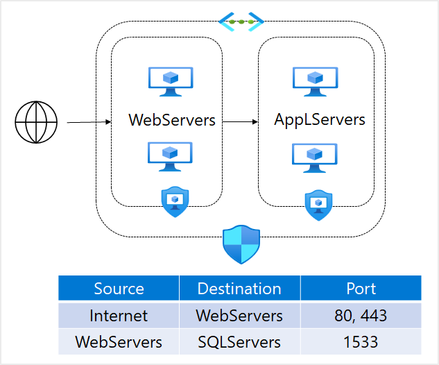

### 제약조건

- ASG와 관련된 다른 제한 외에도 구독에 사용할 수 있는 ASG 수에는 제한이 있습니다.
- 보안 규칙에서 하나의 ASG를 원본 및 대상으로 지정할 수 있습니다. 원본 또는 대상에는 여러 ASG를 지정할 수 없습니다.
- ASG에 할당된 모든 네트워크 인터페이스는 ASG에 할당된 첫 번째 네트워크 인터페이스가 있는 동일한 가상 네트워크에 있어야 합니다.
- 보안 규칙에서 ASG를 원본 및 대상으로 지정하는 경우 두 ASG의 네트워크 인터페이스가 동일한 가상 네트워크에 있어야 합니다..

# 3) **Azure Firewall 구성**

Azure Firewall은 Azure Virtual Network 리소스를 보호하는 관리되는 클라우드 기반 네트워크 보안 서비스입니다. 고가용성 및 무제한 클라우드 확장성이 내장되어 있는 서비스 형태의 완전한 상태 저장 방화벽입니다. 구독 및 가상 네트워크 전반에 걸쳐 애플리케이션 및 네트워크 연결 정책을 중앙에서 만들고, 적용하고 기록할 수 있습니다.

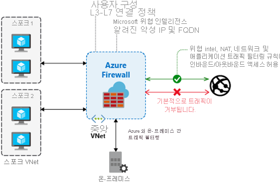

- **기본 제공되는 고가용성**. 고가용성이 기본적으로 제공되므로 추가 부하 분산 장치는 필요하지 않습니다. 구성해야 하는 항목은 없습니다.
- **가용성 영역**. Azure Firewall은 가용성을 높이기 위해 여러 가용 영역에 걸쳐 배포하는 동안 구성할 수 있습니다.
- **제약 없는 클라우드 스케일링 성능**. Azure Firewall은 변화하는 네트워크 트래픽 흐름을 수용하기 위해 필요한 만큼 스케일링할 수 있어 최대 트래픽에 대한 예산을 마련할 필요가 없습니다.
- **애플리케이션 FQDN 필터링 규칙**. 아웃바운드 HTTP/S 트래픽 또는 Azure SQL 트래픽을 와일드 카드를 포함한 FQDN(정규화된 도메인 이름) 목록으로 제한할 수 있습니다.
- **네트워크 트래픽 필터링 규칙**. 원본 및 대상 IP 주소, 포트 및 프로토콜별로 네트워크 필터링 규칙을 중앙에서 만들거나 허용하거나 거부할 수 있습니다.
- **위협 인텔리전스**. 방화벽에서 알려진 악성 IP 주소 및 도메인과 주고받는 트래픽을 경고하고 거부할 수 있도록 하기 위해 위협 인텔리전스 기반 필터링을 사용하도록 설정할 수 있습니다.
- **여러 공용 IP 주소**. 여러 공용 IP 주소를 방화벽과 연결할 수 있습니다.

## **Azure Firewall 만들기**

방화벽을 배포하는 경우 허브-스포크 네트워크 토폴로지를 사용하는 것이 좋습니다.

- *허브*는 온-프레미스 네트워크에 대한 연결의 중심점 역할을 하는 Azure의 가상 네트워크입니다.
- *스포크*는 허브와 피어링하는 가상 네트워크이며 워크로드를 격리하는 데 사용할 수 있습니다.
- 트래픽은 ExpressRoute 또는 VPN 게이트웨이 연결을 통해 온-프레미스 데이터 센터와 허브 사이를 흐릅니다.

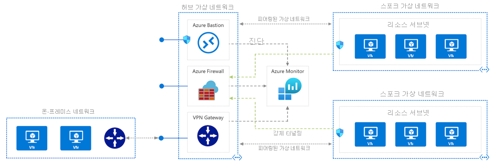

## **방화벽 규칙 만들기**

Azure Firewall에서 구성할 수 있는 규칙에는 세 가지 종류가 있습니다. Azure Firewall은 기본적으로 사용하도록 설정하지 않는 한, 모든 트래픽을 차단합니다.

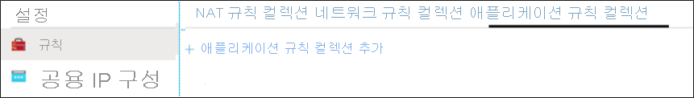

### **NAT 규칙**

- **이름**: 규칙에 대한 레이블입니다.
- **프로토콜**: TCP 또는 UDP입니다.
- **원본 주소**: *(인터넷), 특정 인터넷 주소 또는 CIDR 블록입니다.
- **대상 주소**: 규칙에서 검사할 방화벽의 외부 주소입니다.
- **대상 포트**: 규칙이 방화벽의 외부 IP 주소에서 수신하는 TCP 또는 UDP 포트입니다.
- **변환된 주소**: 서비스를 비공개로 호스트하거나 표시하는 서비스(가상 머신, 내부 부하 분산 장치 등)의 IP 주소입니다.
- **변환된 포트**: Azure Firewall에서 인바운드 트래픽을 라우팅할 포트입니다.

### **네트워크 규칙**

방화벽을 통과하도록 허용되는 모든 비 HTTP/S 트래픽에는 네트워크 규칙이 있어야 합니다. 예를 들어 한 서브넷의 리소스가 다른 서브넷의 리소스와 통신해야 하는 경우 원본에서 대상으로 네트워크 규칙을 구성합니다. 구성 설정은 다음과 같습니다.

- **이름**: 규칙에 대한 친숙한 레이블입니다.
- **프로토콜**: TCP, UDP, ICMP(ping 및 traceroute) 또는 임의입니다.
- **원본 주소**: 원본의 주소 또는 CIDR 블록입니다.
- **대상 주소**: 대상의 주소 또는 CIDR 블록입니다.
- **대상 포트**: 트래픽의 대상 포트입니다.

### **애플리케이션 규칙**

애플리케이션 규칙은 서브넷에서 액세스할 수 있는 FQDN(정규화된 도메인 이름)을 정의합니다. 예를 들어, 방화벽을 통과하는 Windows 업데이트 네트워크 트래픽을 지정합니다. 구성 설정은 다음과 같습니다.

- **이름**: 규칙에 대한 친숙한 레이블입니다.
- **원본 주소**: 원본의 IP 주소입니다.
- **프로토콜:포트**: HTTP/HTTPS 및 웹 서버가 수신 대기 중인 포트입니다.
- **대상 FQDN**: 서비스의 도메인 이름(예: [www.contoso.com](https://www.contoso.com/))입니다. 와일드카드를 사용할 수 있습니다. FQDN 태그는 잘 알려진 Microsoft 서비스와 연결된 FQDN 그룹을 나타냅니다. 예제 FQDN 태그에는 Windows 업데이트, App Service Environment 및 Azure Backup이 포함됩니다.

# 4) Azure DNS 구성

[Azure DNS 구성 - Learn](https://docs.microsoft.com/ko-kr/learn/modules/configure-azure-dns/)

## **초기 도메인 이름**

Azure 구독을 만들면 Azure AD 도메인이 자동으로 만들어집니다. 이 도메인 인스턴스에는 *domainname.onmicrosoft.com* 형식의 ‘초기 도메인 이름’이 지정됩니다. 초기 도메인 이름은 사용자 지정 도메인 이름이 확인될 때까지 사용하기 위한 것입니다.

## **사용자 지정 도메인 이름**

초기 도메인 이름은 변경하거나 삭제할 수 없습니다. 하지만 사용자가 제어하는 라우팅 가능 사용자 지정 도메인 이름을 추가할 수는 있습니다.

- 도메인 관리 작업을 수행하려면 전역 관리자여야 합니다. 전역 관리자는 구독을 만든 사용자입니다.
- Azure AD의 도메인 이름은 전역적으로 고유합니다. 한 Azure AD 디렉터리에서 도메인 이름을 확인하면 다른 디렉터리에서 해당 이름을 사용할 수 없습니다.
- Azure AD에서 사용자 지정 도메인 이름을 사용할 수 있으려면 먼저 사용자 지정 도메인 이름을 사용자의 디렉터리에 추가하고 확인해야 합니다.

### **사용자 지정 도메인 이름 확인**

사용자 지정 도메인 이름을 추가한 후에는 도메인 이름의 소유권을 확인해야 합니다. 확인은 DNS 레코드를 추가하는 방법으로 이루어집니다. DNS 레코드는 MX 또는 TXT일 수 있습니다. DNS 레코드가 추가되면 Azure는 DNS 도메인에 쿼리하여 해당 레코드가 있는지 확인합니다. 이 작업은 몇 분 또는 몇 시간이 걸릴 수 있습니다. Azure에서 DNS 레코드가 있음을 확인하면 도메인 이름이 구독에 추가됩니다.

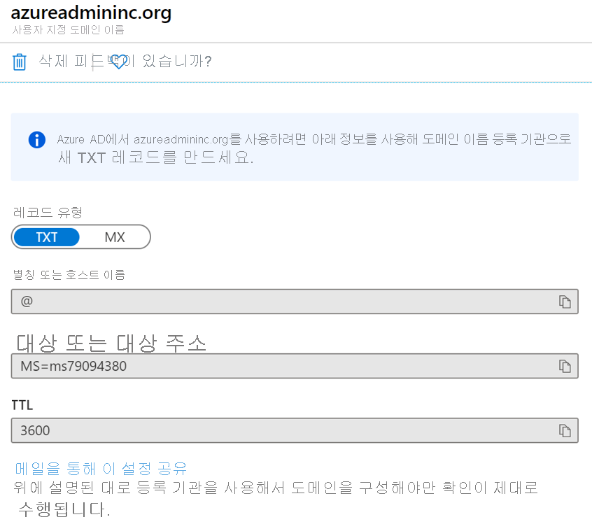

## **Azure DNS 영역 만들기**

Azure DNS는 사용자 지정 DNS 솔루션을 추가할 필요 없이 가상 네트워크의 도메인 이름을 관리하고 확인하는 신뢰할 수 있는 보안 DNS 서비스를 제공합니다.

Azure Portal에서 DNS 영역을 쉽게 추가할 수 있습니다. DNS 영역에 대한 정보에는 이름, 레코드 수, 리소스 그룹, 위치, 구독, 이름 서버 등이 포함됩니다.

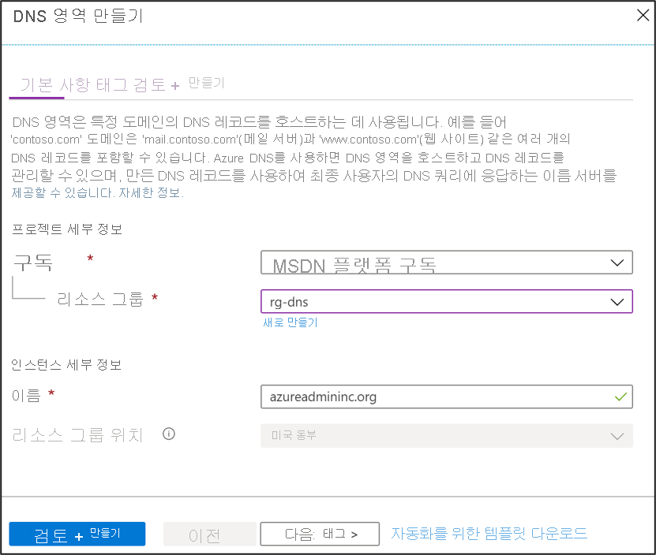

- 영역 이름은 리소스 그룹 내에서 고유해야 하며, 영역이 존재해서는 안 됩니다.
- 서로 다른 리소스 그룹이나 Azure 구독에서는 동일한 영역 이름을 다시 사용할 수 있습니다.
- 복수 영역이 동일한 이름을 공유할 경우 인스턴스는 각각 다른 이름 서버 주소에 할당됩니다.
- 루트/부모 도메인은 등록 기관에 등록되고 Azure NS를 가리킵니다.
- 자식 도메인은 AzureDNS에 직접 등록됩니다.

## **DNS 도메인 위임**

도메인을 Azure DNS에 위임하려면 먼저 해당 영역의 이름 서버 이름을 알아야 합니다. DNS 영역을 만들 때마다 Azure DNS는 풀에서 이름 서버를 할당합니다. 이름 서버가 할당되면 Azure DNS는 영역에 신뢰할 수 있는 NS 레코드를 자동으로 만듭니다.

DNS 영역이 생성되고 이름 서버가 있으면 부모 도메인을 업데이트해야 합니다. 각 등록 기관에는 도메인에 대한 이름 서버 레코드를 변경하는 자체 DNS 관리 도구가 있습니다. 등록 기관의 DNS 관리 페이지에서 NS 레코드를 편집하고 NS 레코드를 Azure DNS에서 만든 레코드로 바꿉니다.

### **자식 도메인**

별도의 자식 영역을 설정하려는 경우 Azure DNS에 하위 도메인을 위임할 수 있습니다. 예를 들어 Azure DNS에서 contoso.com을 구성한 후 partners.contoso.com의 자식 영역을 별도로 구성할 수 있습니다.

## **프라이빗 DNS 영역 계획**

프라이빗 DNS 영역을 사용할 경우 Azure에서 제공하는 이름 대신 고유한 사용자 지정 도메인 이름을 사용할 수 있습니다. 사용자 지정 도메인 이름을 사용하면 조직의 요구 사항에 가장 적합하도록 가상 네트워크 아키텍처를 조정할 수 있습니다. 가상 네트워크 내에서 그리고 가상 네트워크 간에 VM(가상 머신)에 대한 이름을 확인할 수 있게 해줍니다. 또한 분할-수평 보기를 사용해 영역을 구성할 수도 있습니다. 그러면 프라이빗 DNS 영역과 공용 DNS 영역이 이름을 공유할 수 있습니다.

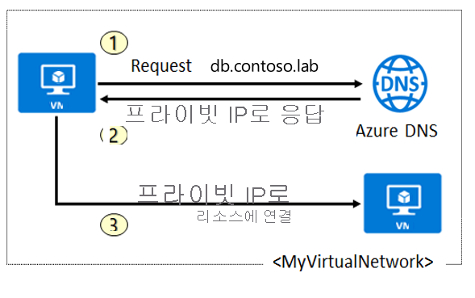

# 5) **가상 네트워크 피어링 구성**

## **가상 네트워크 피어링 사용 확인**

가상 네트워크 피어링을 사용하면 두 개의 Azure 가상 네트워크를 원활하게 연결할 수 있습니다. 가상 네트워크가 피어링되면 연결성을 위해 하나로 표시됩니다

- **지역 VNet 피어링**은 동일한 지역의 Azure 가상 네트워크를 연결합니다.
- **글로벌 VNet 피어링**은 여러 지역의 Azure 가상 네트워크를 연결합니다. 글로벌 피어링을 만들 때 피어링된 가상 네트워크는 Government 클라우드 지역을 제외한 모든 Azure 퍼블릭 클라우드 지역 또는 중국 클라우드 지역에 있을 수 있습니다.

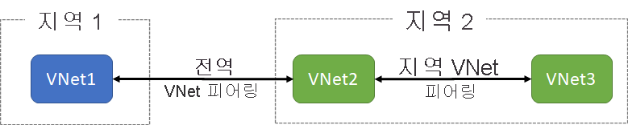

- **프라이빗**. 피어링된 가상 네트워크 간의 네트워크 트래픽이 프라이빗 전용입니다. 가상 네트워크 간의 트래픽이 Microsoft 백본 네트워크에서 유지됩니다. 가상 네트워크 간의 통신에 공용 인터넷, 게이트웨이, 또는 암호화가 필요하지 않습니다.
- **성능**. 다른 가상 네트워크에 있는 리소스 간에 짧은 대기 시간, 높은 대역폭 연결
- **통신**. 가상 네트워크가 피어링되면 하나의 가상 네트워크에 있는 리소스가 다른 가상 네트워크에 있는 리소스와 통신할 수 있습니다.
- **원활**. Azure 구독, 배포 모델 및 Azure 지역에 데이터를 전송할 수 있습니다.
- **중단 없음**. 피어링을 만들 때 또는 피어링이 생성된 후에 각 가상 네트워크에 있는 리소스에 대한 가동 중지 시간이 없습니다.

## **게이트웨이 전송 및 연결 확인**

가상 네트워크가 피어링되면 피어링된 가상 네트워크에 있는 VPN Gateway를 전송 지점으로 구성할 수 있습니다. 이 경우 피어링된 가상 네트워크는 원격 게이트웨이를 사용하여 다른 리소스에 대한 액세스 권한을 얻습니다. 가상 네트워크는 하나의 게이트웨이만을 가질 수 있습니다. 게이트웨이 전송은 VNet 피어링 및 글로벌 VNet 피어링 모두에 대해 지원됩니다.

- 사이트 간 VPN을 사용하여 온-프레미스 네트워크에 연결합니다.
- 다른 가상 네트워크에 대해 VNet 간 연결을 사용합니다.
- 지점 및 사이트 간 VPN을 사용하여 클라이언트에 연결합니다.

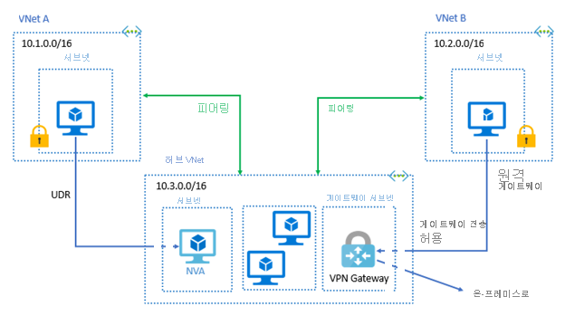

## **가상 네트워크 피어링 만들기**

두 개의 가상 네트워크가 필요합니다. 피어링을 테스트하려면 각 네트워크에 가상 머신이 필요합니다. 처음에는 VM이 통신할 수 없지만 구성한 후에는 통신이 작동합니다. 새로운 단계는 가상 네트워크의 피어링을 구성하는 것입니다.

1. 두 개의 가상 네트워크를 만듭니다.
2. **가상 네트워크를 피어링합니다**.
3. 각 가상 네트워크에 가상 머신을 만듭니다.
4. 가상 머신 간의 통신을 테스트합니다.

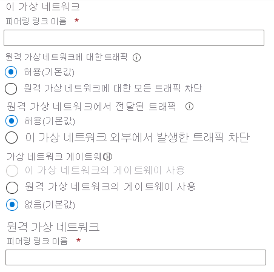

## **서비스 체이닝 사용 확인**

VNet1과 VNet2 간에 그리고 VNet2와 VNet3 간에 VNet 피어링을 설정하는 경우 VNet 피어링 기능은 VNet1과 VNet3 간에 적용되지 않습니다. 그러나 전이성을 제공하도록 사용자 정의 경로 및 서비스 체이닝을 구성할 수 있습니다. 이를 통해 다음을 수행할 수 있습니다.

- 여러 수준의 허브-스포크 아키텍처를 구현합니다.
- 가상 네트워크당 VNet 피어링 수에 대한 제한을 극복합니다.

### **허브-스포크 아키텍처**

허브-스포크 네트워크를 배포하면 허브 가상 네트워크가 네트워크 가상 어플라이언스 또는 VPN Gateway와 같은 인프라 구성 요소를 호스트할 수 있습니다. 모든 스포크 가상 네트워크는 허브 가상 네트워크와 피어링할 수 있습니다. 트래픽은 허브 가상 네트워크의 네트워크 가상 어플라이언스 또는 VPN 게이트웨이를 통해 이동할 수 있습니다.

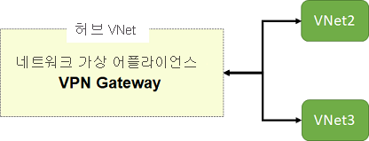

# 6) **VPN Gateway 구성**

VPN Gateway는 각 가상 네트워크당 하나만 사용할 수 있습니다. 그러나 동일한 VPN Gateway에 대해 여러 연결을 만들 수 있습니다. 동일한 VPN Gateway에 대해 여러 연결을 만들면 모든 VPN 터널이 사용 가능한 게이트웨이 대역폭을 공유합니다.

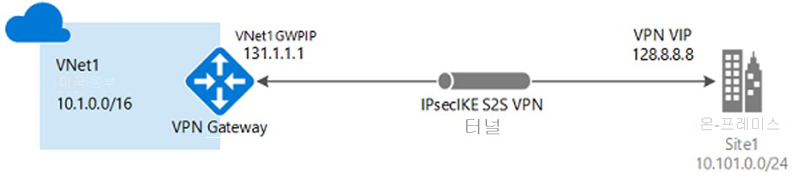

- **사이트 간** 연결은 온-프레미스 데이터 센터를 Azure 가상 네트워크에 연결합니다.
- **VNet 간** 연결은 Azure 가상 네트워크(사용자 지정)를 연결합니다.
- **지점 및 사이트 간(사용자 VPN)** 연결은 개별 디바이스를 Azure 가상 네트워크에 연결합니다.

## **사이트 간 연결 만들기**

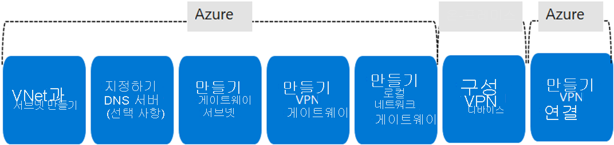

**VNet 및 서브넷을 만듭니다**. 이제 가상 네트워크 및 서브넷을 만드는 방법을 잘 이해하게 되었을 것입니다. 이 VNet은 온-프레미스 위치에 연결해야 합니다. 온-프레미스 네트워크 관리자에게 문의하여 이 가상 네트워크에 대한 IP 주소 범위를 예약하세요.

**DNS 서버를 지정합니다(선택 사항)**. DNS는 사이트 간 연결을 만들지 않아도 됩니다. 그러나 가상 네트워크에 배포된 리소스에 대한 이름 확인이 필요한 경우에는 가상 네트워크 구성에서 DNS 서버를 지정해야 합니다.

### **게이트웨이 서브넷 만들기**

가상 네트워크에 대한 가상 네트워크 게이트웨이를 만들려면 먼저 게이트웨이 서브넷을 만들어야 합니다. 게이트웨이 서브넷은 가상 네트워크 게이트웨이에서 사용되는 IP 주소를 포함하고 있습니다. 가능하면 /28 또는/27의 CIDR 블록을 사용하여 향후 구성 요구 사항을 수용하기에 충분한 IP 주소를 제공하는 방식으로 게이트웨이 서브넷을 만드는 것이 가장 좋습니다.

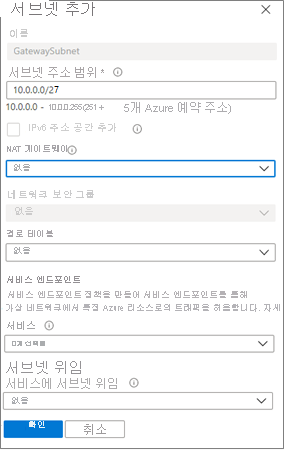

### **VPN 게이트웨이 만들기**

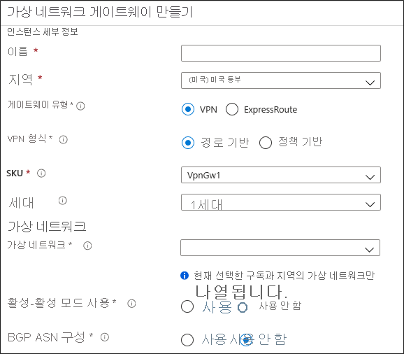

- **게이트웨이 유형** VPN 또는 ExpressRoute를 알고 있습니다.
- **VPN 형식** 경로 기반 또는 정책 기반 대부분의 VPN 유형은 경로를 기준으로 합니다. VPN 디바이스의 제조업체와 모델 및 만들려는 VPN 연결의 종류에 따라 선택하는 VPN 유형이 달라집니다. 일반적인 경로 기반 게이트웨이 시나리오에는 지점 및 사이트 간, 가상 네트워크 간 또는 다중 사이트 간 연결이 포함됩니다. 경로 기반은 ExpressRoute 게이트웨이와 함께 사용하거나 IKEv2를 사용해야 하는 경우에도 선택됩니다. 정책 기반 게이트웨이는 IKEv1만 지원합니다.
- **SKU**. 드롭다운을 사용하여 게이트웨이 SKU를 선택합니다. 선택한 항목은 보유할 수 있는 터널 수와 집계 처리량 벤치마크에 영향을 줍니다. 이 벤치마크는 단일 게이트웨이를 통해 집계된 여러 터널의 측정값을 기준으로 합니다. 인터넷 트래픽 조건 및 애플리케이션 동작으로 인해 처리량이 보장되지 않습니다.
- **세대** Generation1 또는 Generation2 세대 간을 변경하거나 세대 간에 SKU를 변경할 수 없습니다. 기본 및 VpnGw1 SKU는 Generation1에서만 지원됩니다. VpnGw4 및 VpnGw5 SKU는 Generation2에서만 지원됩니다.
- **가상 네트워크** 가상 네트워크 게이트웨이를 통해 트래픽을 보내고 받을 수 있는 가상 네트워크입니다. 가상 네트워크는 둘 이상의 게이트웨이와 연결할 수 없습니다.

### **VPN Gateway 유형 확인**

- **경로 기반 VPN**. 경로 기반 VPN은 IP 전달 또는 라우팅 테이블에서 “경로”를 사용하여 패킷을 해당 터널 인터페이스에 전달합니다. 그런 다음 터널 인터페이스는 터널로 들어오는 터널에서 나가는 패킷을 암호화하거나 암호 해독합니다. 경로 기반 VPN에 대한 정책 또는 트래픽 선택기는 임의 또는 와일드카드로 구성됩니다.
- **정책 기반 VPN**. 정책 기반 VPN은 온-프레미스 네트워크와 Azure VNet 간의 주소 접두사의 조합으로 구성된 IPsec 정책에 따라 IPsec 터널을 통해 패킷을 암호화하고 전달합니다. 정책(또는 트래픽 선택기)은 VPN 디바이스 구성에서 액세스 목록으로 정의됩니다. 정책 기반 VPN을 사용할 때는 다음과 같은 제한에 유의하세요.
    - 정책 기반 VPN은 기본 게이트웨이 SKU에서만 사용할 수 있으며 다른 게이트웨이 SKU와 호환되지 않습니다.
    - 정책 기반 VPN을 사용하는 경우 터널을 하나만 사용할 수 있습니다.
    - S2S 연결 및 특정 구성에 대해서만 정책 기반 VPN을 사용할 수 있습니다. 대부분의 VPN Gateway 구성에는 경로 기반 VPN이 필요합니다.

### **로컬 네트워크 게이트웨이 만들기**

로컬 네트워크 게이트웨이는 일반적으로 온-프레미스 위치를 가리킵니다. Azure에서 참조할 수 있는 이름을 사이트에 지정한 다음, 연결에 대한 온-프레미스 VPN 디바이스의 IP 주소 또는 FQDN을 지정합니다. 또한 VPN Gateway를 통해 VPN 디바이스로 라우팅될 IP 주소 접두사를 지정합니다. 사용자가 지정하는 주소 접두사는 온-프레미스 네트워크에 있는 접두사입니다.

## **고가용성 시나리오 결정**

### **활성/대기**

모든 Azure VPN Gateway는 활성-대기 구성 상태에 있는 두 인스턴스로 구성됩니다. 활성 인스턴스에 계획된 유지 관리 또는 계획되지 않은 중단이 발생한 경우 대기 인스턴스가 자동으로 발생(장애 조치)하여 S2S VPN 또는 VNet 간 연결을 다시 시작합니다.

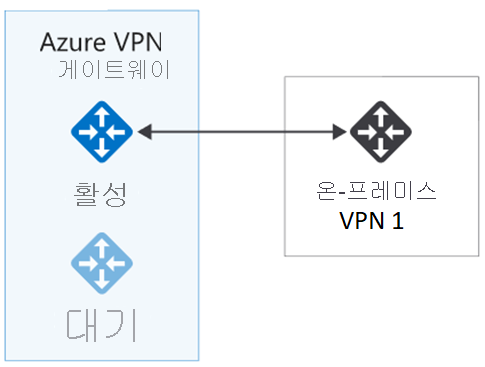

### **활성/활성**

이제 활성-활성 구성에서 Azure VPN Gateway를 만들 수 있습니다. 여기서 게이트웨이 VM의 두 인스턴스는 온-프레미스 VPN 디바이스에 S2S VPN 터널을 설정합니다.

이 구성에서 각 Azure 게이트웨이 인스턴스는 고유한 공용 IP 주소를 가지며 각 로컬 네트워크 게이트웨이 및 연결에 지정된 온-프레미스 VPN 디바이스에 IPsec/IKE S2S VPN 터널을 설정합니다. 두 VPN 터널은 실제로 동일한 연결의 일부입니다. 온-프레미스 VPN 디바이스를 구성하여 해당 Azure VPN Gateway 공용 IP 주소에 두 개의 S2S VPN 터널을 허용하거나 설정해야 합니다.

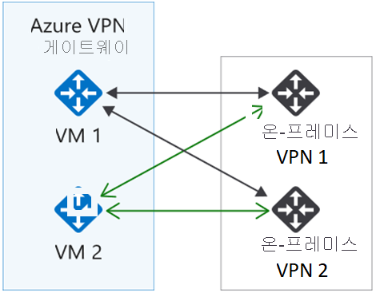

# 7) **ExpressRoute 및 Virtual WAN 구성**

## **ExpressRoute 사용 확인**

Azure ExpressRoute를 사용하면 온-프레미스 네트워크를 Microsoft 클라우드로 확장할 수 있습니다. 연결 공급자가 연결을 용이하게 합니다. ExpressRoute를 사용하면 Microsoft Azure, Microsoft 365, CRM Online과 같은 Microsoft 클라우드 서비스에 대한 연결을 설정할 수 있습니다.

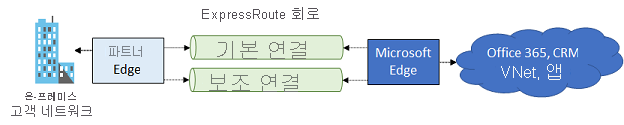

### **빠르고 안정적이며 프라이빗 방식으로 연결**

Azure 데이터 센터와 온-프레미스 또는 공동 배치 환경의 인프라 간 프라이빗 연결을 만들 수 있습니다. ExpressRoute 연결은 공용 인터넷을 통해 연결되지 않으며 일반적인 인터넷 연결보다 안정적이고 속도가 빠르며 대기 시간이 짧습니다.

### **스토리지, 백업 및 복구에 가상 프라이빗 클라우드 사용**

최대 100Gbps의 대역폭으로 Azure에 빠르고 안정적으로 연결할 수 있습니다. 연결 속도가 빠르면 주기적인 데이터 마이그레이션, 비즈니스 연속성을 위한 복제 및 재해 복구와 같은 시나리오에 매우 적합합니다.

### **데이터 센터 확장 및 연결**

기존 데이터 센터에 컴퓨팅 및 스토리지 용량을 연결하고 추가합니다. Azure는 처리량이 높고 대기 시간이 짧아 마치 데이터 센터로의 또는 데이터 센터 간의 자연스러운 확장과 비슷하므로 네트워크 성능 저하 없이 퍼블릭 클라우드의 규모와 경제성을 누릴 수 있습니다.

### **하이브리드 애플리케이션 빌드**

개인 정보 또는 성능을 손상시키지 않고 온-프레미스 인프라 및 Azure에 걸쳐 있는 애플리케이션을 빌드합니다. 예를 들어, Azure에서 온-프레미스 Active Directory 서비스를 통해 고객을 인증하는 회사 인트라넷 애플리케이션을 실행합니다. 퍼블릭 인터넷을 통해 트래픽을 라우팅하지 않고 모든 회사 고객에게 서비스를 제공합니다.

## **ExpressRoute 기능 확인**

### **계층 3 연결**

Microsoft에서는 BGP를 사용하여 온-프레미스 네트워크, Azure의 인스턴스 및 Microsoft 공용 주소 간에 경로를 교환합니다. 다양한 트래픽 프로필에 대해 여러 BGP 세션이 만들어집니다.

### **중복**

각 ExpressRoute 회로는 연결 공급자/네트워크 Edge에서 두 가지 Microsoft Enterprise Edge 라우터(MSEE)에 두 개의 연결로 구성됩니다. Microsoft는 MSEE 각각에 하나의 연결 공급자/네트워크 에지 쪽에서 이중 BGP 연결을 요구합니다.

### **Microsoft 클라우드 서비스에 연결**

ExpressRoute 연결을 사용하면 Microsoft Azure 서비스, Microsoft 365 서비스 및 Microsoft Dynamics 365에 액세스할 수 있습니다. Microsoft 365는 인터넷을 통해 안전하고 안정적으로 액세스하도록 만들어졌으므로 ExpressRoute를 사용하려면 Microsoft 권한 부여가 필요합니다.

### **모든 지정학적 지역에 연결**

피어링 위치 중 하나에서 Microsoft에 연결할 수 있고 지정학적 지역 내 지역에 액세스합니다. 예를 들어 ExpressRoute를 통해 암스테르담의 Microsoft에 연결하는 경우 북유럽 및 서유럽에서 호스팅되는 모든 Microsoft Cloud Services에 액세스합니다.

### **ExpressRoute 프리미엄 추가 기능으로 전역 연결**

ExpressRoute 프리미엄 추가 기능을 사용하여 지정학적 경계를 넘어 연결을 확장합니다. 예를 들어, ExpressRoute를 통해 암스테르담의 Microsoft에 연결하는 경우 국내용 클라우드를 제외하고 전 세계 모든 지역에서 호스팅되는 모든 Microsoft 클라우드 서비스에 액세스할 수 있습니다.

### **ExpressRoute Global Reach를 사용한 온-프레미스 간 연결**

ExpressRoute Global Reach를 사용해 ExpressRoute 회로를 연결하면 온-프레미스 사이트 전체에서 데이터를 교환합니다. 예를 들어 캘리포니아의 프라이빗 데이터 센터는 실리콘 밸리의 ExpressRoute에 연결되어 있고 텍사스의 프라이빗 데이터 센터는 댈러스의 ExpressRoute에 연결되어 있는 경우 ExpressRoute Global Reach를 사용하면 ExpressRoute 회로 2개를 통해 두 프라이빗 데이터 센터를 연결할 수 있습니다. 데이터 센터 간 트래픽은 Microsoft 네트워크를 통해 전송됩니다.

### **대역폭 옵션**

광범위한 대역폭을 위해 ExpressRoute 회로를 구매합니다. 연결 공급자와 확인하여 지원하는 대역폭을 확인합니다.

### **유연한 청구 모델**

사용자에게 적합한 청구 모델을 선택합니다. 몇 가지 [가격 책정 옵션](https://azure.microsoft.com/pricing/details/expressroute/)을 사용할 수 있습니다.

## **사이트 간 및 ExpressRoute 함께 사용**

ExpressRoute는 공용 인터넷을 사용하지 않는 WAN에서 Azure를 비롯한 Microsoft 서비스에 대한 프라이빗 직접 연결입니다. 사이트 간 VPN 트래픽은 공용 인터넷을 통해 암호화되어 이동합니다. 동일한 가상 네트워크에 대한 사이트 간 VPN 및 ExpressRoute 연결을 구성할 수 있으면 여러 장점이 있습니다.

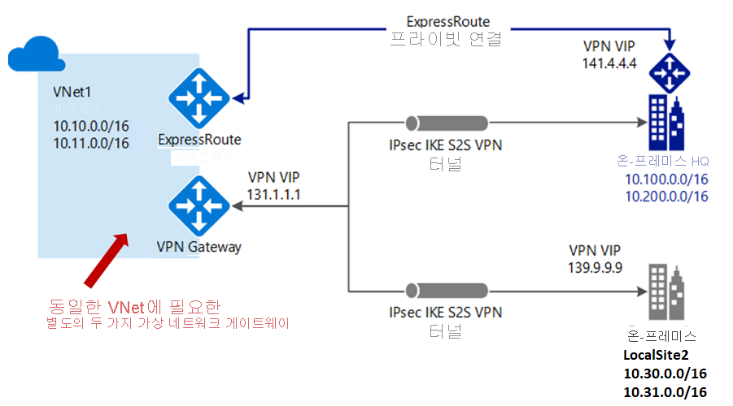

## **사이트 간 연결 옵션 비교**

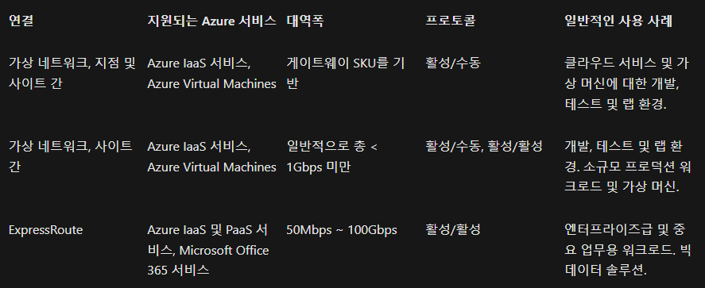

## **Virtual WAN 사용 확인**

Azure Virtual WAN은 Azure를 통해 최적화된 자동 분기 연결을 제공하는 네트워킹 서비스입니다. Azure 지역은 분기를 연결하도록 선택할 수 있는 허브 역할을 합니다. Azure 백본을 사용하여 분기를 연결하고 분기-VNet 연결을 사용합니다. Azure Virtual WAN VPN을 사용하여 연결 자동화를 지원하는 파트너 목록이 있습니다.

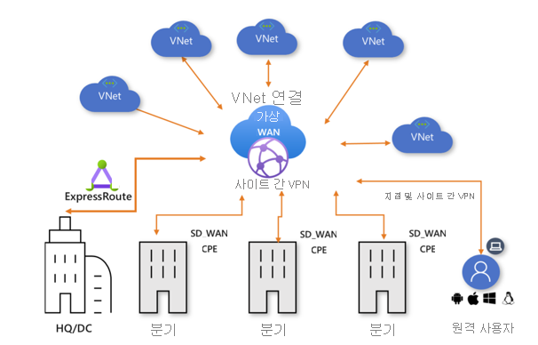

- **허브 및 스포크에서 통합된 연결 솔루션**. 온-프레미스 사이트와 Azure Hub 간의 사이트 간 구성과 연결을 자동화합니다.
- **자동화된 스포크 설정 및 구성**. 가상 네트워크와 워크로드를 Azure 허브에 원활하게 연결합니다.
- **직관적인 문제 해결**. Azure 내에서 엔드투엔드 흐름을 확인한 다음, 이 정보를 사용하여 필요한 작업을 수행할 수 있습니다.

# 8) **네트워크 라우팅 및 엔드포인트 구성**

## **사용자 정의 경로 식별**

Azure는 모든 네트워크 트래픽 라우팅을 자동으로 처리합니다. 그러나 다른 작업을 수행하려면 어떻게 해야 합니까? 예를 들어 라우팅, 방화벽 또는 WAN 최적화와 같은 네트워크 기능을 수행하는 VM이 있을 수 있습니다.

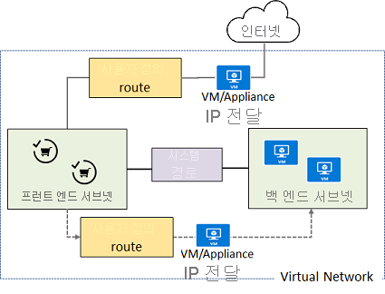

이런 경우 UDR(사용자 정의 경로)을 구성할 수 있습니다. UDR은 트래픽 흐름의 다음 홉을 지정하는 경로를 정의하여 네트워크 트래픽을 제어합니다. 홉은 가상 네트워크 게이트웨이, 가상 네트워크, 인터넷 또는 가상 어플라이언스일 수 있습니다.

## **서비스 엔드포인트 사용 확인**

가상 네트워크 서비스 엔드포인트는 Azure 서비스에 가상 네트워크의 ID를 제공합니다. 서비스 엔드포인트를 가상 네트워크에 사용할 수 있게 되면 리소스에 가상 네트워크 규칙을 추가하여 가상 네트워크에 대한 Azure 서비스 리소스를 보호할 수 있습니다.

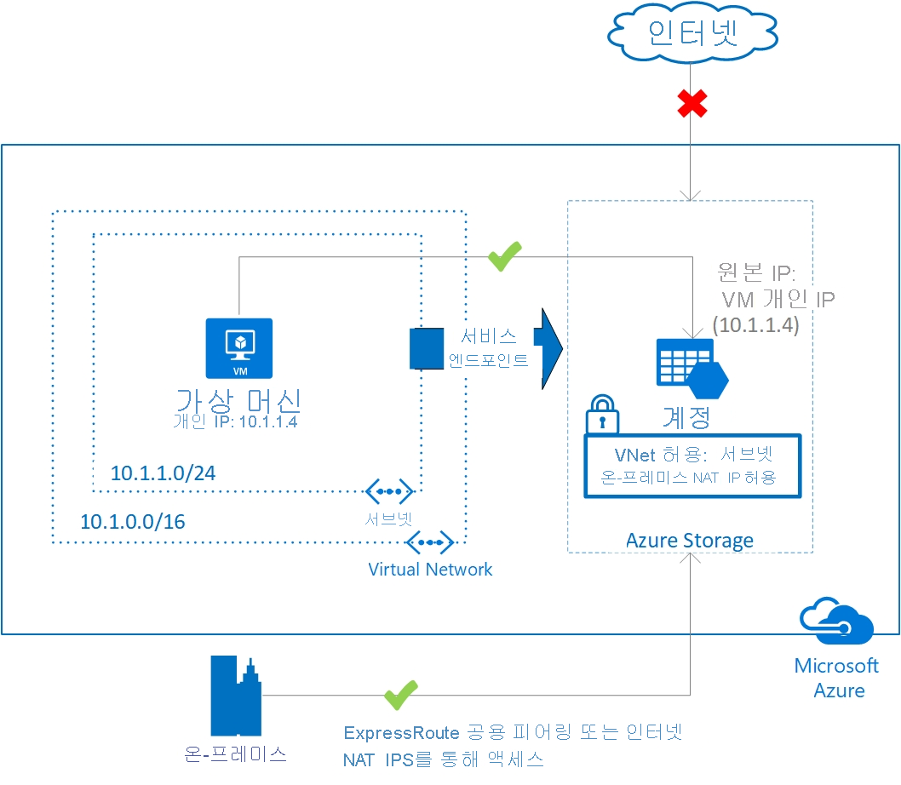

- **Azure 서비스 리소스의 보안 향상**. VNet 프라이빗 주소 공간은 겹칠 수 있으므로 VNet에서 발생한 트래픽을 고유하게 식별하는 데 사용할 수 없습니다. 서비스 엔드포인트는 VNet ID를 서비스로 확장하여 Azure 서비스 리소스를 가상 네트워크에 안전하게 연결합니다. 가상 네트워크에서 서비스 엔드포인트를 사용하도록 설정하면 가상 네트워크 규칙을 추가하여 Azure 서비스 리소스를 가상 네트워크에 안전하게 연결합니다. 규칙은 리소스에 대한 퍼블릭 인터넷 액세스를 완전히 제거하고 가상 네트워크의 트래픽만 허용하여 보안을 향상합니다.
- **가상 네트워크의 Azure 서비스 트래픽에 대한 최적의 라우팅**. 현재 온-프레미스 및/또는 가상 어플라이언스를 통해 인터넷 트래픽을 강제하는 가상 네트워크의 경로(강제 터널링이라고 함)는 Azure 서비스 트래픽이 인터넷 트래픽과 동일한 경로를 사용하도록 강제할 수도 있습니다. 서비스 엔드포인트는 Azure 트래픽에 대한 최적의 라우팅을 제공합니다.
- **엔드포인트는 가상 네트워크의 서비스 트래픽을 직접 Microsoft Azure 백본 네트워크의 서비스로 항상 이동시킵니다**. 트래픽을 Azure 백본 네트워크에 유지하면 서비스 트래픽에 영향을 주지 않고 강제 터널링을 통해 가상 네트워크의 아웃바운드 인터넷 트래픽을 계속 감사하고 모니터링할 수 있습니다. 사용자 정의 경로 및 강제 터널링에 대해 알아봅니다.
- **관리 오버헤드를 줄이고 간단히 설정합니다**. IP 방화벽을 통해 Azure 리소스를 보호하기 위해 가상 네트워크에서 예약된 공용 IP 주소가 더 이상 필요하지 않습니다. 서비스 엔드포인트를 설정하는 데 NAT 또는 게이트웨이 디바이스가 필요하지 않습니다. 서비스 엔드포인트는 서브넷을 통해 구성됩니다. 엔드포인트를 유지하기 위한 추가 오버헤드가 없습니다.

## **프라이빗 링크 사용 식별**

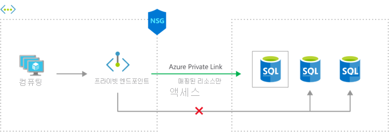

Azure Private Link는 가상 네트워크에서 Azure PaaS(Platform as a Service), 고객 소유 또는 Microsoft 파트너 서비스에 대한 프라이빗 연결을 제공합니다. 네트워크 아키텍처를 간소화하고 퍼블릭 인터넷에 대한 데이터 노출을 예방하여 Azure에서 엔드포인트 간 연결을 보호합니다.

- **Azure의 서비스에 대한 프라이빗 연결**. 트래픽은 퍼블릭 인터넷 액세스 없이 Microsoft 네트워크에 남습니다. 다른 Azure 지역에서 실행되는 서비스에 비공개로 연결할 수 있습니다. Private Link는 전역이며 지역 제한이 없습니다.
- **온-프레미스 및 피어링된 네트워크와 통합**. 온-프레미스 또는 피어링된 가상 네트워크에서 개인 피어링 또는 VPN 터널을 통해 프라이빗 엔드포인트에 액세스합니다. Microsoft가 트래픽을 호스트하므로, 퍼블릭 피어링을 설정하거나 인터넷을 사용하여 워크로드를 클라우드로 마이그레이션할 필요가 없습니다.
- **Azure 리소스에 대한 데이터 반출 방지**. Private Link를 사용하여 프라이빗 엔드포인트를 Azure PaaS 리소스에 매핑합니다. 네트워크 내에 보안 인시던트 있는 경우 매핑된 리소스에만 액세스할 수 있어 데이터 반출 위협이 제거됩니다.
- **고객의 가상 네트워크에 직접 전달되는 서비스**. Azure의 가상 네트워크에서 Azure PaaS, Microsoft 파트너 및 고유한 서비스를 비공개로 사용합니다. Private Link는 Azure AD(Azure Active Directory) 테넌트에서 작동하여 서비스 간 환경을 통합하는 데 도움을 줍니다. 권한 또는 역할 기반 액세스 제어 없이 요청을 직접 보내거나 승인하거나 거부합니다.

# 9) **Azure Load Balancer 구성**

## **Azure Load Balancer 사용 확인**

Azure Load Balancer는 애플리케이션에 고가용성 및 네트워크 성능을 제공합니다. 부하 분산 장치는 부하 분산 규칙 및 상태 프로브를 사용하여 백 엔드 리소스에 인바운드 트래픽을 분산합니다.

- 부하 분산 규칙은 트래픽이 백 엔드에 분산되는 방법을 결정합니다.
- 상태 프로브는 백 엔드의 리소스가 정상인지 확인합니다.

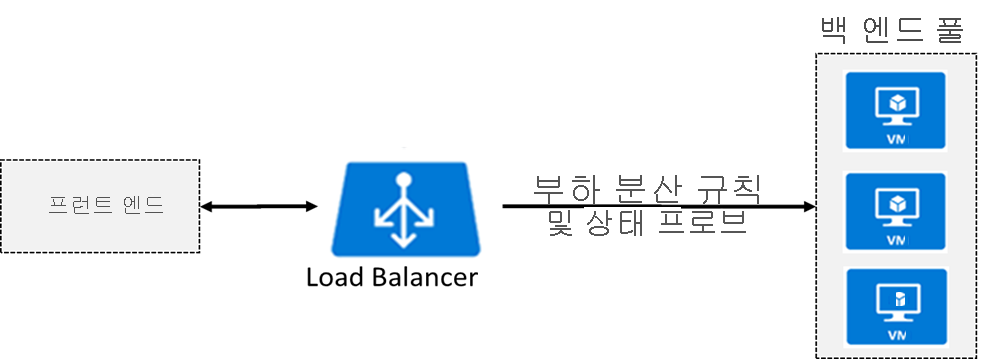

## **퍼블릭 부하 분산 장치 구현**

부하 분산 장치에는 **퍼블릭** 및 **내부**의 두 가지 유형이 있습니다.

공용 부하 분산 장치는 들어오는 트래픽의 공용 IP 주소와 포트 번호를 VM의 개인 IP 주소 및 포트 번호에 매핑합니다. VM의 응답 트래픽에 대한 매핑도 제공됩니다. 부하 분산 규칙을 적용하여 특정 유형의 트래픽을 여러 VM 또는 서비스에 배포할 수 있습니다.

이 다이어그램은 TCP 포트 80에서 웹앱의 공용 IP 주소에 웹 페이지 요청을 보내는 인터넷 클라이언트를 보여 줍니다. Azure Load Balancer는 부하 분산된 세트에 있는 3개 VM에 요청을 분산합니다.

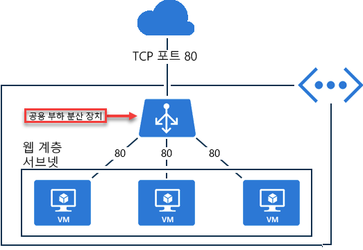

## **내부 부하 분산 장치 구현**

내부 부하 분산 장치는 가상 네트워크 내부에 있는 리소스 또는 VPN을 사용하여 Azure 인프라에 액세스하는 리소스로 트래픽을 보냅니다. 프런트 엔드 IP 주소와 가상 네트워크는 인터넷 엔드포인트에 직접 노출되지 않습니다.

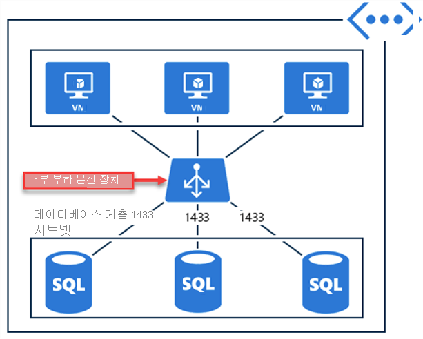

- **가상 네트워크 내**. 가상 네트워크의 VM에서 동일한 가상 네트워크 내에 있는 VM 세트로 부하 분산.
- **크로스-프레미스 가상 네트워크의 경우**. 온-프레미스 컴퓨터에서 동일한 가상 네트워크 내에 있는 VM 세트로 부하 분산.
- **다중 계층 애플리케이션의 경우**. 백 엔드 계층이 인터넷에 연결되어 있지 않은 인터넷 연결 다중 계층 애플리케이션의 부하 분산. 백 엔드 계층에는 인터넷 연결 계층의 트래픽 부하 분산이 필요합니다.
- **LOB(기간 업무) 애플리케이션의 경우**. 추가적인 부하 분산 장치 하드웨어 또는 소프트웨어 없이 Azure에서 호스트되는 LOB(기간 업무) 애플리케이션의 부하 분산. 이 시나리오는 트래픽 부하가 분산되는 컴퓨터 집합에 있는 온-프레미스 서버를 포함합니다.

## **부하 분산 장치 SKU 확인**

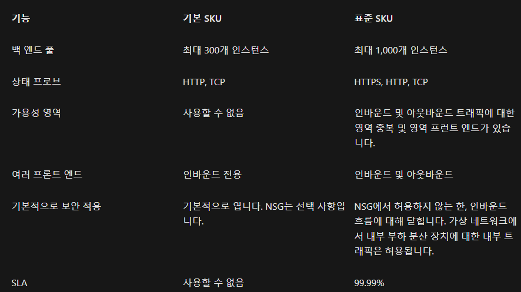

## **백 엔드 풀 만들기**

트래픽을 분산하기 위해 부하 분산 장치에 연결된 가상 NIC의 IP 주소가 백 엔드 주소 풀에 포함됩니다. 백 엔드 풀을 구성하는 방법은 표준 또는 기본 SKU 중 어떤 유형을 사용하는지에 따라 달라집니다.

백 엔드 풀은 백 엔드 풀 블레이드에서 구성됩니다. 표준 SKU의 경우 가용성 집합, 단일 가상 머신 또는 가상 머신 확장 집합에 연결할 수 있습니다.

## **세션 지속성 구성**

기본적으로 Azure Load Balancer는 네트워크 트래픽을 여러 VM 인스턴스에 고르게 분산시킵니다. 부하 분산 장치는 5 튜플(원본 IP, 원본 포트, 대상 IP, 대상 포트, 프로토콜 종류) 해시를 사용하여 트래픽을 사용 가능한 서버에 매핑합니다. 전송 세션 내에서만 연결이 유지됩니다.

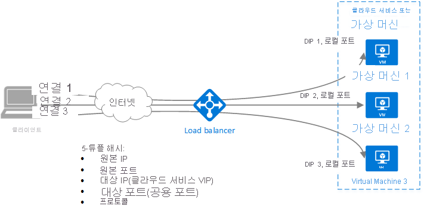

세션 지속성은 클라이언트의 트래픽을 처리하는 방법을 지정합니다. 기본 동작(없음)은 모든 가상 머신에서 클라이언트의 후속 요청을 처리할 수 있다는 것입니다. 이 동작은 변경할 수 있습니다.

- **없음(기본값)**은 모든 가상 머신이 요청을 처리할 수 있도록 지정합니다.
- **클라이언트 IP**를 지정하면 동일한 클라이언트 IP 주소의 후속 요청이 동일한 가상 머신에서 처리됩니다.
- **클라이언트 IP 및 프로토콜**은 동일한 클라이언트 IP 주소 및 프로토콜 조합의 연속적인 요청이 동일한 가상 머신에서 처리되도록 지정합니다.

## **상태 프로브 만들기**

상태 프로브는 부하 분산 장치가 앱의 상태를 모니터링할 수 있도록 합니다. 상태 프로브는 상태 검사에 따라 부하 분산 장치 순환에서 VM을 동적으로 추가하거나 제거합니다. 프로브가 응답하지 않으면 부하 분산 장치는 비정상 인스턴스에 새 연결의 전송을 중지합니다.

‎상태 프로브 **HTTP** 및 **TCP**를 구성하는 두 가지 주요 방법이 있습니다.

- **HTTP 사용자 지정 프로브**. 부하 분산 장치는 정기적으로 엔드포인트를 검색합니다(기본적으로 15초마다). 시간 제한 기간(기본값 31초) 내에 HTTP 200으로 응답하는 인스턴스는 정상 상태입니다. HTTP 200 이외의 모든 상태에서 이 프로브는 실패합니다.
- **TCP 사용자 지정 프로브**. 이 프로브를 사용하려면 정의된 프로브 포트에 대한 TCP 세션 설정이 성공적으로 수행되어야 합니다. VM에 지정된 수신기가 있기만 하면 프로브는 성공합니다. 연결이 거부되면 프로브는 실패합니다.

# 10) **Azure Application Gateway 구성**

## **Application Gateway 구현**

Application Gateway는 클라이언트 애플리케이션에서 웹앱에 보내는 요청을 관리합니다.

Application Gateway는 애플리케이션 계층 라우팅을 사용합니다. 애플리케이션 계층 라우팅은 요청의 URL에 따라 트래픽을 웹 서버 풀로 라우팅합니다. 백 엔드 풀은 Azure 가상 머신, Azure 가상 머신 확장 집합, Azure App Service 및 심지어 온-프레미스 서버를 포함할 수 있습니다.

Application Gateway는 라운드 로빈을 사용하여 각 백 엔드 풀의 서버에 부하 분산 요청을 보냅니다. Application Gateway는 세션 연결 유지를 제공합니다. 동일한 세션의 클라이언트 요청이 동일한 백 엔드 서버로 라우팅되도록 하려면 세션 유지 기능을 사용합니다.

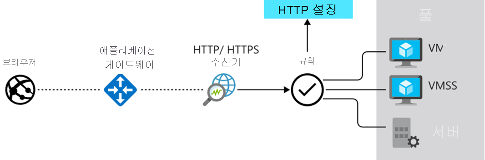

## **Application Gateway 라우팅 확인**

클라이언트는 웹앱에 대한 요청을 게이트웨이의 IP 주소 또는 DNS 이름으로 보냅니다. 게이트웨이는 게이트웨이에 대해 구성된 일단의 규칙을 사용하여 요청을 선택한 백 엔드 풀의 웹 서버로 라우팅하여 요청을 전달할 위치를 결정합니다.

### **경로 기반 라우팅**

경로 기반 라우팅은 서로 다른 백 엔드 서버 풀에 서로 다른 URL 경로를 사용하여 요청을 보냅니다. 예를 들어, /video/* 경로의 요청은 비디오 스트리밍을 처리하도록 최적화된 서버가 있는 백 엔드 풀로 전달하고, /images/* 경로의 요청은 이미지 검색을 처리하는 서버 풀로 전달할 수 있습니다.

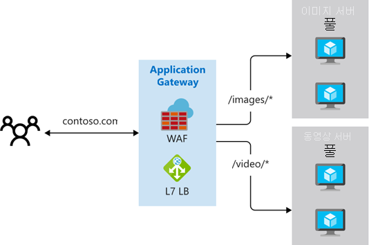

### **다중 사이트 라우팅**

다중 사이트 라우팅은 동일한 애플리케이션 게이트웨이 인스턴스에서 둘 이상의 웹 애플리케이션을 구성합니다. 다중 사이트 구성에서는 Application Gateway의 IP 주소에 여러 개의 DNS 이름(CNAME)을 등록하여 각 사이트의 이름을 지정합니다.

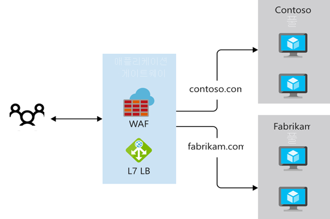

- **리디렉션**. 다른 사이트로 리디렉션하거나 HTTP에서 HTTPS로 리디렉션하는 데 사용할 수 있습니다.
- **HTTP 헤더 다시 쓰기**. HTTP 헤더를 통해 클라이언트와 서버는 요청 또는 응답을 사용하여 매개 변수 정보를 전달할 수 있습니다.
- **사용자 지정 오류 페이지**. Application Gateway를 사용하면 기본 오류 페이지를 표시하는 대신 사용자 지정 오류 페이지를 만들 수 있습니다. 사용자 지정 오류 페이지를 사용하여 사용자 고유의 브랜딩과 레이아웃을 사용할 수 있습니다.

## **Application Gateway 구성 요소 설정**

Application Gateway는 요청을 웹 서버 풀로 라우팅하고 이러한 웹 서버의 상태를 확인하기 위해 결합되는 일련의 구성 요소가 있습니다.

## **프런트 엔드 IP 주소**

클라이언트 요청은 프런트 엔드 IP 주소를 통해 받습니다. 공용 IP 주소, 사설 IP 주소 또는 둘 모두를 사용하도록 Application Gateway를 구성할 수 있습니다. Application Gateway는 둘 이상의 공용 IP 주소와 하나의 사설 IP주소를 가질 수 없습니다.

## **수신기**

Application Gateway는 하나 이상의 수신기를 사용하여 들어오는 요청을 받습니다. 수신기는 프로토콜, 포트, 호스트 및 IP 주소의 지정된 조합에 도착하는 트래픽을 허용합니다. 각 수신기는 지정한 라우팅 규칙에 따라 요청을 서버의 백 엔드 풀로 라우팅합니다. 수신기는 기본 또는 다중 사이트일 수 있습니다. 기본 수신기는 URL의 경로에 따라 요청을 라우팅합니다. 다중 사이트 수신기는 URL의 호스트 이름 요소를 사용하여 요청을 라우팅할 수도 있습니다.

또한 수신기는 사용자와 Application Gateway 간에 애플리케이션을 보호하기 위한 TLS/SSL 인증서를 처리합니다.

## **라우팅 규칙**

라우팅 규칙은 수신기를 백 엔드 풀에 바인딩합니다. 규칙은 요청의 URL에서 호스트 이름 및 경로 요소를 해석하고 해당 요청을 적절한 백 엔드 풀로 보내는 방법을 지정합니다. 라우팅 규칙에는 연결된 HTTP 설정 세트도 있습니다. 이러한 HTTP 설정은 Application Gateway와 백 엔드 서버 간의 트래픽 암호화 여부를 나타냅니다. 다른 구성 정보에는 프로토콜, 세션 연결 유지, 연결 드레이닝, 요청 시간 초과 기간 및 상태 프로브가 포함됩니다.

## **백 엔드 풀**

백 엔드 풀은 웹 서버의 컬렉션을 참조합니다. 풀을 구성할 때 각 웹 서버의 IP 주소와 요청을 수신 대기하는 포트를 제공합니다. 각 풀에서는 고정된 가상 머신 집합, 가상 머신 확장 집합, Azure App Services에서 호스팅하는 앱 또는 온-프레미스 서버 컬렉션을 지정할 수 있습니다. 각 백 엔드 풀에는 작업을 풀 전체에 분산시키는 연결된 부하 분산 장치가 있습니다.

## **웹 애플리케이션 방화벽**

WAF(웹 애플리케이션 방화벽)는 들어오는 요청이 수신기에 도달하기 전에 이를 처리하는 선택적 구성 요소입니다. 웹 애플리케이션 방화벽은 각 요청에 OWASP(Open Web Application Security Project)에서 발표한 다양한 일반적인 위협이 있는지 확인합니다.

## **상태 프로브**

상태 프로브는 백 엔드 풀에서 부하 분산에 사용할 수 있는 서버를 결정합니다. Application Gateway는 상태 프로브를 사용하여 요청을 서버에 보냅니다. 서버에서 200~399 상태 코드의 HTTP 응답을 반환하는 경우 해당 서버가 정상적인 상태로 간주됩니다.

상태 프로브를 구성하지 않으면 Application Gateway에서 서버를 사용할 수 없다고 결정할 때까지 30초 동안 기다리는 기본 프로브를 만듭니다.

# 11) **Azure 배포에 대한 IP 주소 지정 스키마 디자인**

## **네트워크 IP 주소 지정 및 통합**

### **온-프레미스 IP 주소 지정**

- 라우터
- 방화벽
- 스위치
- 네트워크 구분

경계 네트워크와 내부 영역에는 프라이빗 IP 주소가 할당됩니다. 경계 네트워크 및 내부 영역에서 이러한 디바이스에 할당된 IP 주소는 인터넷을 통해 액세스할 수 없습니다. 관리자가 IP 주소 할당, 이름 확인, 보안 설정 및 보안 규칙을 완전히 제어합니다. 인터넷 라우터를 통해 전송되지 않는 내부 네트워크용으로 디자인된 라우팅할 수 없는 IP 주소에는 세 가지 범위가 있습니다.

- 10.0.0.0~10.255.255.255
- 172.16.0.0~172.31.255.255
- 192.168.0.1~192.168.255.255

관리자는 네트워크 디바이스 및 서비스를 수용하도록 온-프레미스 서브넷을 추가하거나 제거할 수 있습니다. 온-프레미스 네트워크에서 사용할 수 있는 서브넷 및 IP 주소 수는 IP 주소 블록에 대한 CIDR(클래스 없는 도메인 간 라우팅)에 따라 달라집니다.

### **Azure IP 주소 지정**

Azure 가상 네트워크는 개인 IP 주소를 사용합니다. 프라이빗 IP 주소의 범위는 온-프레미스 IP 주소 지정의 경우와 같습니다. 온-프레미스 네트워크의 경우처럼 관리자가 Azure 가상 네트워크에서 IP 주소 할당, 이름 확인, 보안 설정 및 보안 규칙을 완전히 제어합니다. 관리자는 IP 주소 블록의 CIDR에 따라 서브넷을 추가하거나 제거할 수 있습니다.

일반적인 Azure 네트워크 디자인에는 일반적으로 다음과 같은 구성 요소가 있습니다.

- 가상 네트워크
- 서브넷
- 네트워크 보안 그룹
- 방화벽
- 부하 분산 장치

**Azure 가상 네트워크의 기본 속성**

기본적으로 Azure 가상 네트워크의 모든 서브넷은 서로 통신할 수 있습니다. 그러나 네트워크 보안 그룹을 사용하여 서브넷 간의 통신을 거부할 수 있습니다. 지원되는 가장 작은 서브넷은 /29 서브넷 마스크를 사용합니다. 지원되는 가장 큰 서브넷은 /2 서브넷 마스크를 사용합니다.

### **온-프레미스 네트워크와 Azure 통합**

온-프레미스 네트워크와 Azure의 통합을 시작하기 전에 온-프레미스 네트워크에서 사용되는 현재 프라이빗 IP 주소 체계를 파악하는 것이 중요합니다. 상호 연결된 네트워크의 IP 주소는 겹칠 수 없습니다.

IP 주소 체계를 계획할 때 겹치는지 확인하는 것이 중요합니다. IP 주소가 겹치는 경우 온-프레미스 네트워크를 Azure 네트워크와 통합할 수 없습니다.

## **Azure에서 공용 및 개인 IP 주소 지정**

### **공용 IP 주소**

공용 서비스에 공용 IP 주소를 사용합니다. 퍼블릭 주소는 정적 이거나 동적일 수 있습니다. 공용 IP 주소는 VM, 인터넷 연결 부하 분산 장치, VPN Gateway 또는 Application Gateway에 할당할 수 있습니다.

- **동적 공용 IP 주소**는 Azure 리소스의 수명 동안 변경될 수 있는 할당된 주소입니다. VM을 만들거나 시작할 때 동적 IP 주소가 할당됩니다. VM을 중지하거나 삭제하면 IP 주소가 해제됩니다. 각 Azure 지역에서 공용 IP 주소는 고유한 주소 풀에서 할당됩니다. 기본 할당 방법은 동적입니다.
- **정적 공용 IP 주소**는 Azure 리소스의 수명 동안 변경되지 않는 할당된 주소입니다. 리소스의 IP 주소를 동일하게 유지하려면 정적 할당 방법을 설정하면 됩니다. 이 경우 IP 주소가 즉시 할당되고 리소스를 삭제하거나 IP 할당 방법을 동적으로 변경할 때만 할당이 해제됩니다.

— 실습

[연습 - Azure 가상 네트워크의 IP 주소 지정 디자인 및 구현 - Learn](https://docs.microsoft.com/ko-kr/learn/modules/design-ip-addressing-for-azure/5-exercise-implement-vnets)

[연습문제](02_연습문제.md)