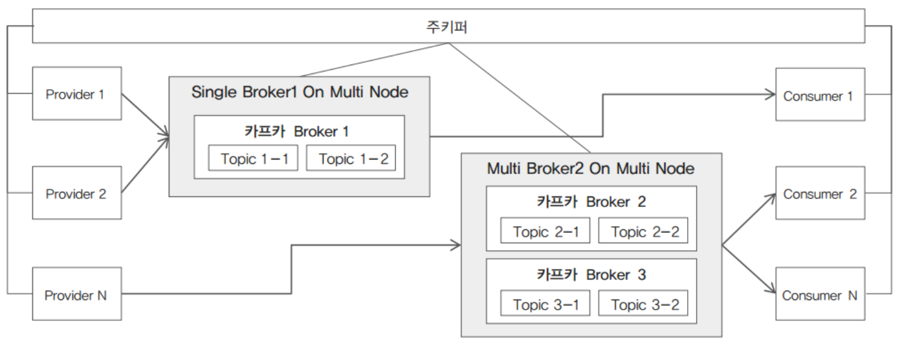

# Apache Kafka




# 설치

[https://twofootdog.tistory.com/90](https://twofootdog.tistory.com/90)

Zookeeper 사전설치 되어있어야 함 ([https://www.notion.so/Apache-Zookeeper-cf7b6a6e84f9476f9717d7dd738d878d?pvs=4](https://www.notion.so/Apache-Zookeeper-cf7b6a6e84f9476f9717d7dd738d878d?pvs=4))

```bash
wget https://downloads.apache.org/kafka/3.5.1/kafka_2.13-3.5.1.tgz
sudo tar xvzf kafka_2.13-3.5.1.tgz -C /usr/local
sudo chown -R hadoop:hadoop /usr/local/kafka_2.13-3.5.1
sudo ln -s /usr/local/kafka_2.13-3.5.1 /usr/local/kafka
```

카프카는 일반 메시지 큐 서비스들과 달리 컨슈머가 메시지를 가져가더라도 저장된 데이터를 임시로 보관하는 기능이 있으며, 하나 혹은 여러 디렉토리를 구성하여 보관 가능하다(디스크가 여러개인 서버의 경우는 디스크 수만큼 디렉토리를 만들어주면 디스크별로 I/O 분산이 가능하다)

```bash
cd /data
mkdir kafka_store_01
mkdir kafka_store_02
```

환경설정

```bash
cd /usr/local/kafka/config
# server.properties
broker.id= 1/2/3 # 서버별로 할당
log.dirs=/data/kafka_store_01,/data/kafka_store_02
# 서버별로 znode 별도 할당 server01_znode / server02_znode / server03_znode
zookeeper.connect=server01:2181,server02:2181,server03:2181/server01_znode
#node1, node2, node3 개별로...
advertised.listeners = PLAINTEXT://node1:9092

```

kafka 실행

```bash
cd /usr/local/kafka/bin
./kafka-server-start.sh -daemon /usr/local/kafka/config/server.properties
```

systemd 등록

```bash
sudo vi /etc/systemd/system/kafka-server.service

#kafka-server.service
[Unit]
Description=kafka-server
After=network.target

[Service]
Type=simple
User=root
Group=root
SyslogIdentifier=kafka-server
WorkingDirectory=/usr/local/kafka
Restart=no
RestartSec=0s
ExecStart=/usr/local/kafka/bin/kafka-server-start.sh /usr/local/kafka/config/server.properties
ExecStop=/usr/local/kafka/bin/kafka-server-stop.sh
```

```bash
systemctl daemon-reload
systemctl start kafka-server.service
```

## Topic 생성

```python
kafka-topics.sh --create --topic SmartCar-Topic --bootstrap-server localhost:9092
```

### Producer Command

```bash
./kafka-console-producer.sh --topic quickstart-events --bootstrap-server localhost:9092
```

### Consumer Command

```bash
./kafka-console-consumer.sh --topic quickstart-events --from-beginning --bootstrap-server localhost:9092
```