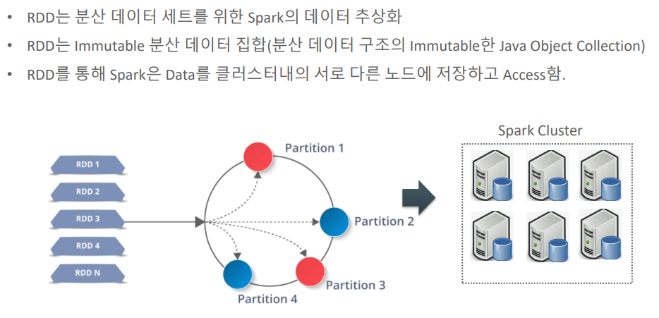
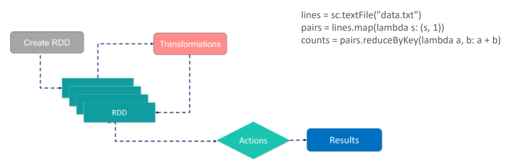
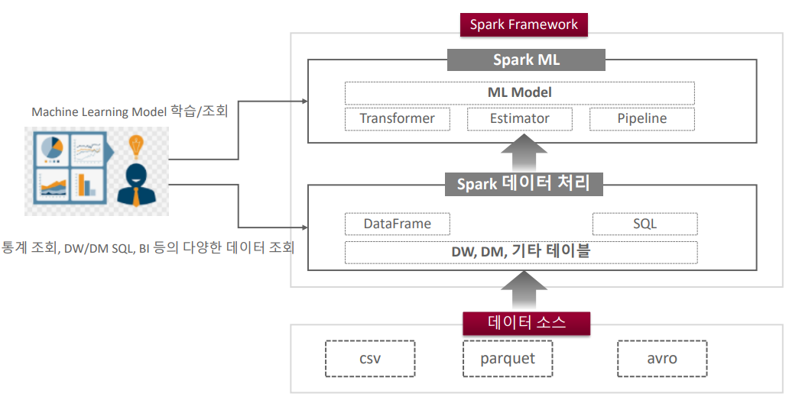

# 정형화 API

# RDD (Resilient Distributed Dataset)





### Spark MLlib



### 스키마(Schema)

데이터 프레임을 위해 컬럼이름과 연관된 데이터 타입을 정의한 것으로 외부 데이터 소스에서 구조화된 데이터를 읽어 들일 때 쓰이게 됨

- 스파크가 데이터 타입을 추측해야 하는 책임을 덜어줌
- 스파크가 스키마를 확정하기 위해 많은 부분을 읽이려고 별도의 잡을 만드는 것을 방지
- 데이터가 스키마와 맞지않을경우 조기에 문제를 발견

스키마를 정의하는 방법은 프로그래밍 스타일과 DDL을 사용하는 방식 두가지가 존재

```python
from pyspark.sql.types import *
schema = Structtype([
	StructField("author", StringType(), False),
	StructField("title", StringType(), False),
	StructField("pages", IntegerType(), False),
])

#DDL방식
schema="author String, title String, pages INT"
```