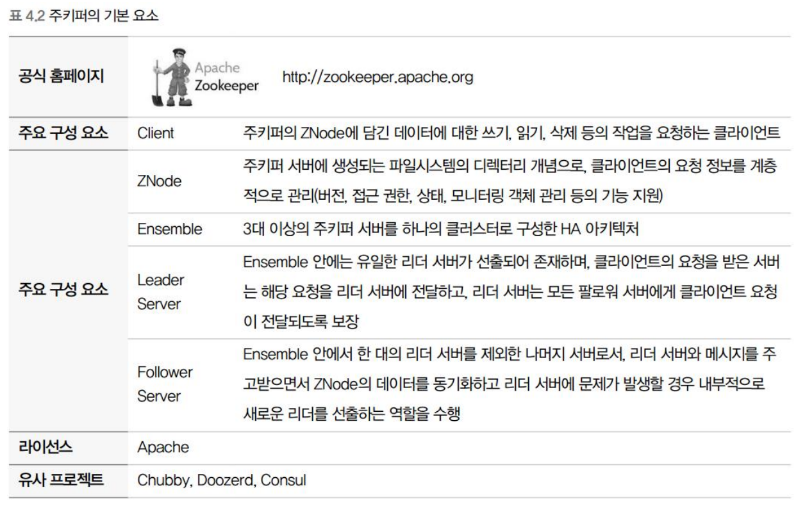
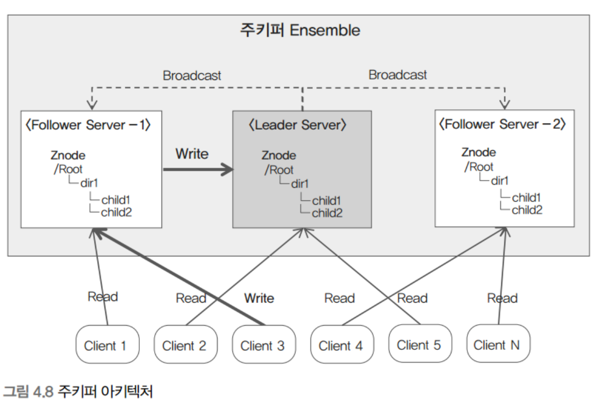

# Apache Zookeeper

카프카와 같은 분산 애플리케이션을 사용하게 되면, 분산 애플리케이션 관리를 위한 코디네이션 애플리케이션이 추가로 필요, 안정적인 코디네이션 서비스로 검증된 주키퍼(ZooKeeper)를 많이 사용

분산 애플리케이션이 안정적인 서비스를 할 수 있도록 분산되어 있는 각 애플리케이션의 정보를 중앙에 집중하고 구성관리, 그룹관리 네이밍, 동기화 등의 서비스를 제공





# 구성요소

## **앙상블**

주키퍼는 서버 여러대를 앙상블(클러스터)로 구성한다. 주키퍼 앙상블로 구성되면, 해당 앙상블 안에 있는 서버(노드) 수가 과반수 이상이 유지될 때 지속적인 서비스가 가능하며, 그렇지 않으면 장애가 발생한다(그렇기 때문에 주키퍼 서버는 홀수대로 구성한다).

## 지노드

주키퍼 내에 분산 애플리케이션 상태정보가 저장되는 곳. 분산 애플리케이션들은 각각 클라이언트가 되어 주키퍼 서버들과 연결을 맺은 후 상태 정보를 주고받게 된다. 상태정보는 주키퍼의 지노드(znode)에 Key-Value 형태로 저장되며, 지노드에 저장된 것을 이용하여 분산 애플리케이션들은 서로 데이터를 주고받게 된다. 지노드에 저장되는 데이터 크기는 바이트~킬로바이트 정도이며, 자식노드를 가지고 있는 계층형 구조로 구성되어 있다. 각 지노드는 데이터 변경 등에 대한 유효성 검사 등을 위해 버전 번호를 관리하며, 지노드 데이터가 변경될 때마다 버전 번호가 증가한다. 또한 주키퍼에 저장되는 데이터는 모두 메모리에 저장되어 처리량이 매우 크고 빠르다.

# 설치

[리눅스에 주키퍼(zookeeper) 설치하기 (tistory.com)](https://twofootdog.tistory.com/89)

클러스터 구성을 위해서는 과반수 이상의 서버가 정상일 경우에만 지속적인 서비스가 가능 → 최소 3대 (홀수)

```bash
wget https://dlcdn.apache.org/zookeeper/zookeeper-3.8.2/apache-zookeeper-3.8.2-bin.tar.gz
sudo tar xvzf apache-zookeeper-3.8.2-bin.tar.gz -C /usr/local
sudo ln -s /usr/local/apache-zookeeper-3.8.2-bin /usr/local/zookeeper
```

지노드의 복사본인 스냅샷과 트랜잭션 로그들이 저장될 별도의 디렉토리 생성

앙상블 내 주키퍼 노드들 구분을 위한 정수형태 ID를 만들어야 함 (1,2,3)

```bash
mkdir /data/zk
echo 1 > /data/zk/myid
```

```bash
sudo cp /usr/local/zookeeper/conf/zoo_sample.cfg /usr/local/zookeeper/conf/zoo.cfg
#zoo.cfg
dataDir=/data/zk
server.1=master1.mshome.net:2888:3888
server.2=worker1.mshome.net:2888:3888
server.3=worker2.mshome.net:2888:3888
```

주키퍼 실행/중

```bash
/usr/local/zookeeper/bin/zkServer.sh start # 시작
/usr/local/zookeeper/bin/zkServer.sh stop # 중지
/usr/local/zookeeper/bin/zkServer.sh restart
/usr/local/zookeeper/bin/zkServer.sh status
```

### 방화벽 정책 적용

주키퍼 클라이언트 포트인 2181, 그리고 앙상블끼리 연결 & 리더 선출에 사용하는 2888, 3888 포트도 방화벽 을 오픈 (인바운드 정책)

### systemd 관리

**/etc/systemd/system/zookeeper-server.service**

```bash
[Unit]
Description=zookeeper-server
After=network.target

[Service]
Type=forking
User=root
Group=root
SyslogIdentifier=zookeeper-server
WorkingDirectory=/usr/local/zookeeper
Restart=always
RestartSec=0s
ExecStart=/usr/local/zookeeper/bin/zkServer.sh start
ExecStop=/usr/local/zookeeper/bin/zkServer.sh stop
```

systemd 재시작

```bash
systemctl daemon-reload
systemctl start zookeeper-server
```