# Bigdata 개요

# 빅데이터의 이해와 도입

빅데이터 시스템의 도입목적이 명확하여야 함

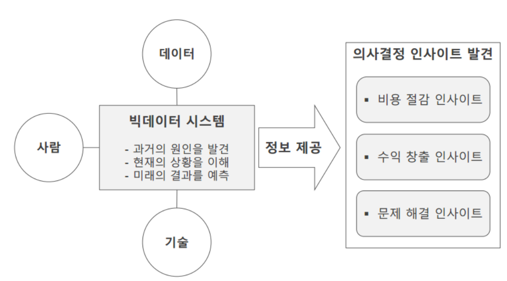

빅데이터 인사이트의 이해

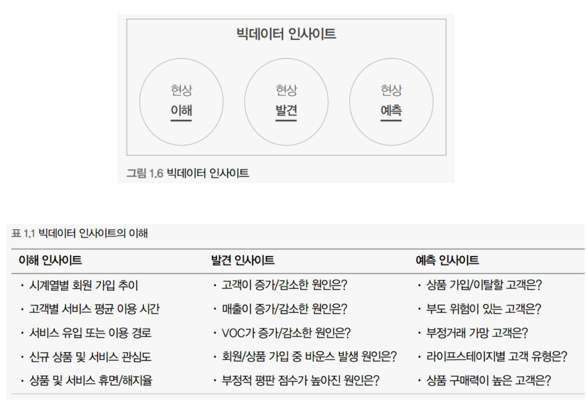

## 빅데이터의 활용

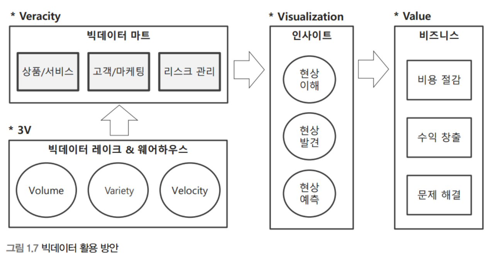

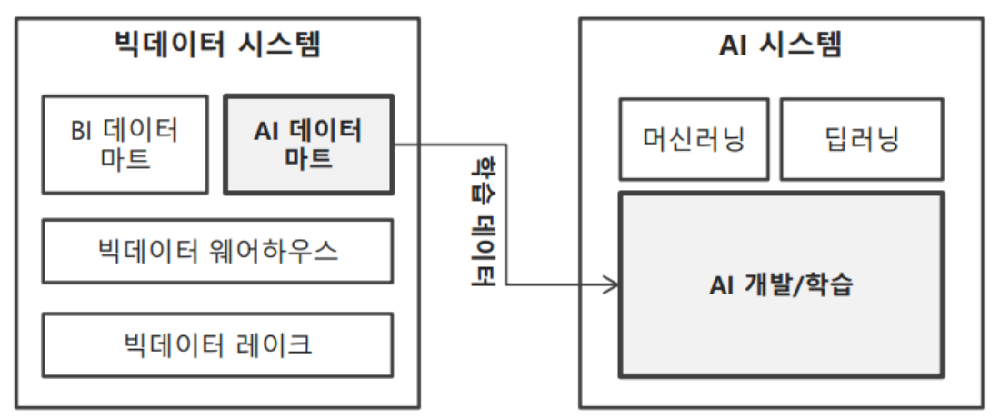

빅데이터 프로젝트의 유형

- 플랫폼 구축형 프로젝트
    - 전형적인 빅데이터 SI구축형 사업
    - H/W와 S/W를 설치 및 구성
    - 3~6개월 정도로 추진
    - 수집 → 적재 → 처리 → 탐색 → 분석의 기능을 구
- 빅데이터 분석 프로젝트
    - 플랫폼이 구축 완료 후 수행
    - 빅데이터 탐색으로 데이터의 이해가 높아질때 시작
    - 조직의 가치사슬 중, 대규모 분석이 필요한 시점에 추진
    - 1~3개월 일정으로 추진
    - 분석주제영역 : 마케팅/고객, 상품/서비스 개발, 리스크 관리
    - 비즈니스 전문가, 데이터분석가, 데이터 엔지니어링 역할이 필요함
- 빅데이터 운영 프로젝트
    - 구축 완료된 플랫폼을 중장기적으로 유지관리
    - 대규모 HW,SW로 운영비용이 높음
    - 분야별 전문가 그룹이 확보되어야 함
    - 빅데이터 거버넌스 체계를 수립해야 함 (중요!)

## 빅데이터 기술의 변화

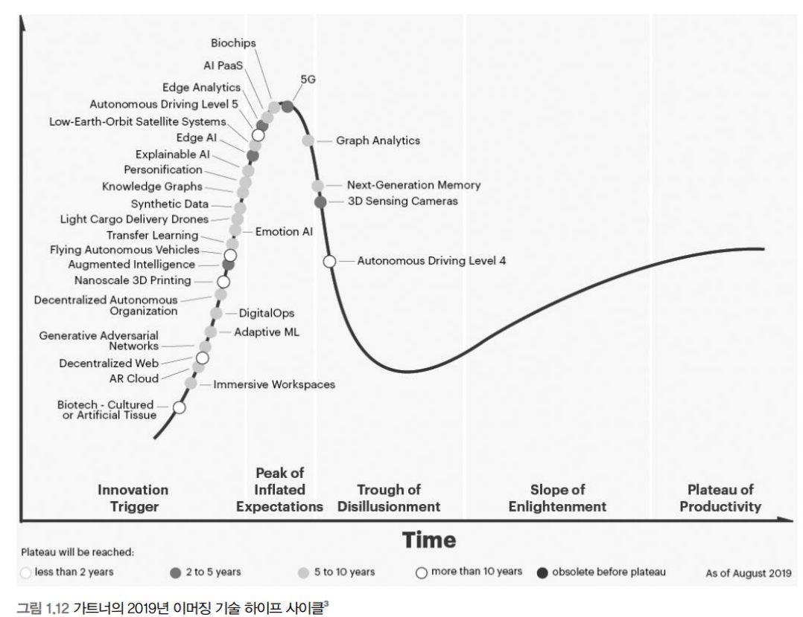

2015년 경 빅데이터의 거품이 빠지고 이머징 기술로서 접근

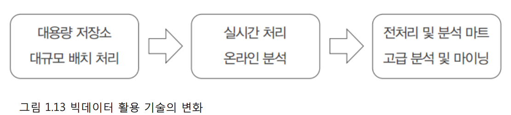

빅데이터 기술의 변화 : 거대한 오픈소스 생태계로 구성된 플랫폼으로 발전

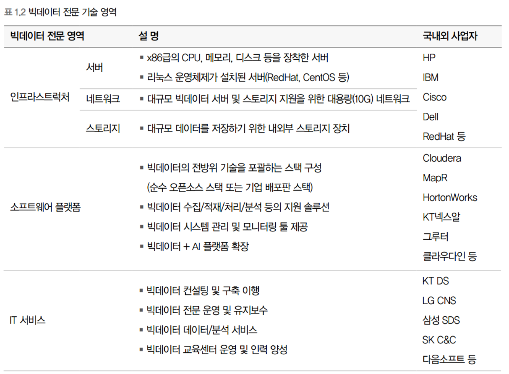

## 빅데이터 구현기술

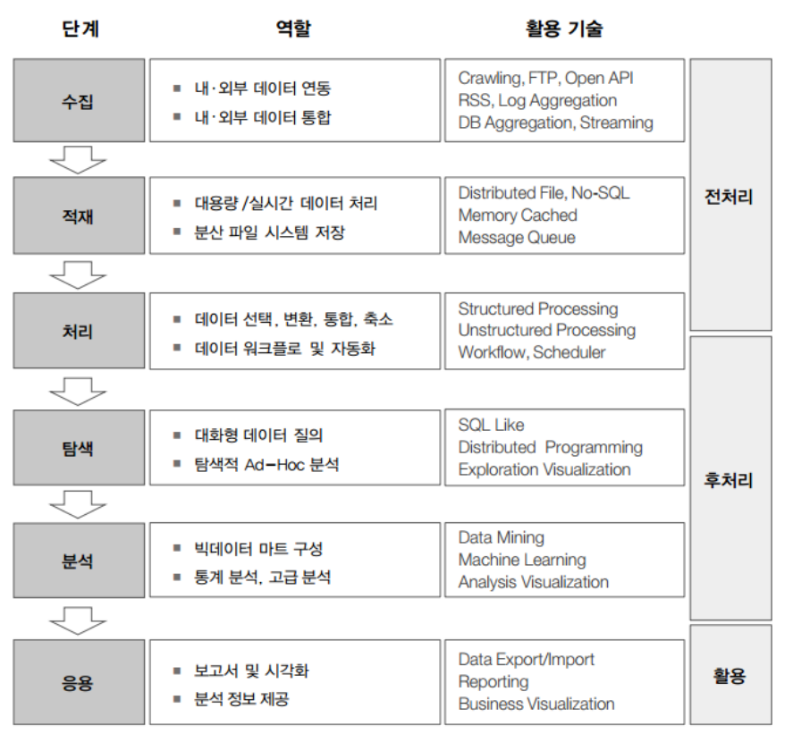

### 수집

분산처리의 선형적 확장이 특징

스트림 데이터, 정형/반정형/비정형 데이터로 분류하여 수집하게 됨

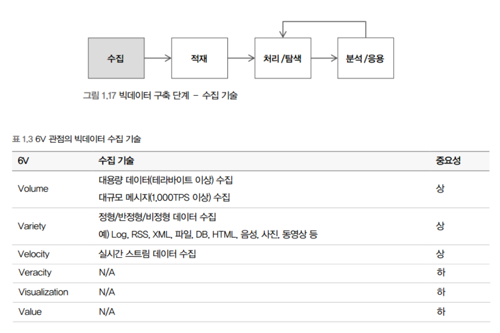

### 적재

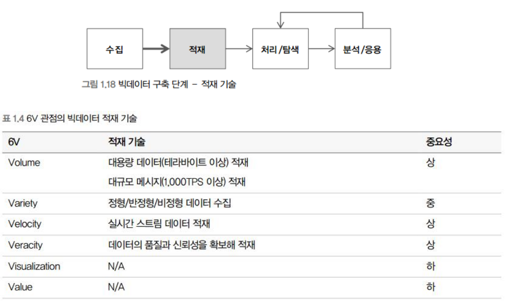

### 처리/탐색

대화형 Ad-hoc 형태의 작업이 진행 (SQL on Hadoop)

Hue, Hive, Spark, SQL, Oozie(Workflow)

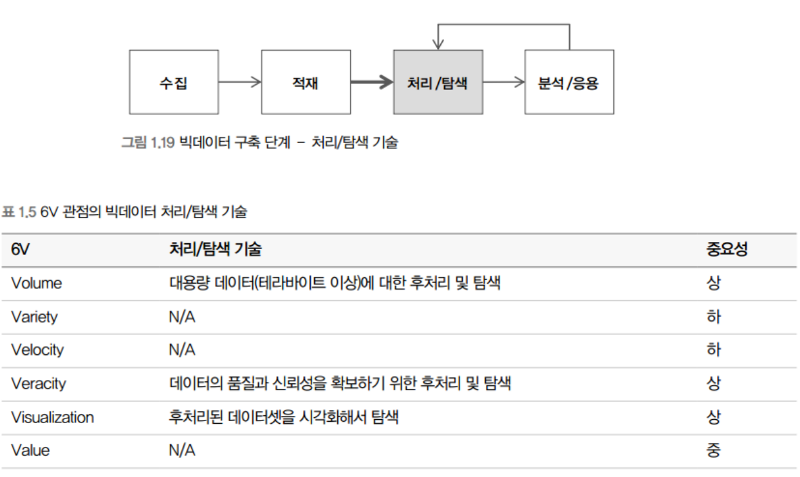

### 분석/응용

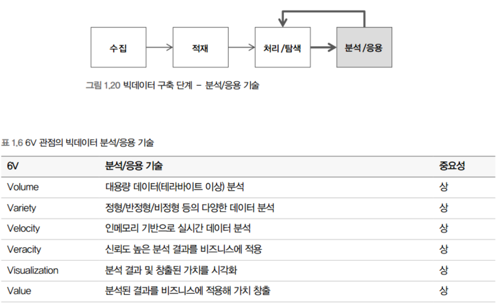