# 쿠버네티스 네트워크

# 1. 서비스

- 파드는 일시적으로 생성한 컨테이너의 집합
- 때문에 파드가 지속적으로 생겨났을 때 서비스를 하기에 적합하지 않음
- IP 주소의 지속적인 변동, 로드밸런싱을 관리해줄 또 다른 개체가 필요
- 파드의 IP가 변경될 때마다 재설정하지 않도록 해야 함

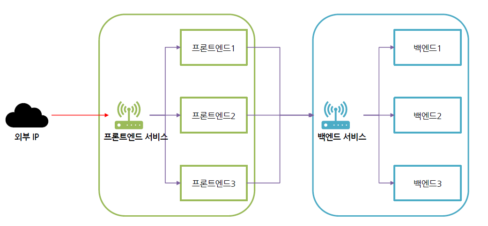

## Cluster IP

다수의 파드를 하나의 서비스로 묶어서 관리

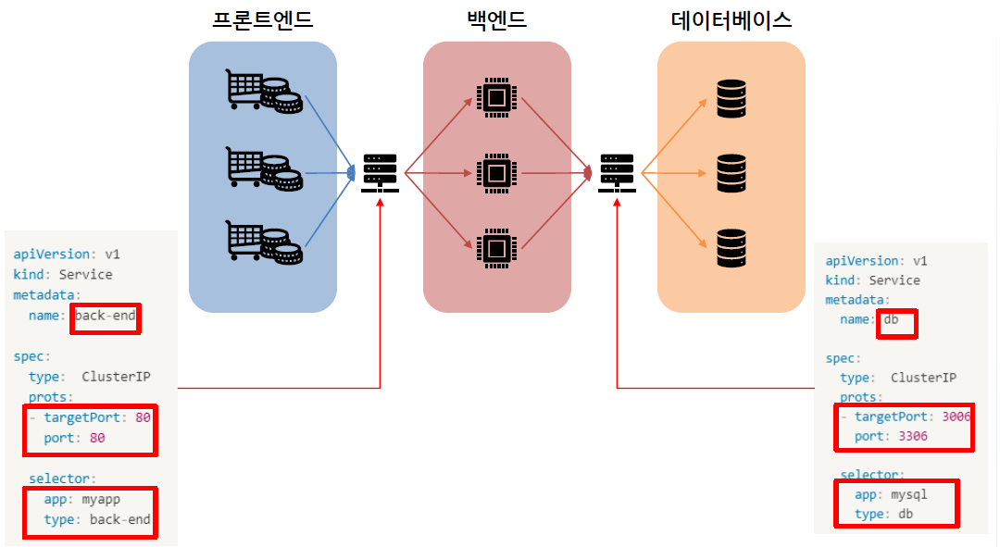

- 세션문제 : 다수의 파드로 구성된 서비스로 구성시 웹서비스의 세션이 유지되지 않음
- 이를 위해 처음 진입한 클라이언트 IP를 그대로 유지해주는 방법으로 Session Affinity옵션으로 ClientIP사용

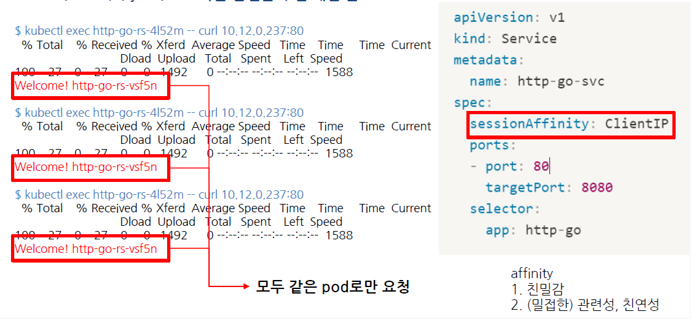

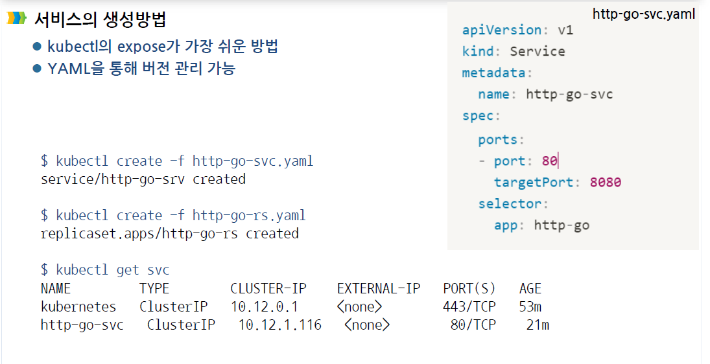

http-go-deploy.yaml

```yaml
apiVersion: v1
kind: Service
metadata:
  name: http-go-svc
spec:
  selector:
    run: http-go
  ports:
    - protocol: TCP
      port: 80
      targetPort: 8080
---

apiVersion: apps/v1
kind: Deployment
metadata:
  creationTimestamp: null
  labels:
    run: http-go
  name: http-go
spec:
  replicas: 1
  selector:
    matchLabels:
      run: http-go
  strategy: {}
  template:
    metadata:
      creationTimestamp: null
      labels:
        run: http-go
    spec:
      containers:
      - image: gasbugs/http-go
        name: http-go
        ports:
        - containerPort: 8080
        resources: {}
status: {}
```

# 2. 엔드포인트

- 쿠버네티스의 서비스 기능을 사용하면 외부 서비스와도 연결이 가능
- 외부 서비스와 연결을 수행할 때는 서비스의 endpoint를 레이블을 사용해 지정하는 것이 아니라 외부 IP 를 직접 endpoint 라는 별도의 자원에서 설정

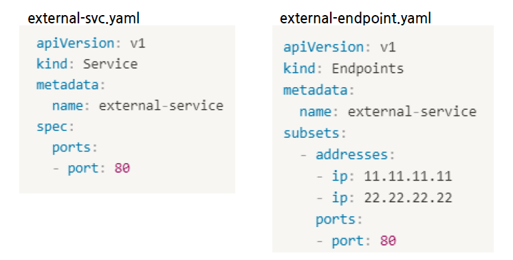

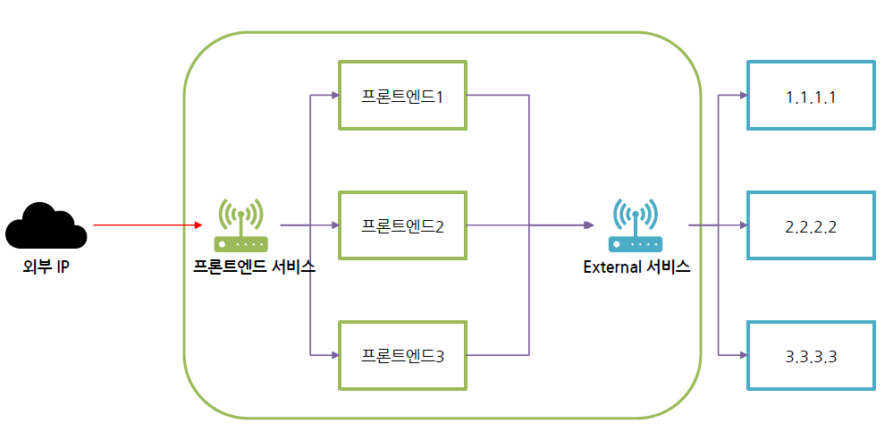

# 3. Service Expose

## 3.1 NodePort

노드의 자체 포트를 사용하여 파드로 리다이렉션

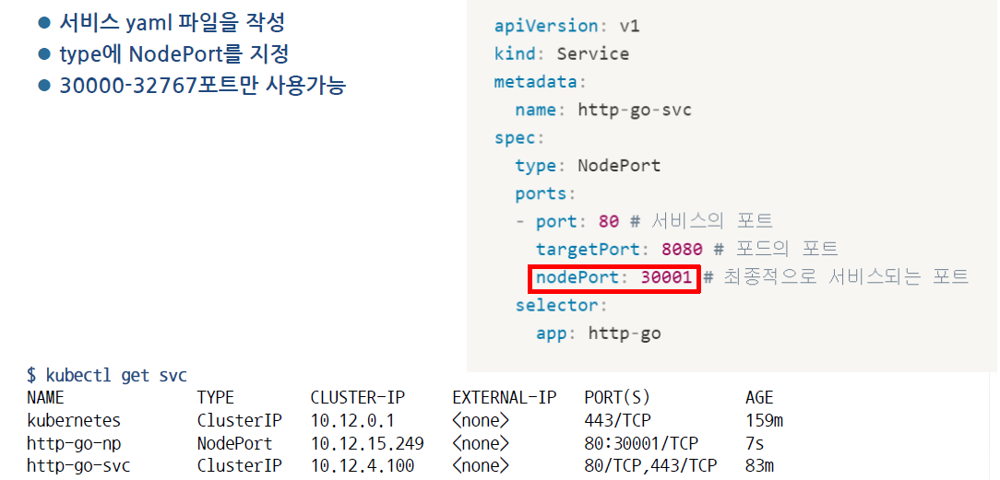

http-go-np.yaml

```yaml
apiVersion: v1
kind: Service
metadata:
  name: http-go-np
spec:
  type: NodePort
  selector:
    run: http-go
  ports:
    - protocol: TCP
      port: 80
      targetPort: 8080
      nodePort: 30001
```

## 3.2 LoadBalancer

- 외부 게이트웨이를 사용해 노드 포트로 리다이렉션
- NodePort 서비스의 확장된 서비스
- 클라우드 서비스에서 사용 가능
- yaml 파일에서 타입을 NodePort 대신 LoadBalancer 를 설정
- 로드 밸런서의 IP 주소를 통해 서비스에 액세스

http-go-lb.yaml

```yaml

apiVersion: v1
kind: Service
metadata:
  name: http-go-lb
spec:
  type: LoadBalancer
  selector:
    run: http-go
  ports:
    - protocol: TCP
      port: 80
      targetPort: 8080
```

tomcat-deploy-np-lb.yaml

```yaml
apiVersion: apps/v1
kind: Deployment
metadata:
  creationTimestamp: null
  labels:
    run: tomcat
  name: tomcat
spec:
  replicas: 1
  selector:
    matchLabels:
      run: tomcat
  strategy: {}
  template:
    metadata:
      creationTimestamp: null
      labels:
        run: tomcat
    spec:
      containers:
      - image: consol/tomcat-7.0
        name: tomcat
        ports:
        - containerPort: 8080
        resources: {}
status: {}
---
apiVersion: v1
kind: Service
metadata:
  name: tomcat-np
spec:
  type: NodePort
  selector:
    run: tomcat
  ports:
    - protocol: TCP
      port: 80
      targetPort: 8080
      nodePort: 30002
---
apiVersion: v1
kind: Service
metadata:
  name: tomcat-lb
spec:
  type: LoadBalancer
  selector:
    run: tomcat
  ports:
    - protocol: TCP
      port: 80
      targetPort: 8080
```

## 3.3 Ingress

- 하나의 IP 주소를 통해 여러 서비스를 제공하는 특별한 메커니즘
- ingress : (어떤 장소에) 들어감, 입장, 입장권

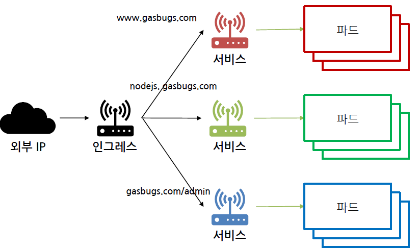

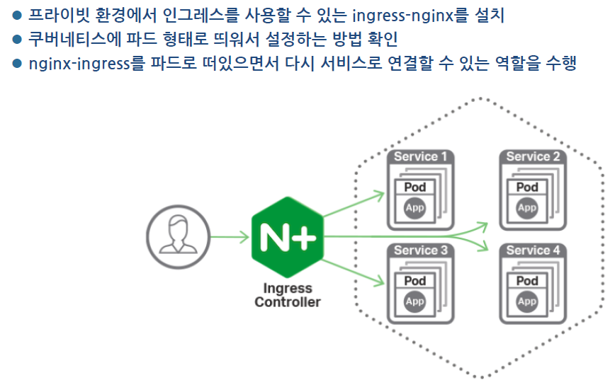

인그레스 nginx 설치

```bash
git clone https://github.com/kubernetes/ingress-nginx/
kubectl apply -k `pwd`/ingress-nginx/deploy/static/provider/baremetal/
kubectl delete validatingwebhookconfigurations.admissionregistration.k8s.io ingress-nginx-admission
```

ingress 자원을 사용해 룰 생성

```yaml
cat <<EOF | kubectl apply -f -
apiVersion: networking.k8s.io/v1
kind: Ingress
metadata:
  name: http-go-ingress
  annotations:
    kubernetes.io/ingress.class: nginx
    nginx.ingress.kubernetes.io/rewrite-target: /welcome/test
spec:
  rules:
    - http:
        paths:
          - pathType: Exact
            path: /welcome/test
            backend:
              service:
                name: http-go
                port: 
                  number: 80
EOF
```

서비스를 구성할 수 있는 다음 명령어를 실행한다.

```yaml
kubectl create deployment http-go --image=gasbugs/http-go:ingress # 인그레스 테스트용 http-go
kubectl expose deployment http-go --port=80 --target-port=8080
```

TLS 인증서 생성

```bash
openssl req -x509 -nodes -days 365 -newkey rsa:2048 \
    -out ingress-tls.crt \
    -keyout ingress-tls.key \
    -subj "/CN=ingress-tls"

kubectl create secret tls ingress-tls \
    --namespace default \
    --key ingress-tls.key \
    --cert ingress-tls.crt
```

TLS 인증서를 사용하는 ingress 생성

```yaml
cat <<EOF | kubectl apply -f -
apiVersion: networking.k8s.io/v1
kind: Ingress
metadata:
  name: http-go-ingress
  annotations:
    kubernetes.io/ingress.class: nginx
    nginx.ingress.kubernetes.io/rewrite-target: /welcome/test
    nginx.ingress.kubernetes.io/ssl-redirect: "true"
spec:
  tls:
  - hosts:
    - gasbugs.com
    secretName: ingress-tls
  rules:
    - host: gasbugs.com
      http:
        paths:
          - pathType: Exact
            path: /welcome/test
            backend:
              service:
                name: http-go
                port: 
                  number: 80
EOF
```

```bash
curl http://gasbugs.com:32049/welcome/test -kv --resolve gasbugs.com:32049:127.0.0.1

curl https://gasbugs.com:31915/welcome/test -kv --resolve gasbugs.com:31915:127.0.0.1

curl https://gasbugs1.com:31915/welcome/test -kv --resolve gasbugs1.com:31915:127.0.0.1
```

Ingress 실습

```bash
kubectl delete all --all

# http-go 디플로이먼트/서비스 생성
kubectl create deploy http-go --image=gasbugs/http-go 
kubectl expose deploy http-go --port=80 --target-port=8080

# 톰캣 디플로이먼트/서비스 생성
kubectl create deploy tomcat --image=consol/tomcat-7.0 
kubectl expose deploy tomcat --port=80 --target-port=8080

# TLS 인증서 생성
openssl req -x509 -nodes -days 365 -newkey rsa:2048 \
    -out gasbugs-tls.crt \
    -keyout gasbugs-tls.key \
    -subj "/CN=ingress-tls"

# tls 인증서를 통해 secret을 구성
kubectl create secret tls gasbugs-tls \
    --namespace default \
    --key gasbugs-tls.key \
    --cert gasbugs-tls.crt

cat <<EOF | kubectl apply -f -
apiVersion: networking.k8s.io/v1
kind: Ingress
metadata:
  name: http-go-ingress
  annotations:
    kubernetes.io/ingress.class: nginx
    nginx.ingress.kubernetes.io/rewrite-target: /
    nginx.ingress.kubernetes.io/ssl-redirect: "true"
spec:
  tls:
  - hosts:
    - tomcat.gasbugs.com    
    - http-go.gasbugs.com
    secretName: gasbugs-tls
  rules:
    - host: http-go.gasbugs.com
      http:
        paths:
          - pathType: Prefix
            path: /
            backend:
              service:
                name: http-go
                port: 
                  number: 80
    - host: tomcat.gasbugs.com
      http:
        paths:
          - pathType: Prefix
            path: /
            backend:
              service:
                name: tomcat
                port: 
                  number: 80
EOF
```

```bash
curl http://tomcat.gasbugs.com:32049/welcome/test -kv --resolve tomcat.gasbugs.com:32049:127.0.0.1

curl https://tomcat.gasbugs.com:31915/ -kv --resolve tomcat.gasbugs.com:31915:127.0.0.1

curl https://http-go.gasbugs.com:31915/ -kv --resolve http-go.gasbugs.com:31915:127.0.0.1
```

# 4. 쿠버네티스 네트워크 모델

## 4.1 파드 내 컨테이너 간 통신

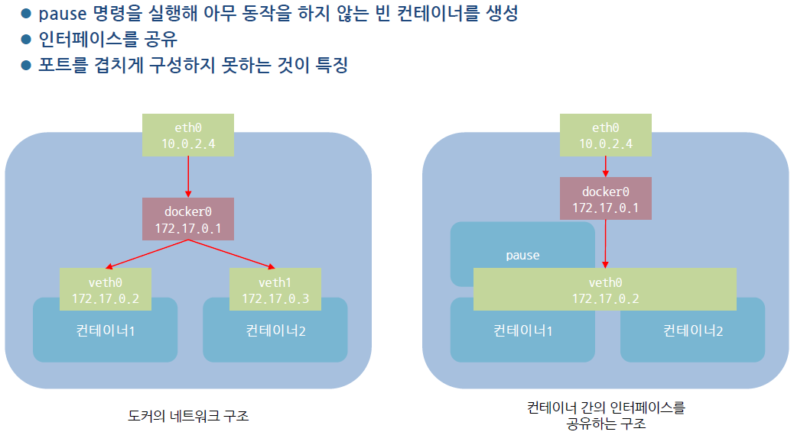

## 4.2 파드 간의 통신

- 파드끼리의 통신을 위해서는 CNI 플러그인이 필요
- ACI, AOS, AWS VPN CNI, CNI Genie, GCE, flannel, Weave Net, Calico 등

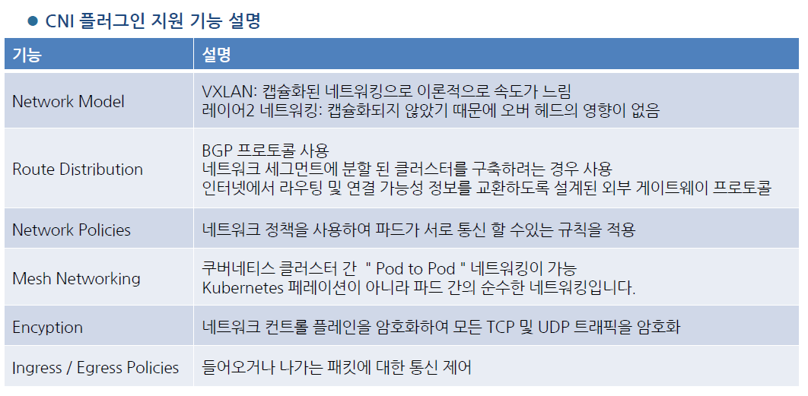

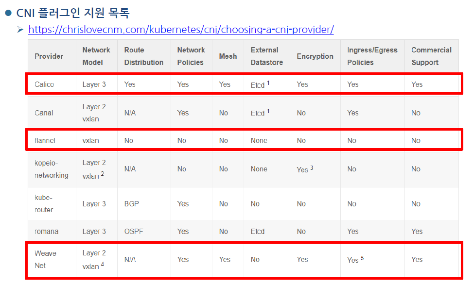

## 4.3 파드와 서비스 사이의 통신

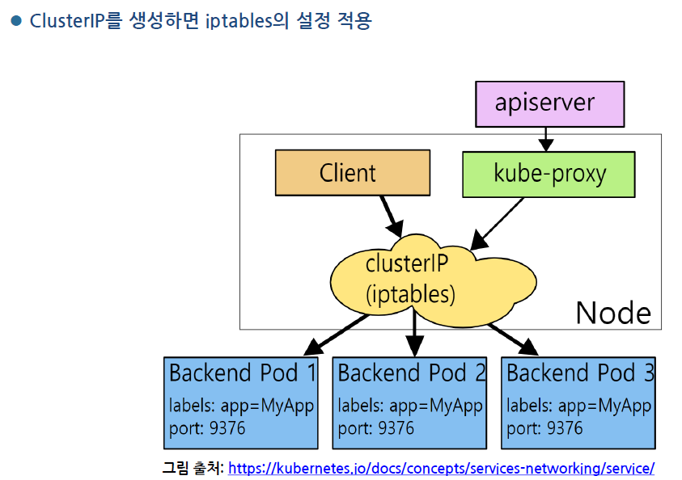

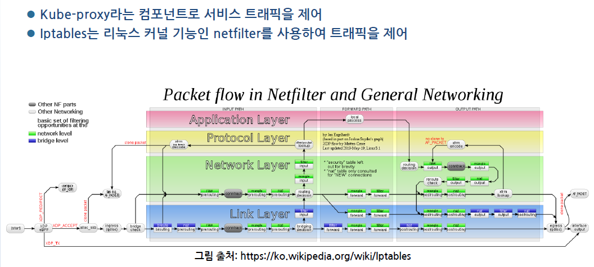

### 4.4 외부 클라이언트와 서비스 사이의 통신

netfilter와 kube-proxy기능을 사용해 원하는 서비스 및 파드로 연결

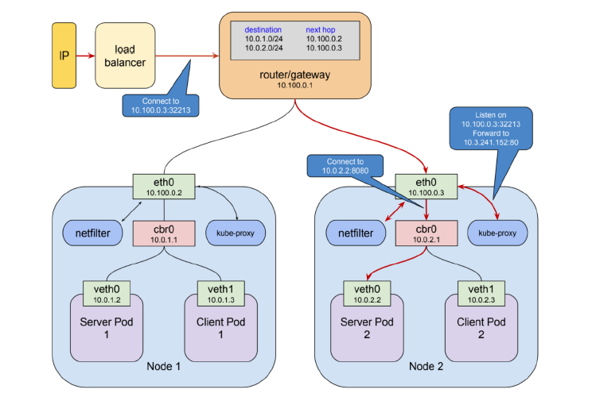

# 5. 도메인 서비스 FQDN

[https://kubernetes.io/ko/docs/concepts/services-networking/dns-pod-service/](https://kubernetes.io/ko/docs/concepts/services-networking/dns-pod-service/)

- FQDN(Fully Qualified Domain Name) : 전체 도메인 네임이라고 불리는 도메인 전체이름을 표기하는 방식
- **<서비스이름>.<네임스페이스이름>.svc.cluster.local**의 형식을 가짐

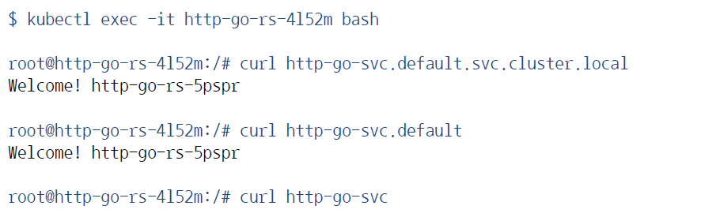

## CoreDNS

- 내부에서 DNS 서버 역할을 하는 POD 이 존재
- 각 미들웨어를 통해 로깅 캐시 쿠버네티스를 질의하는 등의 기능을 가짐
    
    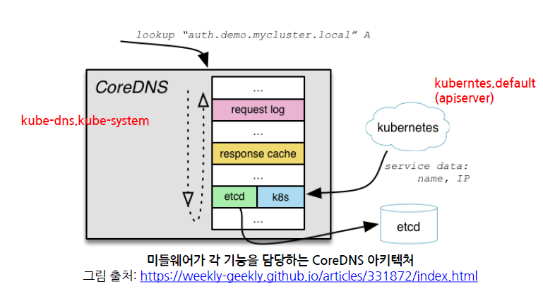
    
- 해당 DNS 에는 configmap 저장소를 사용해 설정 파일을 컨트롤
- Corefile 을 통해 현재 클러스터의 NS 를 지정

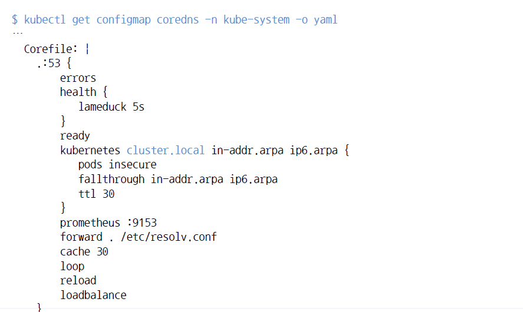

## Subdomain을 사용한 DNS서비스

- yaml 파일의 호스트 이름은 파드의 metadata name 을 따름
- 필요한 경우 hostname 을 따로 선택 가능
- subdomain 은 서브도메인을 지정하는 데 사용
- 서브 도메인을 설정하면 FQDN 사용 가능

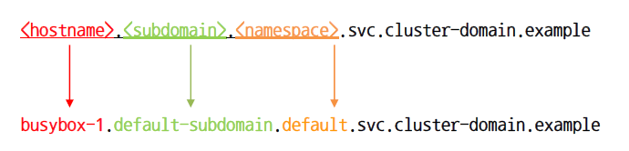

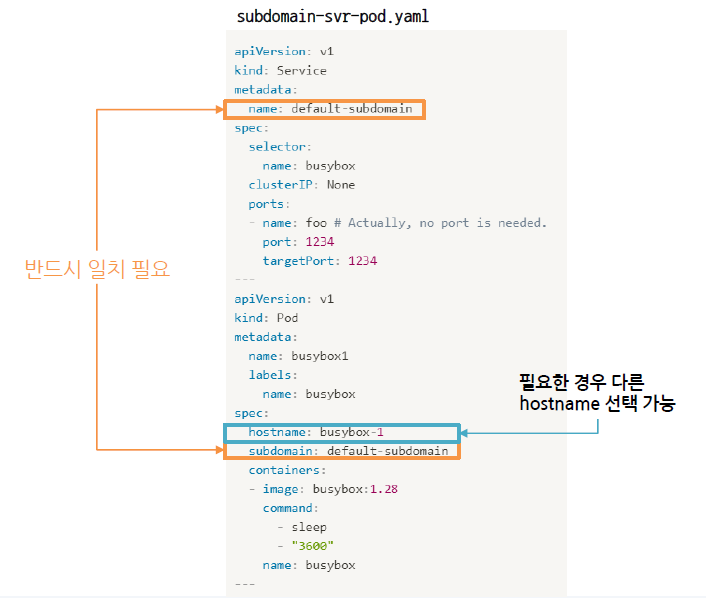

## 서비스 DNS 연습문제

- 네임스페이스 blue 에 jenkins 이미지를 사용하는 pod jenkins 디플로이먼트를 생성하고 이를 위한서비스 srv-jenkins 를 생성하라
- default 네임스페이스의 http-go 이미지의 curl 을 사용하여 pod-jenkis:8080 을 요청하라
- kubectl exec http-go-77cb5c879-29kld --curl srv-jenkins.blue:8080

blue-jenkins-svc-deploy.yaml

```yaml
apiVersion: v1
kind: Namespace
metadata:
  creationTimestamp: null
  name: blue
spec: {}
status: {}
---
apiVersion: apps/v1
kind: Deployment
metadata:
  creationTimestamp: null
  labels:
    run: pod-jenkins
  name: pod-jenkins
  namespace: blue
spec:
  replicas: 1
  selector:
    matchLabels:
      run: pod-jenkins
  strategy: {}
  template:
    metadata:
      creationTimestamp: null
      labels:
        run: pod-jenkins
    spec:
      containers:
      - image: jenkins
        name: pod-jenkins
        ports:
        - containerPort: 8080
        resources: {}
status: {}
---
apiVersion: v1
kind: Service
metadata:
  creationTimestamp: null
  labels:
    run: pod-jenkins
  name: srv-jenkins
  namespace: blue
spec:
  ports:
  - port: 8080
    protocol: TCP
    targetPort: 8080
  selector:
    run: pod-jenkins
status:
  loadBalancer: {}
```