# 스케줄링과 라이프 사이클 관리

# 1. 어플리케이션 변수관리

- 쿠버네티스의 환경 변수는 YAML 파일이나 다른 리소스로 전달
- 하드 코딩된 환경 변수는 여러 환경에 데이터를 정의하거나 유지, 관리가 어려움
- ConfigMap은 외부에 컨테이너 설정을 저장할 수 있음

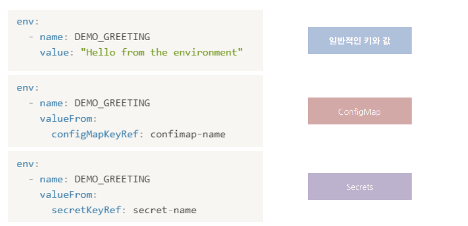

```yaml
...
spec:
	containers:
	- name: envar-demo-container
		image: gcr.io/google-samples/node-hello:1.0
		env:
		- name: DEMO_GREETING
			value: "Hello from the environment"
		- name: DEMO_FAREWELL
			value: "Such a sweet sorrow"
```

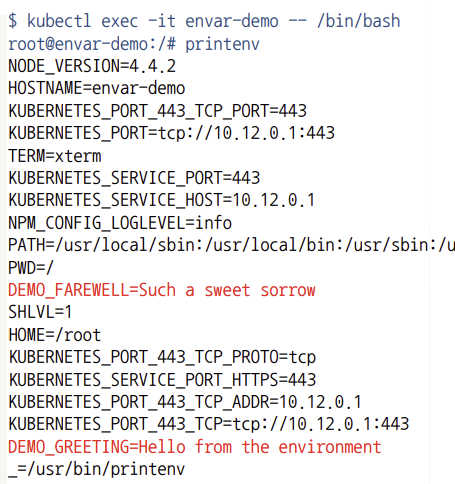

## 1.1 ConfigMap

```yaml
#configMap 저장
kubectl create configmap <map-name> <data-source>
#저장내용 확인
kubectl get configmap map-name -o yaml
```

node-env.yaml

```yaml
#configmap.yaml
...
metadata:
	name: special-config
	namespace: default
data:
	special.how: very
---
...
containers:
- name: test-container
	image: k8s.gcr.io/busybox
	command: ["/bin/sh", "-c", "env"]
	env:
	- name: SPECIAL_LEVEL_KEY
		**valueFrom:
			configMapKeyRef:
				name: special-config
				key: special.how**
	restartPolicy: Never		
```

### ConfigMap을 통한 Volume Mount

volumes-configmap.yaml

```yaml
apiVersion: v1
kind: Pod
metadata:
  name: volumes-configmap  
  labels:
    purpose: demonstrate-envars
spec:
  containers:
  - name: envar-demo-container
    image: gcr.io/google-samples/node-hello:1.0
    volumeMounts:
      - name: config-volume
        mountPath: /etc/config
  volumes:
    - name: config-volume
      configMap:
        # Provide the name of the ConfigMap containing the files you want
        # to add to the container
        name: special-config
```

## 1.2 Secret

비밀번호, OAuth토큰 및 ssh키와 같은 민감정보 저장

```yaml
echo -n 'admin > ./username
echo -n '1d2f3e45df' > ./password
#base64 인코딩되어 저장 -> yaml로 직접 작성시에는 base64로 변환하여 생성하여야 함
kubectl create secret generic db-user-pass --from-file=./username --from-file=./password
```

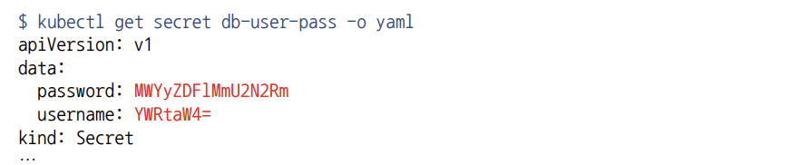

envars-secret.yaml 

```yaml
apiVersion: v1
kind: Pod
metadata:
  name: envar-secret
  labels:
    purpose: demonstrate-envars
spec:
  containers:
  - name: envar-demo-container
    image: gcr.io/google-samples/node-hello:1.0
    env:
    - name: user
      valueFrom:
        secretKeyRef:
          name: db-user-pass
          key: username
    - name: pass
      valueFrom:
        secretKeyRef:
          name: db-user-pass
          key: password
```

# 2. Init 컨테이너

- 파드 컨테이너 실행 전에 초기화 역할을 하는 컨테이너
- **완전히 초기화가 진행된 다음에야 주 컨테이너를 실행**
- Init 컨테이너가 실패하면, 성공할때까지 파드를 반복해서 재시작
- restartPolicy에 Never를 하면 재시작하지 않음

pod-init-container.yaml 

```yaml
apiVersion: v1
kind: Pod
metadata:
  name: myapp-pod
  labels:
    app: myapp
spec:
  containers:
  - name: myapp-container
    image: busybox:1.28
    command: ['sh', '-c', 'echo The app is running! && sleep 3600']
  initContainers:
  - name: init-myservice
    image: busybox:1.28
    command: ['sh', '-c', "until nslookup myservice.$(cat /var/run/secrets/kubernetes.io/serviceaccount/namespace).svc.cluster.local; do echo waiting for myservice; sleep 2; done"]
  - name: init-mydb
    image: busybox:1.28
    command: ['sh', '-c', "until nslookup mydb.$(cat /var/run/secrets/kubernetes.io/serviceaccount/namespace).svc.cluster.local; do echo waiting for mydb; sleep 2; done"]
```

# 3. 시스템 리소스 요구사항 및 제한 설정

- CPU 및 메모리는 각각 자원 유형을 지니며 자원 유형에는 기본 단위를 사용
- CPU는 코어 단위로 지정되며 메모리는 바이트 단위로 지정

| 자원유형 | 단위 | 비고 |
| --- | --- | --- |
| CPU | m (millicpu) | CPU 0.1은 100m |
| Memory | Ti, Gi, Mi, Ki, T, G, M, K | K,M,G는 1000씩 / Ki, Mi, Gi는 1024씩 |

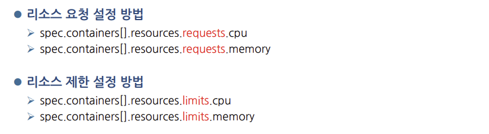

nginx-deploy.yaml 

```yaml
apiVersion: apps/v1
kind: Deployment
metadata:
  creationTimestamp: null
  labels:
    run: nginx
  name: nginx
spec:
  replicas: 3
  selector:
    matchLabels:
      run: nginx
  strategy: {}
  template:
    metadata:
      creationTimestamp: null
      labels:
        run: nginx
    spec:
      containers:
      - image: nginx
        name: nginx
        ports:
        - containerPort: 80
        resources: 
          requests:
            memory: "200Mi"
            cpu: "1m"
          limits:
            memory: "400Mi"
            cpu: "2m"
status: {}
```

## 3.1 limitRanges

[https://kubernetes.io/docs/concepts/policy/limit-range/](https://kubernetes.io/docs/concepts/policy/limit-range/)

네임 스페이스에서 파드 또는 컨테이너별로 리소스를 제한하는 정책

- 네임 스페이스에서 파드나 컨테이너당 최소 및 최대 컴퓨팅 리소스 사용량 제한
- 네임 스페이스에서 PersistentVolumeClaim 당 최소 및 최대 스토리지 사용량 제한
- 네임 스페이스에서 리소스에 대한 요청과 제한 사이의 비율 적용
- 네임 스페이스에서 컴퓨팅 리소스에 대한 디폴트 requests/limit를 설정하고 런타임 중인 컨테이너에 자동으로 입력

```yaml
apiVersion: v1
kind: LimitRange
metadata:
	name: limit-mem-cpu-per-container
spec:
	limits:
	- max:
			cpu: "800m"
			memory: "1Gi"
	  min:
			cpu: "100m"
			memory: "99Mi"
		default:
			cpu: "700m"
			memory: "900Mi"
		defaultRequest:
			cpu: "110m"
			memory: "111Mi"
		type: Container #리소스 제한수준 제어 Container, Pod, PersistentVolumeClaim
```

## 3.2 ResourceQuota

[https://kubernetes.io/docs/tasks/administer-cluster/manage-resources/quota-memory-cpu-namespace/](https://kubernetes.io/docs/tasks/administer-cluster/manage-resources/quota-memory-cpu-namespace/)

- 제한하기 원하는 네임스페이스에 ResourceQuota 리소스 생성
- 모든 컨테이너에는 CPU, 메모리에 대한 최소요구사항 및 제한 설정이 필요 (모든 컨테이너의 리소스 합을 제한)

```yaml
apiVersion: v1
kind: ResourceQuota
metadata:
	name: mem-cpu-demo
spec:
	hard:
		requests.cpu: "1"
		requests.memory: 1Gi
		limits.cpu: "2"
		limits.memory: 2Gi
```

# 4. 데몬셋

- 각 노드당 하나의 파드만을 구성
- kube-proxy가 데몬셋으로 만든 쿠버네티스 기본 파드

http-go-ds.yaml 

```yaml
apiVersion: apps/v1
kind: **DaemonSet**
metadata:
  name: http-go
spec:
  selector:
    matchLabels:
      name: http-go
  template:
    metadata:
      labels:
        app: http-go
    spec:
      tolerations:
      - key: node-role.kubernetes.io/master
        effect: NoSchedule
      containers:
      - name: http-go
        image: gasbugs/http-go
```

## 4.1 Taint

- Taint (테인트) : 오점을 남기다, 더럽히다
- 노드에 설정하여 “어떤” 오점을 남김

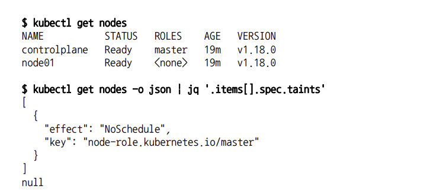

## 4.2 Tolerations

- Toleration : 용인하다, 견디다
- 노드가 같고있는 오점(Taint)를 용인하는 옵션을 파드에 설정함 → Taint 노드에 배치가능한 파드
- 오점이 있는 경우 톨러레이션 세팅이 필수적으로 필요함

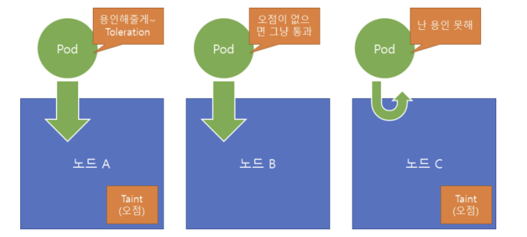

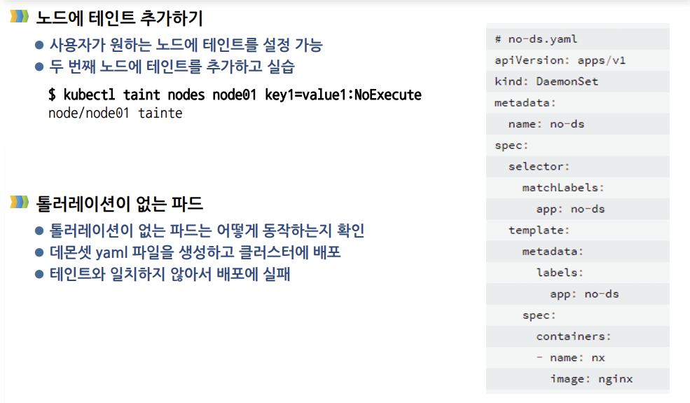

# 5. Pod 수동 스케줄링

- 특수한 환경의 경우 특정 노드에서 실행되도록 파드를 제한
- 일반적인 스케줄러는 자동으로 합리적인 배치를 수행하므로 이러한 제한은 필요하지 않음
    - SSD가 있는 노드에서 파드를 실행해야 하는 경우
    - GPU서비스가 필요한 경우
    - 서비스 성능 극대화를 위해 하나의 노드에 필요한 파드를 모두 배치

## 5.1 NodeName필드를 사용한 매뉴얼 스케줄링

```jsx
apiVersion: v1
kind: Pod
metadata:
	name: http-go
spec:
	containers:
	- name: http-go
		image: gasbugs/http-go
	nodeName: work1
```

## 5.2 NodeSelector를 활용한 스케줄링

- 특정 하드웨어를 가진 노드에서 파드를 실행하고자 하는 경우에 사용
- GPU, SSD등의 이슈를 가진 사항을 적용

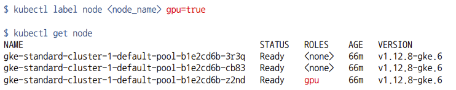

```jsx
apiVersion: v1
kind: Pod
metadata:
	name: http-go
spec:
	containers:
	- name: http-go
	  image: gasbugs/http-go
	nodeSelector:
		gpu: "true" 
```

# 6. 오토 스케일링 HPA워크스루

- HPA: 파드 자체를 복제하여 처리할 수 있는 파드의 개수를 늘리는 방법
- VPA: 리소스를 증가시켜 파드의 사용 가능한 리소스를 늘리는 방법
- CA : 번외로 클러스 자체를 늘리는 방법 (노드 추가)

## 6.1 HPA(Horizontal Pod Autoscaler)

- 쿠버네티스에는 기본 오토스케일링 기능 내장
- CPU사용률을 모니터링하여 실행된 파드의 개수를 늘리거나 줄림

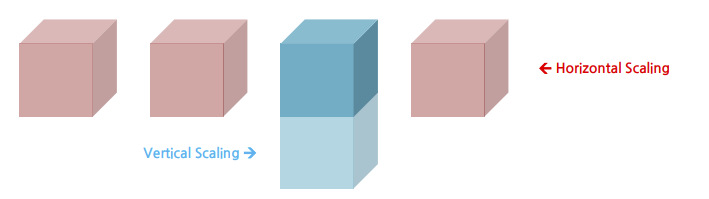

```jsx
kubectl autoscale deployment my-app --max 6 --min 4 --cpu-percent 50
```

autoscaling.yaml

```jsx
apiVersion: autoscaling/v1
kind: HorizontalPodAutoscaler
metadata:
	name: myapp-hpa
	namespace: default
spec:
	maxReplicas: 10
	minReplicas: 1
	scaleTargetRef:
		apiVersion: extensions/v1beta1
		kind: Deployment
		name: myapp
	targetCPUUtilizationPercentage: 30
```

php-apache 서버 구동 및 노출

[https://kubernetes.io/ko/docs/tasks/run-application/horizontal-pod-autoscale-walkthrough/](https://kubernetes.io/ko/docs/tasks/run-application/horizontal-pod-autoscale-walkthrough/)

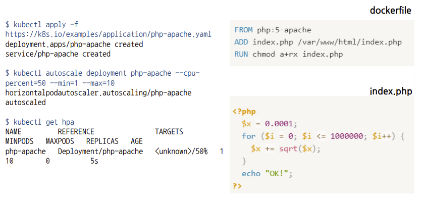

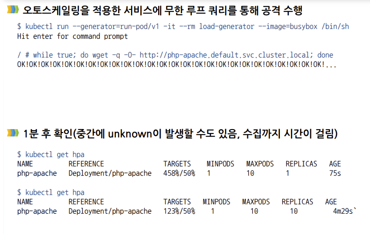

## 6.2 클라우드에서의 VPA/CA 지원

공식 쿠버네티스에서는 제공하지 않으나 클라우드 서비스에서 제공

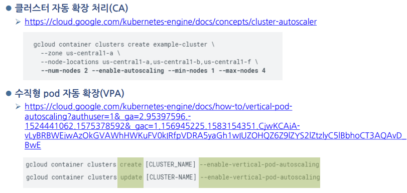