# HELM Chart

# 1. helm 소개와 설치

Docs: [https://helm.sh/ko/docs/](https://helm.sh/ko/docs/)

설치 설명 사이트: [https://helm.sh/docs/intro/install/#from-script](https://helm.sh/docs/intro/install/#from-script)

## 1.1 About helm

- 쿠버네티스 어플리케이션 관리를 지원하는 도구
- 복잡한 어플리케이션을 정의, 설치, 업그레이드 수행에 도움
- 사용자는 helm에 정의되어있는 내용을 사용해 쉽게 설치하거나 삭제

## 1.2 helm의 특징

| 특징 | 내용 |
| --- | --- |
| 복잡성 관리 | 가장 복잡한 앱을 기술하며 어플리케이션을 반복적으로 설치하는 것을 제공 |
| 쉬운 업데이트 | 커스텀 후크와 in-place업그레이드를 지원해 업데이트 |
| 간단한 공유 | 차트를 공용서버를 통해 쉽게 버전관리 및 호스팅 가능 |
| 롤백 | 이전 버전의 릴리즈로 쉽게 롤백 |

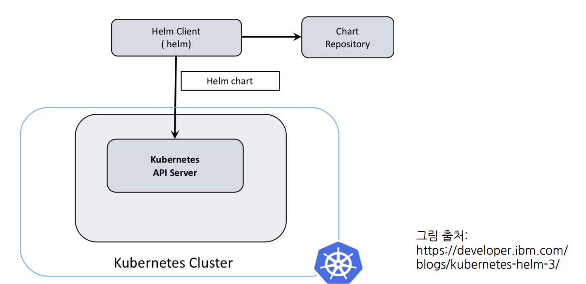

## 1.3 helm 설치

```bash
curl -fsSL -o get_helm.sh https://raw.githubusercontent.com/helm/helm/master/scripts/get-helm-3 
chmod 700 get_helm.sh 
./get_helm.sh
```

# 2. 애플리케이션 배포와 삭제

- 외부에서 정의된 yaml파일을 내려받아 쿠버네티스에 어플리케이션을 배포
- 외부 저장소를 helm repo add명령으로 추가

저장소 추가

```bash
$ helm repo add bitnami [https://charts.bitnami.com/bitnami](https://charts.bitnami.com/bitnami)
"bitnami" has been added to your repositories
```

목록 업데이트

```bash
$ helm repo update
Hang tight while we grab the latest from your chart repositories...
...Successfully got an update from the "bitnami" chart repository
Update Complete. ⎈Happy Helming!⎈
```

추가된 레파지토리에 헬름 차트 리스트 확인

```bash
helm search repo bitnami
```

helm 차트로 mysql 배포하기

```bash
# 네임스페이스 생성 
$ kubectl create ns mysql

# 헬름 차트로 mysql 배포
$ helm install mysqlname bitnami/mysql -n mysql
...
NAME: mysqlname
LAST DEPLOYED: Thu Sep  2 06:12:35 2021
NAMESPACE: mysql
STATUS: deployed
REVISION: 1
TEST SUITE: None
NOTES:
** Please be patient while the chart is being deployed **
```

배포된 mysql 확인하기

```bash
kubectl get pod -n mysql
```

다음 명령을 사용하면 mysql의 root 패스워드를 확인

```bash
kubectl get secret --namespace mysql mysqlname -o jsonpath="{.data.mysql-root-password}" | base64 --decode
```

mysql로 접속하기

```bash
$ kubectl -n mysql exec -it mysqlname-0 -- mysql -u root -p
Enter password:
```

헬름 리스트 확인

```bash
helm list -n mysql
```

상태 확인하기

```bash
helm status mysqlname -n mysql
```

배포된 패키지 삭제

```bash
helm uninstall mysqlname -n mysql
```

# 3. 새로운 차트 생성과 실행

- 쿠버네티스에서 애플리케이션을 배포할 때 필요한 기본적인 리소스를 확인
- 3 티어로 구성된 이 그림은 각 계층마다 디플로이먼트와 서비스를 포함
- 추가적으로 Configmap과 Secret등을 사용해 추가 설정할 수 있도록 구성되
- 헬름 차트 내에서도 이러한 정보들은 YAML 파일로 정의

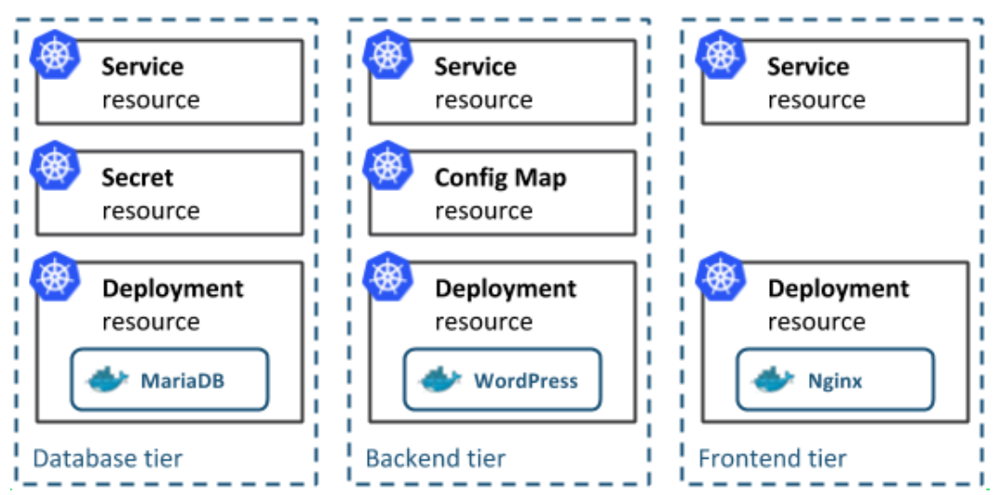

helm 차트 생성하기

```bash
helm create mychart
```

차트 구조 확인하기

```bash
# sudo apt update && sudo apt install tree -y
tree mychart
```

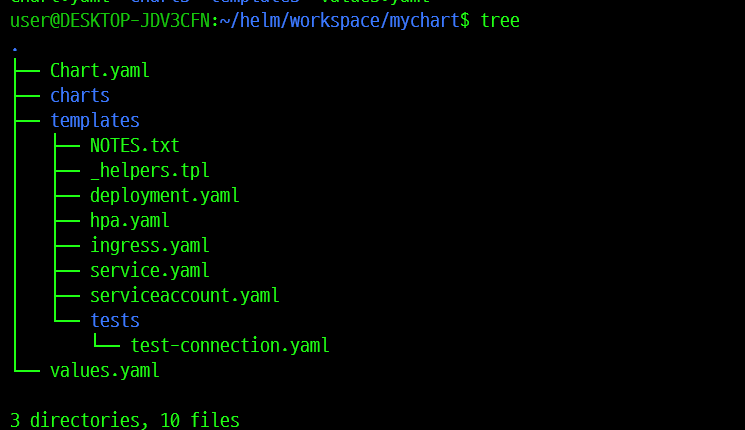

## 3.1 templates 디렉토리

- 서비스를 만드는데 필요한 자원들의 yaml파일 집합
- deployment, service, hpa등으로 구성됨
- 템플릿 파일은 go템플릿 렌더링 엔진에서 읽을 수 있는 변수 형태로 구성
- {{ }} 기호 안의 내용들은 템플릿이 구성될 때 외부의 값을 통해 코드가 실행되면서 결정되는 내용

템플릿 자료 확인하기

```bash
head -n 20 mychart/templates/deployment.yaml
```

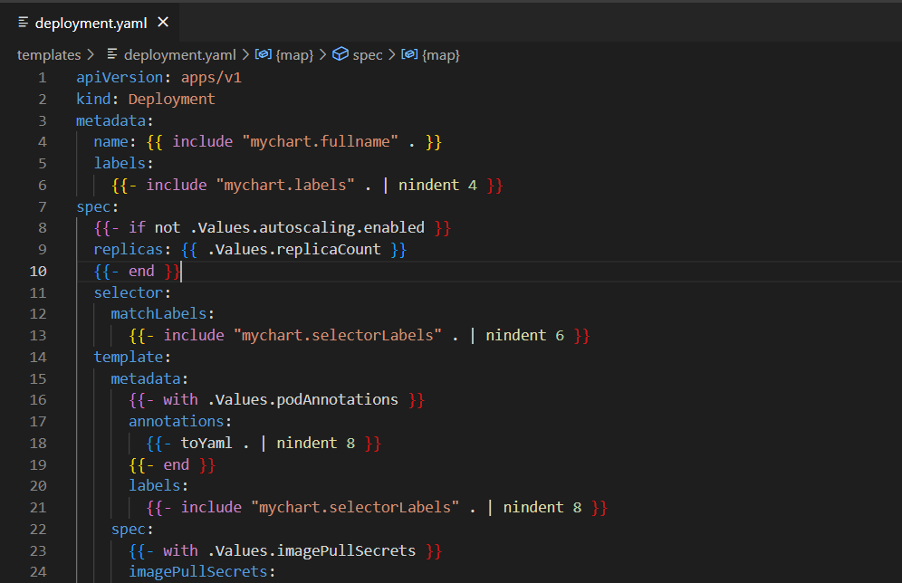

```bash
cat mychart/templates/service.yaml
```

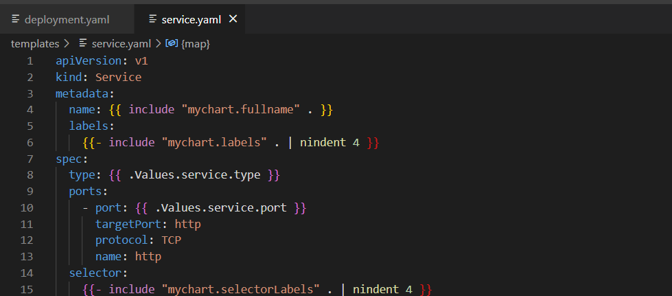

## 3.2 서비스에 value 전달하기 - 인스톨 명령어에서 전달

```bash
helm install --dry-run --debug mychart ./mychart/ \
--set service.type=LoadBalancer \
--set service.port=8080
```

## 3.3 서비스에 value 전달하기 - values.yaml 파일로 전달

```bash
vim mychart/values.yaml
```

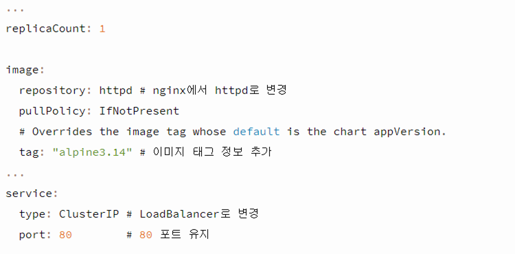

## 3.4 헬름 차트 설정 점검하기

템플릿이 잘 구성되었는지 확인

```bash
helm lint mychart
```

헬름차트 배포하기

```bash
helm install mychart ./mychart/
```

# 4. 차트 패키징 및 github 레파지토리를 활용한 배포

[https://blog.naver.com/isc0304/222515622985](https://blog.naver.com/isc0304/222515622985)

## 4.1 Repository 생성

github.com에서 새로운 Repository를 구성

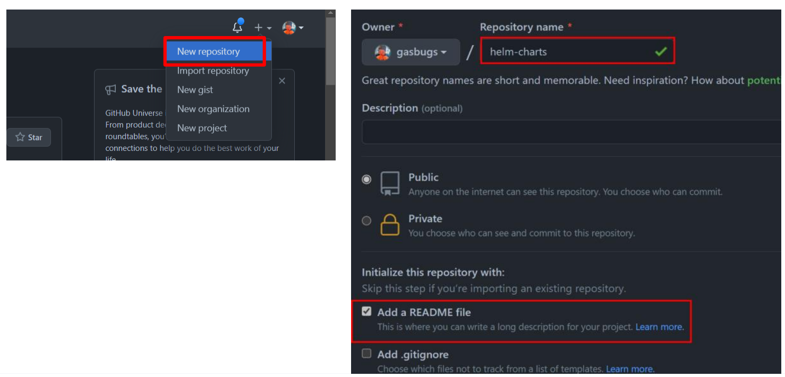

## 4.2 헬름 차트 패키지

git clone 및 디렉토리 생성

```yaml
git clone https://github.com/gasbugs/helm-charts.git
mkdir -p helm-charts/stable
cd helm-charts/stable
```

helm chart 생성

```yaml
helm create mychart
helm package mychart
```

## 4.3 헬름차트 패키지와 index.yaml 구성

Chart.yaml

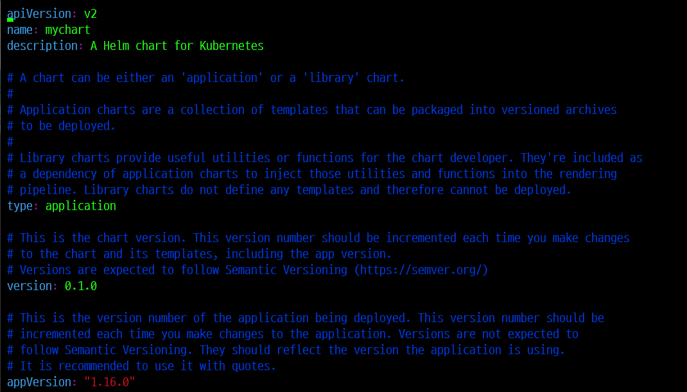

index.yaml

```yaml
helm repo index
```

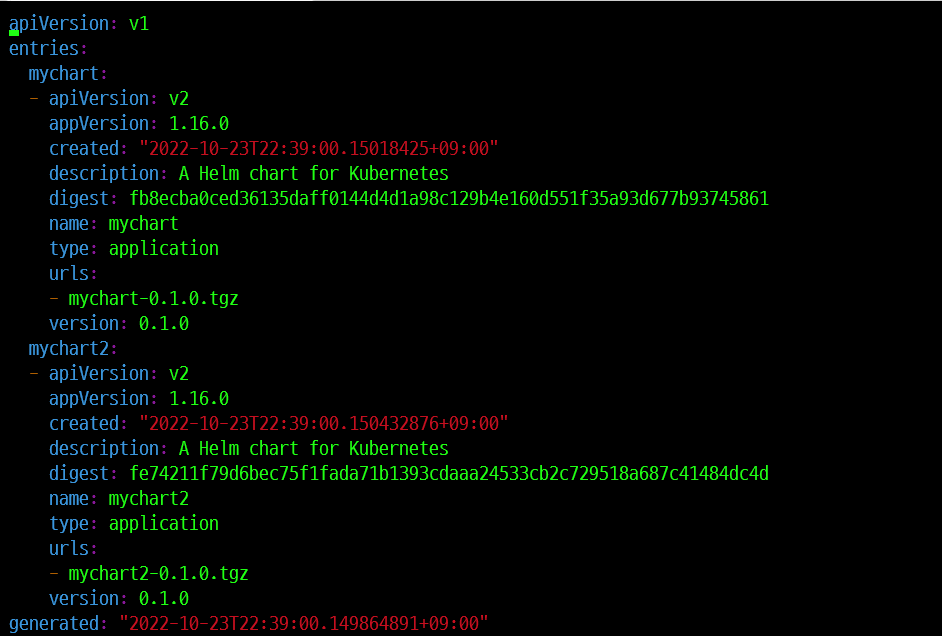

## 4.4 github push

github 비밀토큰 생성메뉴로 접근

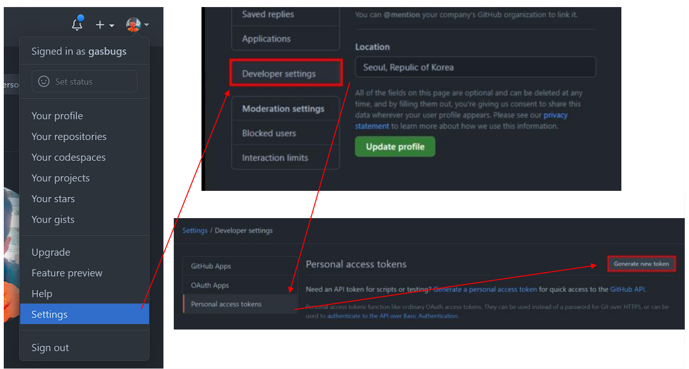

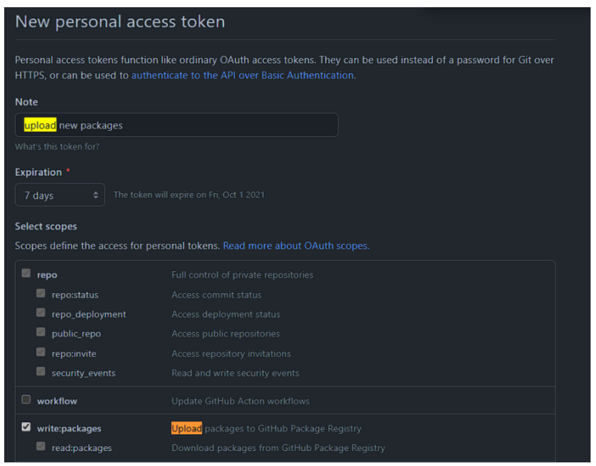

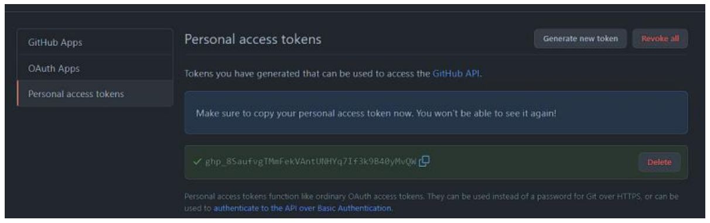

github 업로드 진행

```yaml
git commit -m "upload new packages"
git push origin main
```

## 4.5 github repository를 활용한 배포

index.yaml파일 위치를 github에서 찾아내어 경로를 add하고 업데이트

```bash
helm repo add gasbugs-charts https://raw.githubusercontent.com/gasbugs/helm-charts/main/stable
helm repo update

```

search명령을 사용하여 업로드한 두개의 차트를 검색

```bash
helm search repo mychart
```

## 4.6 헬름 차트를 사용해 인스톨 시작

```bash
helm install mychart-test gasbugs-charts/mychart2 -n default
```