# 주요 커맨드

### 디플로이먼트 생성

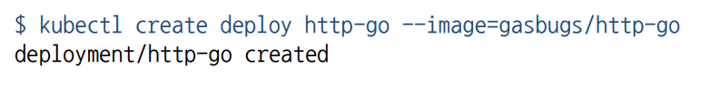

### 서비스 노출

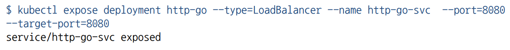

### 서비스 IP정보 확인

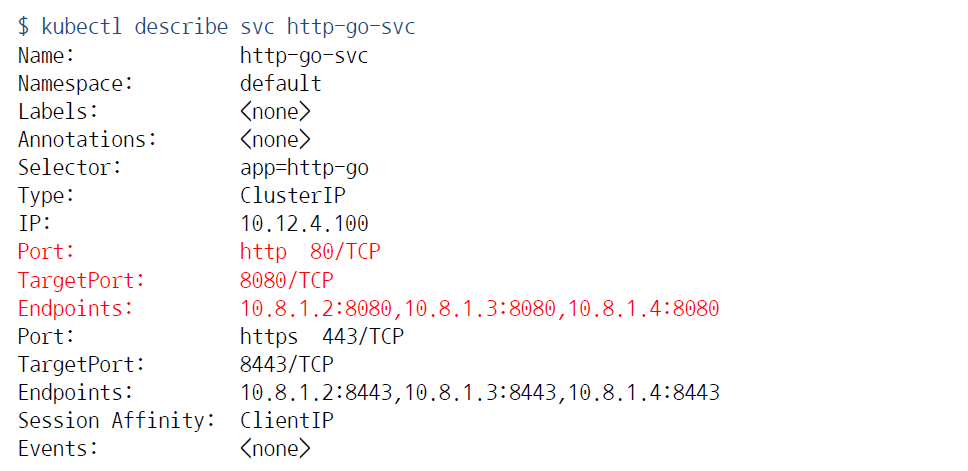

### 어플리케이션 스케일링

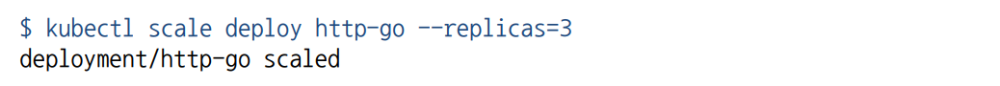

### Pod의 자세한 내용 살펴보기

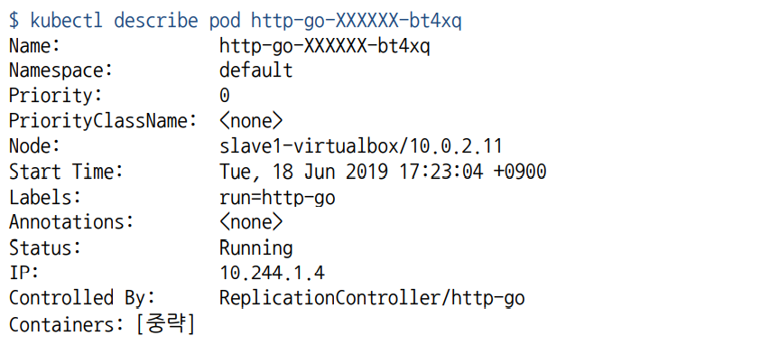

### Pod에서 YAML파일 불러오기

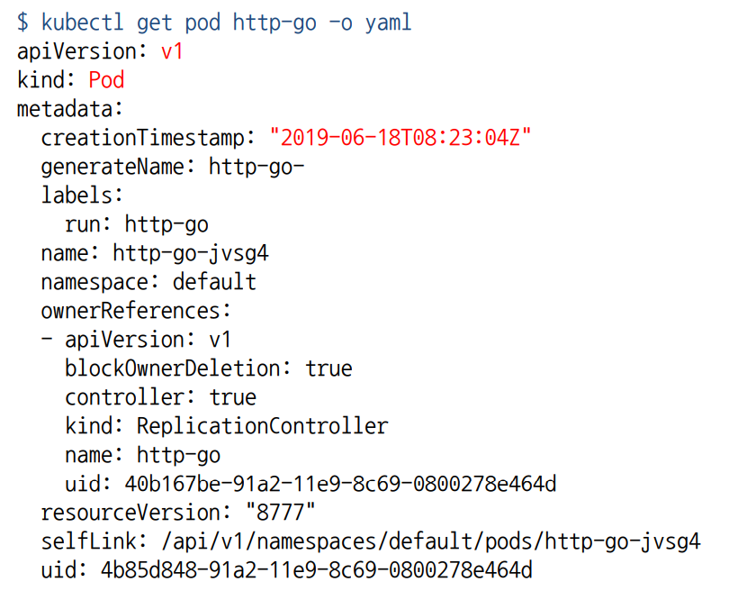

### 디스크립터를 사용한 Pod생성

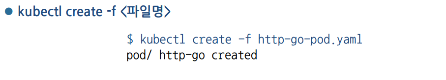

### Pod의 로그 가져오기

### 컨테이너에서 호스트로 포트포워딩

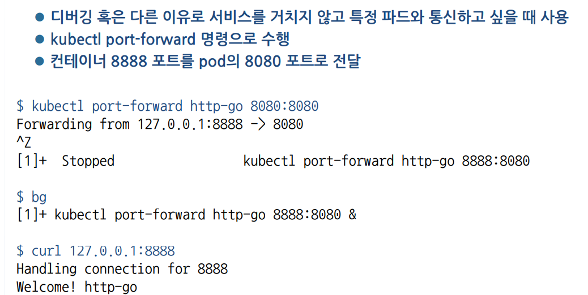

### 레이블 추가 및 수정

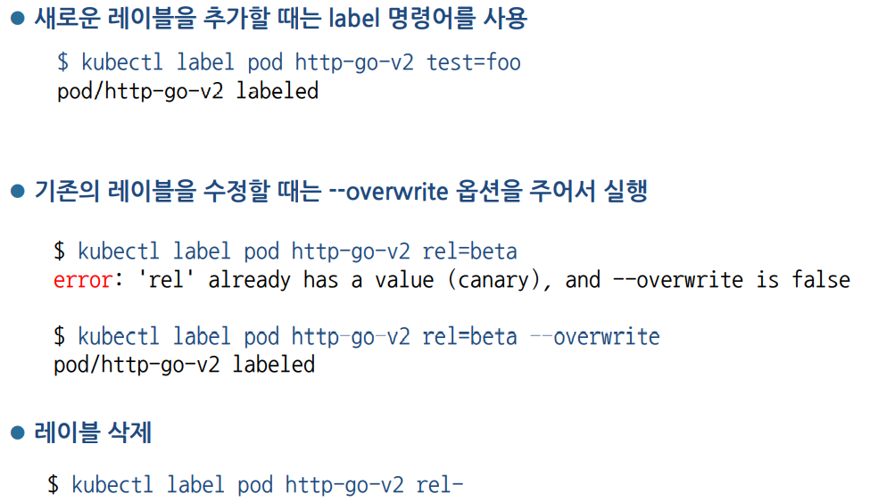

### 레이블 확인

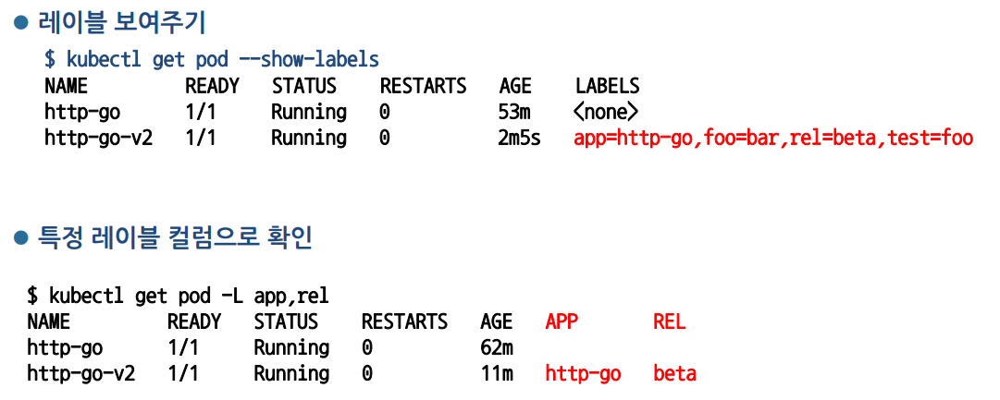

### 레이블로 필터링하여 검색

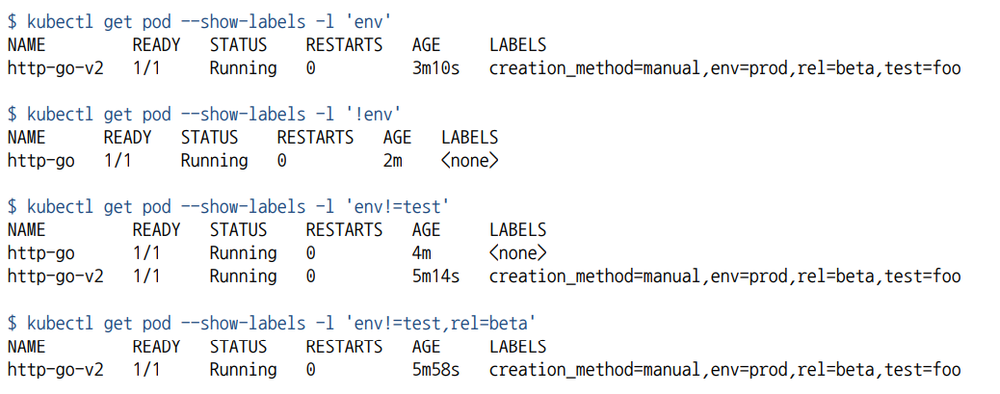

### 레플리카 삭제 시 실행 중 파드는 계속 유지하고 싶은경우

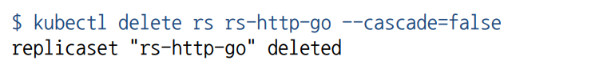

### 현재클러스터의 기본 네임스페이스 확인

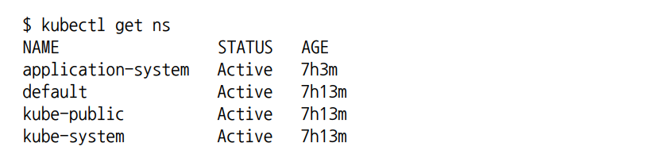

### 전체 네임스페이스 대상으로 get 명령어 수행

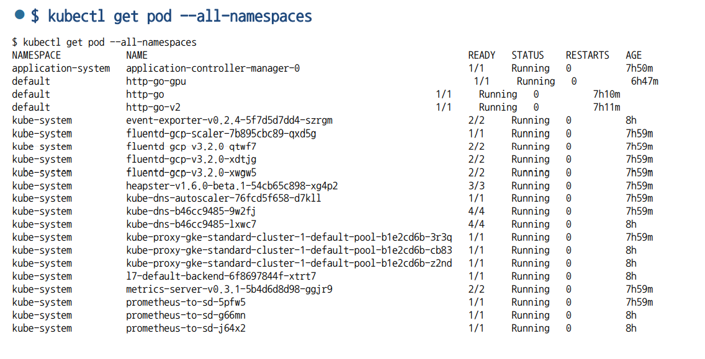