# Kubernetes on AWS

쿠버네티스를 설치하기 위한 node 최소사양은 2core/2GB 이상 

⇒ t3.medium이상의 EC2 인스턴스 3대가 최소요건

# 인스턴스 생성

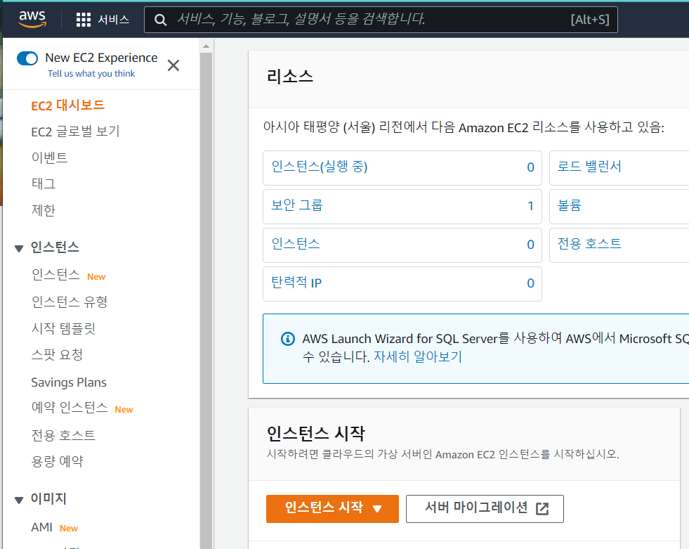

Amazon Linux, t3.medium 인스턴스, 키페어는 ssh로 키를 다운로드 받아 사용할 수 있으나 별도 설정이 가능

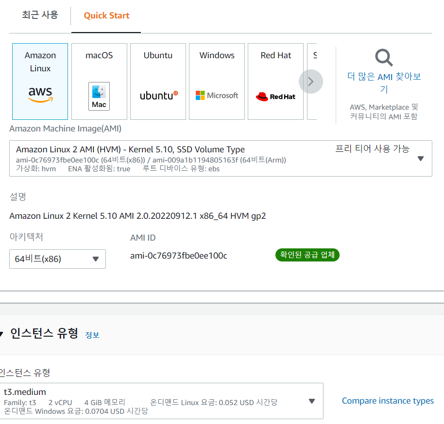

보안그룹 : default선택하거나 별도 그룹 생성하여 설정, 스토리지는 적당히…

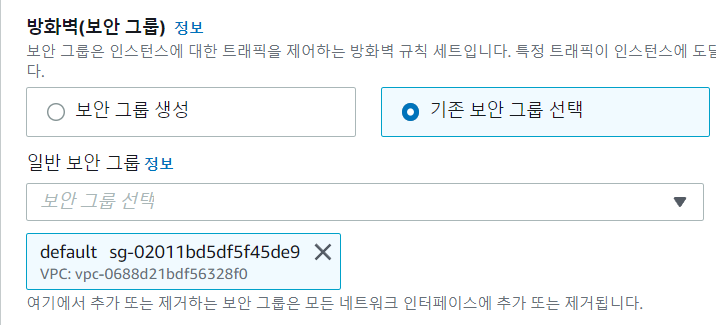

## ssh키 등록

WSL을 설치한 조건에서 ssh키를 생성

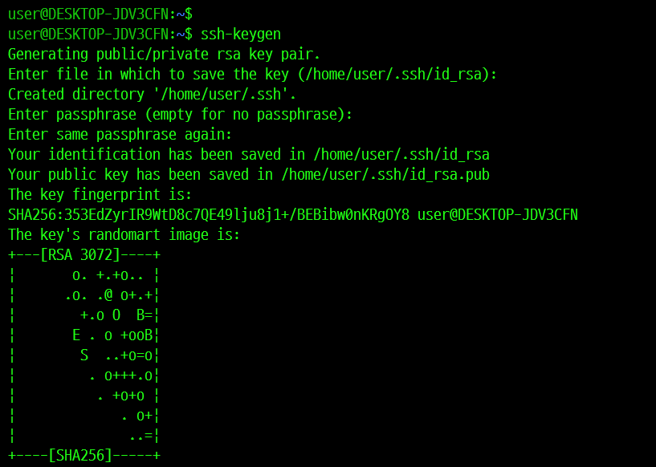

aws 콘솔에서 쉘 연결

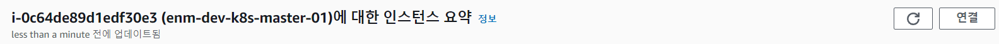

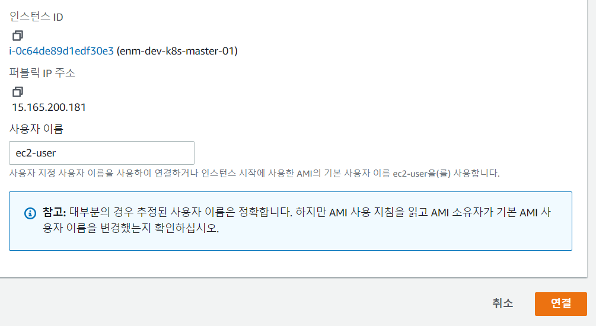

로컬에서 생성한 ssh 공개키를 복사

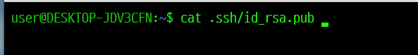

인스턴스 쉘에서 vi를 이용해 복사한 키를 붙여넣기

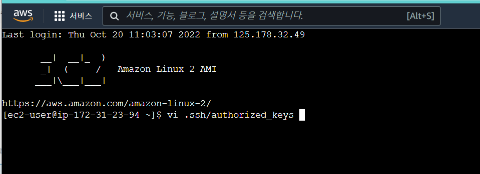

로컬 쉘에서 로그인 수행

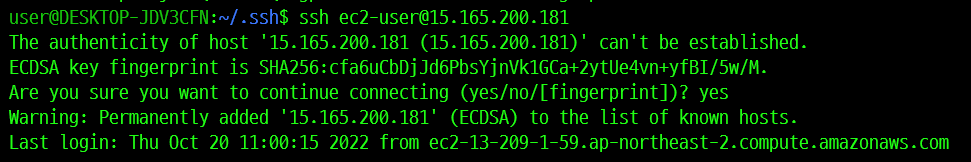

## 보안규칙

6443포트를 경유하여 워커노드가 마스터노드에 join하여 클러스터를 구성하여야 하므로 해당 포트를 오픈하여야 함

보안탭의 보안그룹을 선택, 인바운드 규칙에 6443 포트 추가

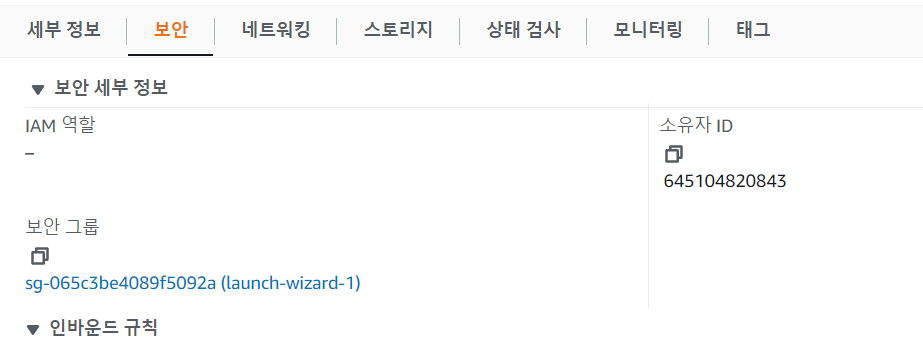

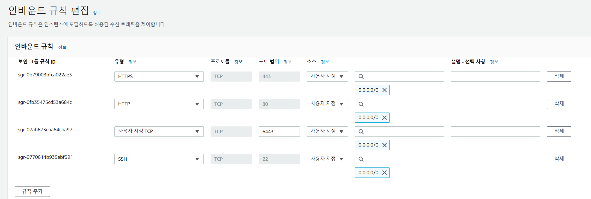

## 탄력적 IP 할당

공인 IP사용 시 인스턴스 시작/중지할때마다 변경, 이를 고정시켜야 하는데 AWS내 탄력적 IP(Elastic IP)기능을 이용

탄력적 IP선택

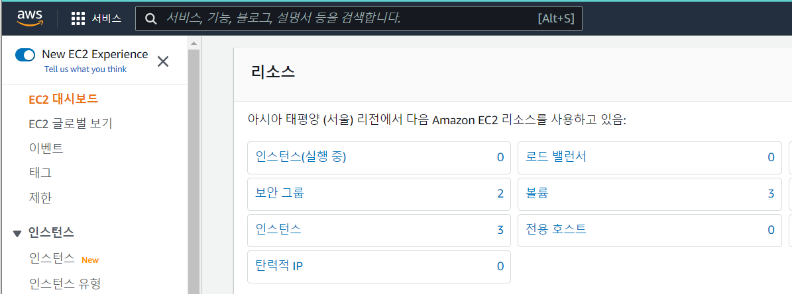

탄력적 IP주소 할당을 선택하여 새로운 IP생성

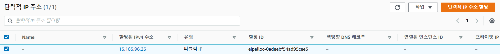

생성한 IP를 선택하면 탄력적 IP주소 연결 선택

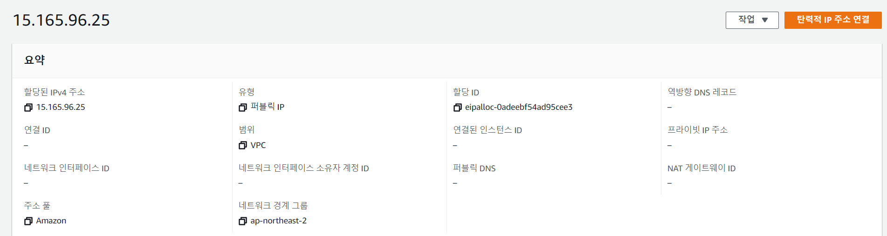

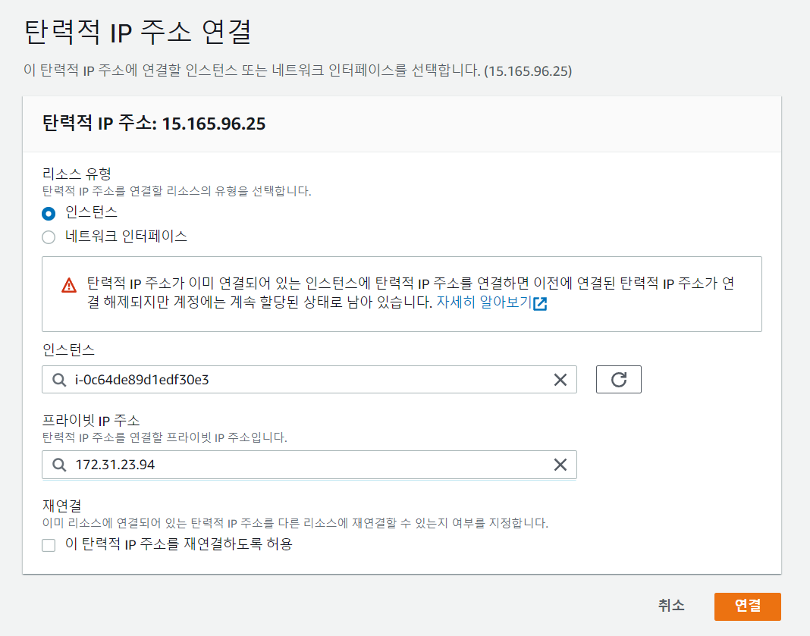

# OS 설정

## selinux 비활성화

```bash
setenforce 0
sed -i 's/^SELINUX=enforcing$/SELINUX=disabled/' /etc/selinux/config
```

## swap 비활성화

```bash
swapoff -a
sed -i '/ swap / s/^\(.*\)%/#\1/g' /etc/fstab
```

## 방화벽 비활성화

firewalld 데몬을 중지시켜야 하나 aws인스턴스에서는 방화벽이 설치되어 있지 않음

```bash
systemctl disable firewalld
systemctl stop firewalld
```

## iptables 커널 설정

```bash
# /etc/modules-load.d/k8s.conf
br_netfilter

# /etc/sysctl.d/k8s.conf
net.bridge.bridge-nf-call-ip6tables = 1
net.bridge.bridge-nf-call-iptables = 1

sysctl --system
```

# 쿠버네티스 설치

## yum repository 설정

```bash
# /etc/yum.repos.d/kubernetes.repo
[kubernetes]
name=kubernetes
baseurl=https://packages.cloud.google.com/yum/repos/kubernetes-el7-x86_64
enabled=1
gpgkey=https://packages.cloud.google.com/yum/doc/yum-key.gpg https://packages.cloud.google.com/yum/doc/rpm-package-key.gpg
```

## docker 설치

```bash
curl -s https://get.docker.com | sudo sh #아마존 리눅스는 안됨 yum install docker대체
systemctl enable docker
systemctl start docker
```

## docker daemon.json 편집

```json
/* /etc/docker/damon.json*/
{
	"exec-opts": ["native.cgroupdriver=systemd"],
	"log-driver": "json-file",
	"log-opts": {
		"max-size": "100m"
	},
	"storage-driver": "overlay2",
	"storage-opts": [
		"overlay2.override_kernel_check=true"
	]
}
```

## kubernetes 패키지 설치

```bash
yum install -y kubelet kubeadm kubectl --disableexcludes=kubernetes
```

## kubadm config

```bash
kubeadm init
mkdir -p $HOME/.kube
sudo cp -i /etc/kubernetes/admin.conf $HOME/.kube/config
sudo chown $(id -u):$(id -g) $HOME/.kube/config
```

kubelet 실행

```bash
systemctl enable kubelet
systemctl start kubelet
```

# Master Node 설정

cidr는 서브넷 영역… private IP 기준


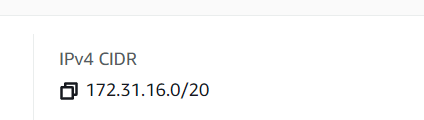

```bash
kubeadm reset
kubeadm init --apiserver-advertise-address 172.31.16.249 --apiserver-cert-extra-sans 15.165.96.25 --pod-network-cidr=192.168.1.0/24
```

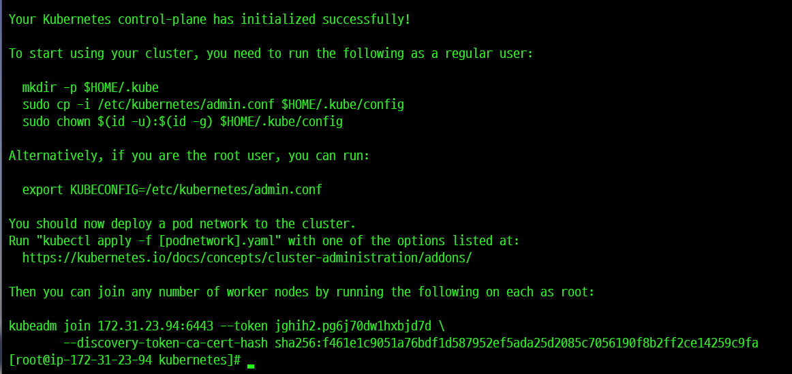

## weave CNI 플러그인 설치

```bash
kubectl apply -f https://github.com/weaveworks/weave/releases/download/v2.8.1/weave-daemonset-k8s.yaml
```

# Worker Node 설정

```bash
kubeadm reset
kubeadm join 172.31.23.94:6443 --token jghih2.pg6j70dw1hxbjd7d --discovery-token-ca-cert-hash sha256:f461e1c9051a76bdf1d587952ef5ada25d2085c7056190f8b2ff2ce14259c9fa
```

# 클러스터 구성

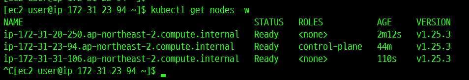