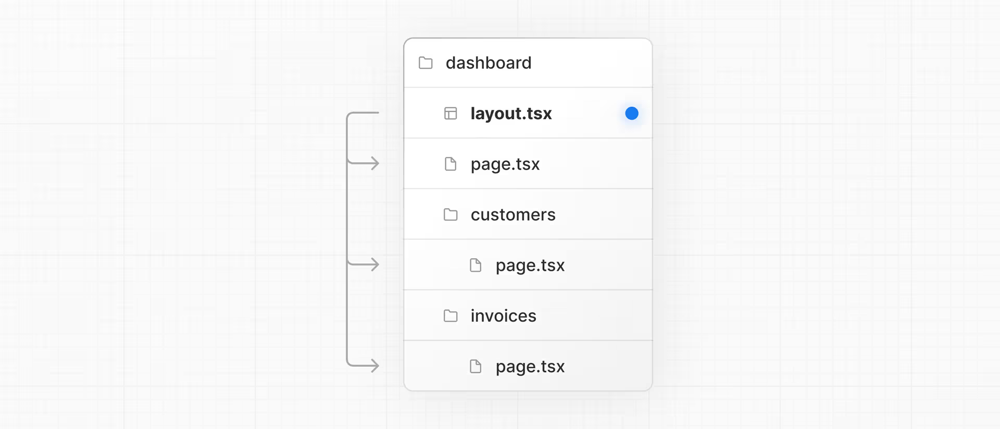
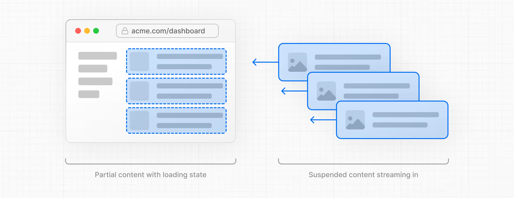

# Next.js

https://nextjs.org/learn/dashboard-app/getting-started

# 프로젝트 만들기

```sql
npm install -g pnpm

# 대시보드 boilerplate
npx create-next-app@latest nextjs-dashboard --example "https://github.com/vercel/next-learn/tree/main/dashboard/starter-example" --use-pnpm

```

## app 폴더 구조

Next.js 13부터 도입된 App Router는 다음과 같은 폴더 구조를 가집니다:

- **app/** - 모든 라우트와 컴포넌트가 위치하는 루트 폴더
- **app/layout.tsx** - 전체 앱의 공통 레이아웃을 정의하는 루트 레이아웃 파일
- **app/page.tsx** - 앱의 홈페이지를 정의하는 파일
- **app/ui/** - 재사용 가능한 UI 컴포넌트들을 포함하는 폴더
- **app/lib/** - 유틸리티 함수, 데이터 fetching 로직 등을 포함하는 폴더

## 주요 특징

- **서버 컴포넌트:** 기본적으로 모든 컴포넌트는 서버 컴포넌트로 동작
- **중첩 라우팅:** 폴더 구조를 통한 직관적인 라우팅 시스템
- **레이아웃:** 중첩된 레이아웃을 쉽게 구현 가능
- **로딩 UI:** loading.tsx를 통한 suspense 기반 로딩 상태 처리
- **에러 처리:** error.tsx를 통한 자동 에러 바운더리 구현

## 특수 파일

- **layout.tsx** - 공유 UI를 위한 레이아웃 정의
- **page.tsx** - 페이지의 고유 UI 구현
- **loading.tsx** - 로딩 상태를 위한 UI
- **error.tsx** - 에러 상태를 위한 UI
- **not-found.tsx** - 404 에러 페이지

## 실행

```sql
pnpm dev
```

# Style 적용

Tailwind CSS 라이브러리 적용 global.css

```css
@tailwind base;
@tailwind components;
@tailwind utilities;
...
```

```tsx
# CSS 호출
import '@/app/ui/global.css';
```

## Tailwind CSS 특징

[https://tailwindcss.com/](https://tailwindcss.com/)

- **유틸리티 우선 접근방식:** 미리 정의된 클래스를 조합하여 스타일링
- **반응형 디자인:** sm:, md:, lg: 등의 접두사로 쉽게 반응형 구현
- **커스터마이징:** tailwind.config.js를 통해 테마와 스타일 확장 가능
- **개발 생산성:** 별도의 CSS 파일 작성 없이 HTML 내에서 스타일링

## 자주 사용되는 클래스

- **레이아웃:** flex, grid, container, p-{size}, m-{size}
- **타이포그래피:** text-{size}, font-{weight}, text-{color}
- **색상:** bg-{color}, text-{color}, border-{color}
- **효과:** hover:, focus:, active: 등의 상태 수정자

```tsx
// Tailwind CSS 사용 예시
export default function Button() {
  return (
    <button className="bg-blue-500 hover:bg-blue-700 text-white font-bold py-2 px-4 rounded">
      Click me
    </button>
  );
}
```

## CSS Module

/app/ui/home.module.css

```css
.shape {
  height: 0;
  width: 0;
  border-bottom: 30px solid black;
  border-left: 20px solid transparent;
  border-right: 20px solid transparent;
}
```

/app/page.tsx

```tsx
import styles from '@/app/ui/home.module.css';
...
<div className={styles.shape} />
```

## clsx 라이브러리를 통한 class toggle

[https://www.npmjs.com/package/clsx](https://www.npmjs.com/package/clsx)

```tsx
import clsx from 'clsx';
 
export default function InvoiceStatus({ status }: { status: string }) {
  return (
    <span
      className={clsx(
        'inline-flex items-center rounded-full px-2 py-1 text-sm',
        {
          'bg-gray-100 text-gray-500': status === 'pending',
          'bg-green-500 text-white': status === 'paid',
        },
      )}
    >
    // ...
)}
```

## 폰트추가

/app/ui/fonts.ts

```tsx
import { Inter, Lusitana } from 'next/font/google';
export const inter = Inter({subsets: ['latin'] });
#Second Font
export const lusitana = Lusitana({
    weight: ['400','700'],
    subsets: ['latin'],
});
```

/app/layout.tsx

```tsx
import { inter } from '@/app/ui/fonts';
...
    <body className={`${inter.className} antialiased`}>{children}</body>
```

# Assets

이미지 등의 정적 자원은 /public 폴더에서 제공함

## <Image> 컴포넌트

HTML 태그 확장 컴포넌트로 자동화된 최적화 기능을 제공

- 이미지 로딩 시 layout shift 현상을 방지
- 작은 viewport를 가지는 기기에서 큰 이미지를 전송하는 것을 방지하기 위해 리사이징 기능 제공
- 기본설정으로 Lazy loading
- 브라우저 지원에 따라 webp/avif 포맷 지원

```tsx
import Image from 'next/image';
...
      <Image
        src="/hero-desktop.png"
        width={1000}
        height={760}
        className="hidden md:block"
        alt="Screenshots of the dashboard project showing desktop version"
      />
      {/* 모바일 사이즈 viewport일 경우 위의 이미지는 hidden, 아래 이미지가 보여짐 */}
      <Image
        src="/hero-mobile.png"
        width={560}
        height={620}
        className="block md:hidden"
        alt="Screenshots of the dashboard project showing mobile version"
      />
```

# Nested routing

파일시스템 기반 라우팅, 각 폴더가 route segment 로써 URL segment 매핑

page.tsx : React 컴포넌트로서 exports, it’s required for the route to be accessible.

layout.tsx : 여러 페이지에서 공유하여 사용되는 UI

```tsx
import SideNav from '@/app/ui/dashboard/sidenav';
 
export default function Layout({ children }: { children: React.ReactNode }) {
  return (
    <div className="flex h-screen flex-col md:flex-row md:overflow-hidden">
      <div className="w-full flex-none md:w-64">
        <SideNav />
      </div>
      <div className="flex-grow p-6 md:overflow-y-auto md:p-12">{children}</div>
    </div>
  );
}
```



# Data Fetching

Backend로써 DB로부터 데이터를 읽어와 ORM을 통해 오브젝트 형성

---

### ✅ Server Components 요약

1. **JavaScript 비동기 작업 지원**
    - Server Components는 **`Promise`** 를 지원하므로 **`async/await` 문법으로 데이터 요청이 가능**합니다.
    - 따라서 `useEffect`, `useState`, 기타 데이터 패칭 라이브러리 없이도 동작합니다.
2. **서버에서 실행**
    - Server Components는 클라이언트가 아닌 **서버에서 실행**되므로, **무거운 데이터 처리나 로직을 서버에서 수행**할 수 있습니다.
    - 클라이언트로는 처리 결과만 전송하므로 성능상 이점이 있습니다.
3. **API 계층 없이 DB 직접 조회 가능**
    - Server Components는 서버 환경에서 실행되므로 **별도의 API 서버 없이 직접 데이터베이스를 조회**할 수 있습니다.
    - 덕분에 **불필요한 API 코드 작성 및 유지보수를 줄일 수 있습니다.**

---

/app/lib/data.ts

```tsx
import postgres from 'postgres';
const sql = postgres(process.env.POSTGRES_URL!, { ssl: 'require' });
// ...
```

/app/dashboard/page.tsx

```tsx
import { Card } from '@/app/ui/dashboard/cards';
import RevenueChart from '@/app/ui/dashboard/revenue-chart';
import LatestInvoices from '@/app/ui/dashboard/latest-invoices';
import { lusitana } from '@/app/ui/fonts';
import { fetchRevenue } from '@/app/lib/data';
 
export default async function Page() {
  const revenue = await fetchRevenue();
  // ...
}
```

# Static and Dynamic Rendering

---

## ✅ Static Rendering이란?

**정적 렌더링**은 데이터를 **빌드 시점(build time)** 또는 **재검증(revalidate) 시점**에 서버에서 미리 불러와 HTML을 생성하는 방식입니다.

- 사용자가 사이트에 접속할 때마다, 서버는 **이미 만들어진(캐시된) 결과**를 제공합니다.

---

### ✅ Static Rendering의 장점

1. **빠른 웹사이트 속도**
    - HTML이 미리 렌더링되어 CDN(예: Vercel)을 통해 전 세계에 배포됨
    - 사용자 위치와 상관없이 **빠르고 안정적인 접속 가능**
2. **서버 부하 감소**
    - 매 요청마다 페이지를 동적으로 생성할 필요 없음
    - **컴퓨팅 비용 절감**
3. **SEO에 유리**
    - 콘텐츠가 페이지 로딩 시점에 이미 HTML로 존재
    - 검색 엔진이 **더 쉽게 페이지를 인덱싱**할 수 있어, 검색 순위 상승 가능

---

### ✅ 언제 Static Rendering을 쓰는 게 좋을까?

- 사용자마다 다른 정보가 필요 없는 페이지
    
    예:
    
    - 블로그 글
    - 제품 상세 페이지
    - 공지사항 등 **공용 콘텐츠**

---

### ⚠️ Static Rendering이 **적합하지 않은 경우**

- **개인화된 데이터**가 필요한 경우 (예: 유저별 대시보드)
- **실시간으로 자주 업데이트되는 데이터**가 있는 경우

## ✅ Dynamic Rendering이란?

**동적 렌더링**은 **사용자가 페이지에 접속할 때마다**, 서버가 해당 요청에 맞춰 **실시간으로 페이지를 렌더링하는 방식**입니다.

즉, 데이터는 **요청 시점(request time)** 에 가져와서 처리됩니다.

---

### ✅ Dynamic Rendering의 장점

1. **실시간 데이터 표시**
    - 자주 바뀌는 데이터를 즉시 반영 가능
    - 예: 주식 정보, 실시간 알림, 최신 뉴스 등
2. **사용자 맞춤 콘텐츠 제공**
    - 유저별 **대시보드, 프로필, 설정 페이지** 등에서 유리
    - 로그인된 사용자에 따라 다른 데이터를 보여줄 수 있음
3. **요청 시점 정보 접근 가능**
    - 쿠키, URL 쿼리 파라미터 등 **접속 당시의 정보**를 이용해 콘텐츠를 맞춤 처리 가능
    - 예: 다크모드 설정, 언어 선택, A/B 테스트 등

---

### ✅ 언제 Dynamic Rendering을 쓰는 게 좋을까?

- 사용자마다 다른 콘텐츠를 보여줘야 하는 경우
- 데이터가 자주 변경되는 경우
- 요청 시점 정보가 필요한 경우 (예: 로그인 여부, 쿠키, 쿼리 파라미터)

---

### ⚠️ 단점

- 매 요청마다 서버 연산이 필요하므로 **속도가 느릴 수 있음**
- **서버 비용 증가** 가능
- **캐싱 어려움** (콘텐츠가 사용자마다 다름)

---

정리하면:

| 렌더링 방식 | 시점 | 용도 |
| --- | --- | --- |
| **Static Rendering** | 빌드 시 | 공용 데이터, 빠른 응답 |
| **Dynamic Rendering** | 요청 시 | 개인화 데이터, 실시간 정보 |

필요하시면 두 방식을 혼합하는 **Incremental Static Regeneration (ISR)** 도 함께 설명해드릴 수 있습니다.

# Streaming

---

### ✅ Streaming이란?

**Streaming**은 데이터를 **작은 조각(chunk)** 단위로 나눠서, 준비되는 순서대로 서버에서 클라이언트로 **점진적으로 전송**하는 기술입니다.

- 전체 데이터를 다 받아야 화면이 그려지는 것이 아니라, **일부 UI부터 먼저 보여줄 수 있음**

### ✅ Streaming의 장점

1. **느린 요청이 전체 페이지 로딩을 막지 않음**
    - 특정 데이터가 느리게 도착해도 **먼저 준비된 UI부터 화면에 표시**할 수 있음
    - 사용자 경험(UX) 향상
2. **React 컴포넌트 구조와 잘 어울림**
    - React는 UI를 컴포넌트 단위로 나누기 때문에, 각 컴포넌트를 개별 chunk로 처리하기 적합
3. **병렬 데이터 패칭 가능**
    - 순차적으로 데이터를 불러오는 대신, **여러 데이터를 동시에(fetch 병렬)** 가져올 수 있어 전체 렌더링 시간이 단축됨

---

### ✅ Next.js에서 Streaming 구현 방법

1. **페이지 수준에서 (`loading.tsx`)**
    - 특정 라우트가 로딩 중일 때 보여줄 **로딩 UI를 자동으로 구성**
    - Next.js가 `<Suspense>`를 자동으로 생성해 줌
2. **컴포넌트 수준에서 (`<Suspense>`)**
    - 더 세밀하게 제어 가능
    - 느린 컴포넌트만 따로 감싸서, 빠른 컴포넌트는 먼저 보여주고 느린 컴포넌트는 나중에 표시

```tsx
import { Suspense } from 'react'
import SlowComponent from './SlowComponent'

export default function Page() {
  return (
    <div>
      <h1>빠른 콘텐츠</h1>
      <Suspense fallback={<p>로딩 중...</p>}>
        <SlowComponent />
      </Suspense>
    </div>
  )
}

```

---

### ✅ 요약

| 항목 | 설명 |
| --- | --- |
| 개념 | 데이터를 순차가 아닌 **부분적으로 나눠 전송** |
| 장점 | UX 개선, 빠른 부분 먼저 보여주기, 병렬 처리 |
| Next.js 사용법 | `loading.tsx` (페이지 수준) / `<Suspense>` (컴포넌트 수준) |



## loading.tsx

special Next.js file built on top of React Suspense. It allows you to create fallback UI to show as a replacement while page content loads.

# Partial Prerendering (PPR)