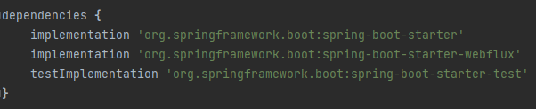

# Spring WebFlux

[[Spring] WebFlux란 무엇인가? - 개념(특징), MVC와 비교, 사용 이유 (tistory.com)](https://devmoony.tistory.com/174)

리액티브 어플리케이션 개발을 기본으로 함

- 비동기, Non-Blocking Reactive 개발에 사용하는 경우
- 효율적으로 동작하는 고성능 웹어플리케이션 개발에 사용
- 서비스간 호출이 많은 마이크로서비스 아키텍처에 적합

두 가지 프로그래밍 모델을 지원

- 애노테이션 기반 명령형 방식 : 기존 웹 프레임워크인 스프링 웹 MVC와 유사하지만 리액티브 서비스를 지원
- 함수지향 모델 기반의 라우터 및 핸들러 방식

논 블로킹과 고정된 스레드 수만으로 모든 요청을 처리 → 단일 스레드로 운영되며 블로킹 라이브러리가 사용될 경우 블도 스레드로 요청하여 처리, 절대 Event Loop가 블로킹되지 말아야 함

높은 트래픽 처리를 요하는 경우에 사용되며 그외 트래픽이 감당 가능한 수준이라면 MVC로 구현하여도 무방

# 라이브러리 의존성 설정

gradle 기준 라이브러리 추가 (JDK 17이상에서… )

