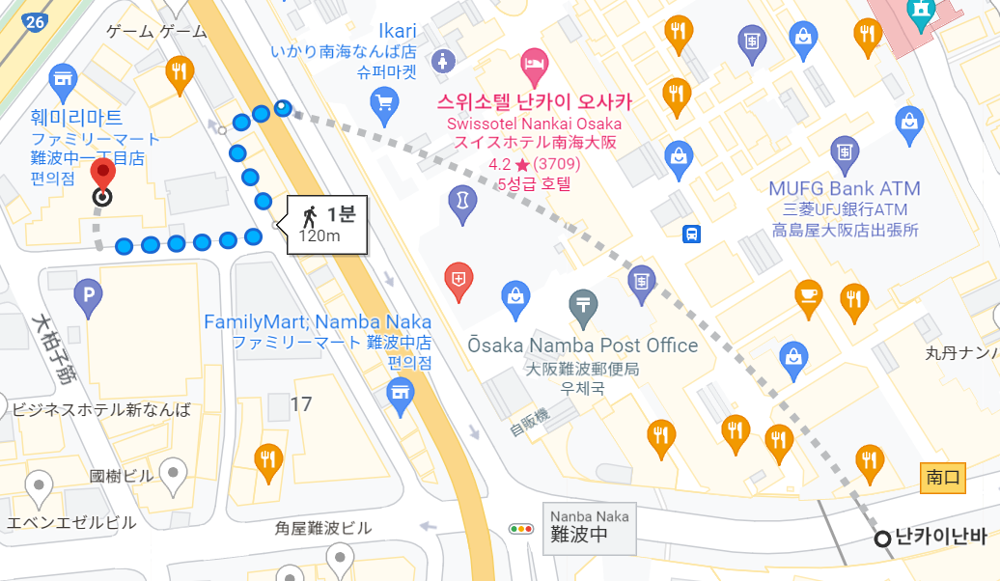
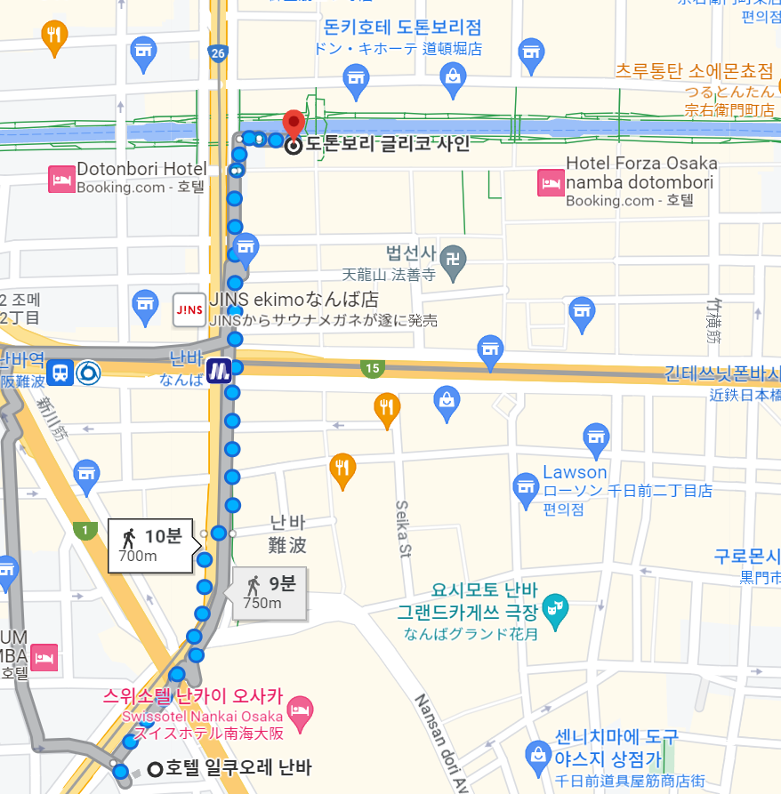
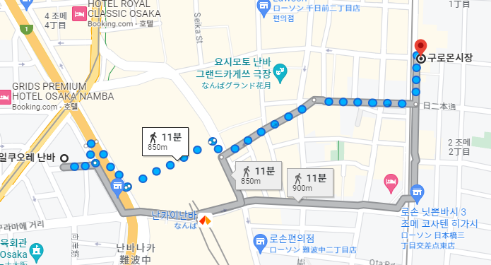
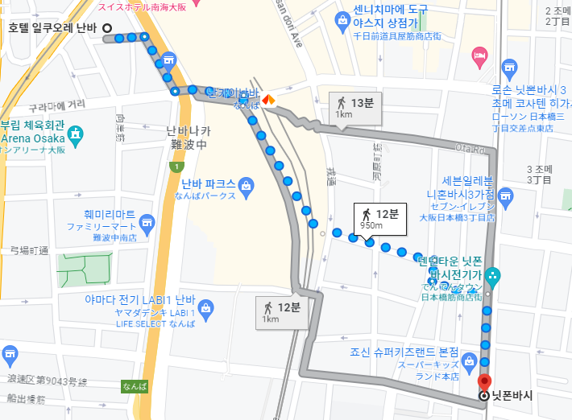

# 1일차

8/22 진에어 14:55 출발, 16:50 도착

# 도착 후 라피트 탑승 (17:47 출발)

[https://www.klook.com/ko/blog/599-kansai-airport-namba-train-ticket-osaka-kr/?spm=City.Blog%3Aany%3A%3ABLog%3ACard_LIST&clickId=298e131325](https://www.klook.com/ko/blog/599-kansai-airport-namba-train-ticket-osaka-kr/?spm=City.Blog%3Aany%3A%3ABLog%3ACard_LIST&clickId=298e131325)

난카이 공항역 매표소 : 1터미널 2층 E출입구

난카이 난바역 도착

**숙소**

Il Cuore Namba, 1-15-15 Nambanaka Naniwa, 오사카, 일본

# 도톤보리

[https://livejapan.com/ko/in-kansai/in-pref-osaka/in-namba_dotonbori_shinsaibashi/article-a2000483/](https://livejapan.com/ko/in-kansai/in-pref-osaka/in-namba_dotonbori_shinsaibashi/article-a2000483/)

돈키호테 면세쿠폰 : [https://www.djapanpass.com/coupon/use_coupon](https://www.djapanpass.com/coupon/use_coupon)

# 구로몬 시장

# 덴덴타운

[https://osaka-info.kr/tour-osaka/?q=YToyOntzOjEyOiJrZXl3b3JkX3R5cGUiO3M6MzoiYWxsIjtzOjQ6InBhZ2UiO2k6ODt9&bmode=view&idx=52892&t=board](https://osaka-info.kr/tour-osaka/?q=YToyOntzOjEyOiJrZXl3b3JkX3R5cGUiO3M6MzoiYWxsIjtzOjQ6InBhZ2UiO2k6ODt9&bmode=view&idx=52892&t=board)

